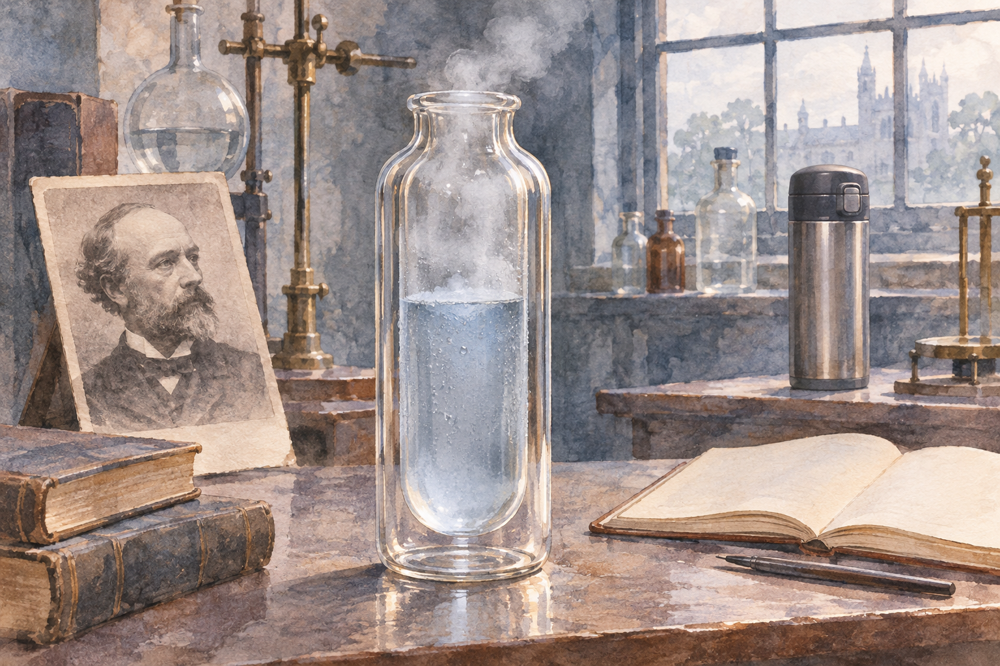

# 보온병 — 차가운 실험을 지키던 병이 생활로 들어오다

*듀어의 낮은 온도 연구와 생활 속 단열 구조의 연결*

생활을 바꾼 물건과 기술 · 집과 생활 도구

> 출처 대조와 공개 게시 승인을 마친 이야기입니다. 실제 게시 여부는 사이트 배포 상태를 따릅니다.

*AI 이야기 장면 삽화 · 역사적 상황과 원리를 떠올리기 위한 그림이며 실제 사진·인물 초상·정확한 복원이나 과학 도해가 아닙니다.*

보온병에는 뜨거운 차도 담고 차가운 물도 담는다. 같은 병이 서로 반대의 일을 하는 것처럼 보이지만 원리는 연결되어 있다. 안의 온도를 새로 만들어 내기보다 바깥과 열이 오가는 속도를 줄이는 것이다. 이 익숙한 물건의 역사에는 아주 낮은 온도를 다루던 실험실이 있다.

19세기 말 제임스 듀어와 관련된 진공 용기는 액체 공기 같은 물질을 다루는 연구에서 중요했다. 차가움을 오래 지키려는 필요를 따라가 보면 생활용품의 기능을 새롭게 이해할 수 있다. 보온병은 어떻게 뜨거운 것과 차가운 것 양쪽을 도울 수 있을까.

## 01. 얼음보다도 훨씬 차가운 액체를 담기

공기를 매우 낮은 온도에서 액체로 만들면 평범한 주변 환경이 상대적으로 따뜻하게 느껴진다. 실험실의 탁자와 손, 방 안의 공기가 모두 열을 전달하는 쪽이 된다. 액체가 얼마나 차가운지만큼 그것을 어떤 그릇에 담는지가 중요했다.

1900년에 나온 기술사 책은 액체 공기를 보존하는 장치로 듀어의 진공 용기를 소개한다. 이때 용기는 실험을 담는 수동적인 배경이 아니다. 연구할 물질의 상태를 유지하게 하는 도구였다. 새로운 물질을 만드는 기술과 그것을 잠시라도 다룰 수 있게 하는 기술이 함께 필요했다.

## 02. 병의 벽을 두 겹으로 만들다

진공 용기의 중요한 특징은 두 겹의 벽 사이에 공기가 거의 없는 공간을 두는 것이다. 안쪽과 바깥쪽 벽을 따로 생각하면 단순해 보이지만, 그 사이의 조건이 열의 이동을 바꾼다. 병의 두께를 무조건 늘리는 방식과는 다른 해법이다.

평범한 벽에서는 재료를 따라 열이 전달되고 주변의 공기도 열을 옮긴다. 두 벽 사이의 공간을 진공에 가깝게 만들면 이런 전달 경로를 줄일 수 있다. 물건의 성능이 단단한 재료에만 달린 것이 아니라 재료 사이에 무엇을 남기거나 비우는지에도 달려 있는 셈이다.

## 03. 진공이라고 열이 전혀 움직이지 않는 것은 아니다

공기가 거의 없다고 열의 이동이 완전히 사라지는 것은 아니다. 복사처럼 공간을 건너는 방식도 있고 병의 입구와 연결된 부분을 통한 경로도 있다. 그래서 진공이라는 한 단어만으로 모든 성능을 설명하기 어렵다. 전체 구조를 함께 살펴야 한다.

이 점은 생활에서 경험하는 변화와도 맞는다. 보온병에 넣은 내용물의 온도는 시간이 지나면 바뀐다. 병은 영원히 같은 온도를 보장하는 장치가 아니라 변화의 속도를 늦추는 장치다. 잘 작동한다는 뜻을 변화가 전혀 없다는 뜻으로 이해하지 않는 것이 중요하다.

## 04. 차가운 것을 지키면 뜨거운 것도 지킬 수 있을까

열은 온도가 높은 쪽에서 낮은 쪽으로 이동한다. 아주 차가운 액체를 담으면 바깥에서 안으로 들어오는 열이 문제다. 뜨거운 차를 담으면 안에서 바깥으로 나가는 열이 문제가 된다. 이동을 줄이는 구조는 두 경우에 모두 도움이 될 수 있다.

이렇게 보면 보온과 보냉은 전혀 다른 마법이 아니다. 어느 쪽이 더 따뜻한지에 따라 방향이 바뀔 뿐, 온도 차이에 따른 교환을 늦춘다는 원리는 이어진다. 물건의 이름이 한 가지 용도를 먼저 떠올리게 해도 실제 기능은 더 넓을 수 있다.

## 05. 실험실의 성능과 생활의 편리는 다르다

연구실에서 잘 작동하는 용기를 일상에서 쓰려면 다른 조건도 생각해야 한다. 사람이 들고 다니고 뚜껑을 열고 닫으며 씻고 보관한다. 열을 막는 능력만 좋다고 좋은 생활용품이 되지는 않는다. 사용자가 매일 다룰 수 있는 형태와 내구성이 필요하다.

이것은 실험실의 발명과 대중적인 제품 사이의 거리다. 새로운 원리를 발견하는 일과 안전하고 편리하게 반복 사용하는 물건으로 만드는 일은 연결되지만 같은 단계는 아니다. 익숙한 보온병의 모양에는 사용 환경에 맞추는 별도의 설계 문제가 들어 있다.

## 06. 뚜껑과 입구도 병의 일부다

벽만 훌륭해도 열이 드나드는 다른 경로가 크면 전체 성능은 달라진다. 뚜껑을 자주 열면 안과 밖이 직접 만나고, 입구와 연결 부위도 열이 이동하는 길이 된다. 보온병을 볼 때 가운데의 빈 공간만 생각하지 말아야 하는 이유다.

이런 관찰은 다른 기술을 이해할 때도 유용하다. 가장 눈에 띄는 원리 하나가 전체 결과를 혼자 결정하지 않는다. 연결되는 부분과 사용 방식이 함께 작동한다. 보온병은 작고 친숙한 물건이지만, 시스템의 성능이 여러 경로의 합이라는 사실을 보여 준다.

## 07. 생활용품 안에 남은 낮은 온도의 역사

보온병을 뜨거운 음료의 물건으로만 알던 사람에게 듀어의 진공 용기는 뜻밖의 출발점이다. 연구자가 차가운 물질을 다루며 마주한 문제가 다른 생활의 필요와 연결되었다. 한 분야에서 생긴 해법이 전혀 다른 장면에서도 쓸모를 얻은 것이다.

보온병 안쪽의 반짝이는 표면도 같은 맥락에서 이해할 수 있다. 진공이 줄이는 경로와 복사에 대응하는 표면의 역할은 서로 다르다. 목을 가늘게 만들고 입구를 막는 구조까지 더해져야 한다. 하나의 비밀 재료보다 여러 열전달 경로를 나누어 다룬 설계라고 보는 편이 정확하다.

다음에 병을 열어 아직 따뜻한 차를 마실 때에는 열을 넣어 주는 장치가 아니라 열이 드나드는 길을 줄인 구조를 떠올려 보자. 아주 차가운 실험과 일상의 음료 사이에는 같은 물리적 질문이 있다. 무엇을 더할지가 아니라 무엇의 이동을 늦출지 생각한 역사가 그 안에 남아 있다.

## 이야기의 바탕이 된 자료

- [E. W. Byrn (1900), Liquid Air](https://raw.githubusercontent.com/GITenberg/The-Progress-of-Invention-in-the-Nineteenth-Century._41538/master/41538-0.txt) · 확인일 2026-11-05
  - 확인 내용: 19세기 말 액체 공기 연구·이중 벽 진공 용기·듀어 용기의 보존 역할. 원문의 위험한 실험 절차는 전재하지 않음
- [OpenStax University Physics Volume 2 — Mechanisms of Heat Transfer](https://raw.githubusercontent.com/openstax/osbooks-university-physics-bundle/main/modules/m58389/index.cnxml) · 확인일 2026-11-05
  - 확인 내용: 전도·대류·복사, 온도 차이에 따른 이동, 진공·은도금 벽·목·마개 등 보온병의 열전달 경로

---

[같은 소주제의 이야기](README.md) · [전체 서가](../../README.md)
