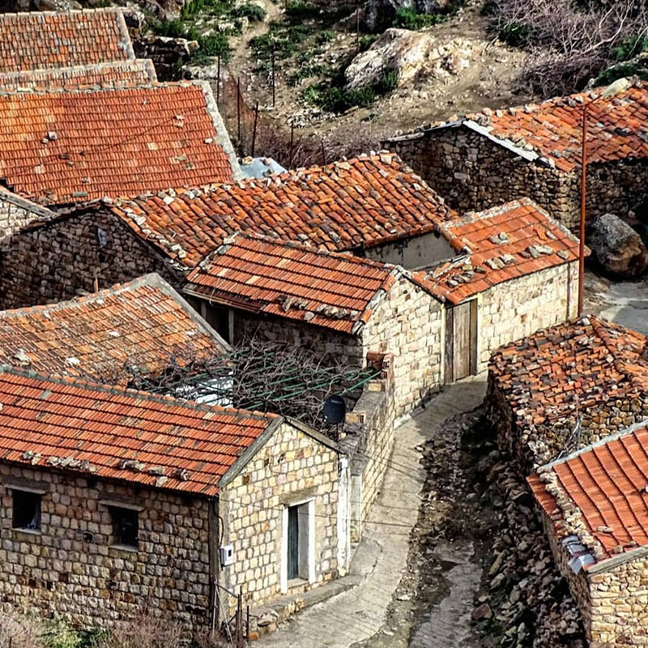

# 한 지붕 아래 사람과 가축의 자리가 있었다

*알제리 카빌 주택을 읽는 작은 단서*

Life · Housing

> 출처 대조와 공개 게시 승인을 마친 이야기입니다. 실제 게시 여부는 사이트 배포 상태를 따릅니다.

*PhR610/flickr, CC BY 2.0 · OpenStax 수록본. 원본 전체 사진을 자르지 않고 사용했습니다.*

[이미지 출처·제작 근거](https://raw.githubusercontent.com/openstax/osbooks-introduction-anthropology/main/media/ANTHRO_Figure_03_01_002.jpg) · CC BY 2.0

사진에는 붉은 지붕과 돌벽이 모여 있다. 알제리 북부의 카빌 사람들이 지은 집들이다. 밖에서 보면 단단한 벽과 지붕이 먼저 보이지만, 집을 이해하는 일은 그 안의 자리를 생각하는 데서도 시작된다.

OpenStax 교재는 1960년대 피에르 부르디외가 분석한 전통 카빌 주택의 사례를 소개한다. 이 사진의 집 한 채를 그대로 조사한 평면도라는 뜻은 아니다. 외관 사진과 설명의 사례를 함께 읽는 것이다.

## 1. 바닥의 높이가 다른 자리

연구 사례의 집에는 낮은 구획을 나누는 벽이 있었고, 그쪽은 밤에 가축을 들이는 자리였다. 같은 지붕 아래에서도 바닥을 낮추고 구분해 서로 다른 활동의 자리를 만들었다.

나머지 더 높고 넓은 부분은 사람의 생활에 쓰였다. 집을 방 이름 몇 개로만 나누는 대신 높이와 경계로 읽어 보면 내부의 구성이 다르게 느껴진다.

## 2. 빛이 잘 드는 쪽의 쓰임

교재는 문 반대쪽의 베틀 자리와 그곳에 드는 빛도 설명한다. 손님 등을 맞는 자리와 여러 생활 활동이 집 안의 위치에 따라 구별되었다.

사진에서 보이지 않는 내부를 마음대로 그려 넣을 필요는 없다. 여기서 볼 것은 지붕의 재료만이 아니라 일을 하고 사람을 맞는 방식도 집의 구성에 영향을 준다는 점이다. 어떤 자리를 좋다고 여기는지에도 생활의 생각이 담길 수 있다.

## 3. 같은 지붕이 같은 용도를 뜻하지는 않는다

건물의 겉모양에서 한 공간을 상상하기 쉽지만 안에서는 높이와 경계가 역할을 나눌 수 있다. 사람과 가축의 구획을 다르게 두었다는 설명은 벽과 바닥의 작은 차이를 생활의 구조로 읽게 한다. 방의 이름만으로 집을 이해하는 방식과 다른 단서다. 함께 있다는 것과 구분이 없다는 것은 같은 말이 아니다.

사진은 실제 외관을 보여 주고 교재의 연구 설명은 내부의 사용을 알려 준다. 두 자료가 서로 같은 정보를 담은 것은 아니다. 바깥의 돌과 지붕을 확인하는 일과 안쪽의 베틀 자리, 낮은 구획을 이해하는 일을 구분하면 사진에 없는 세부를 보았다고 착각하지 않게 된다. 설명을 통해 시선을 넓힐 수 있다.

## 4. 빛이 드는 자리는 일의 자리이기도 하다

베틀과 빛의 관계를 소개하는 대목은 공간을 크기와 재료 이상의 것으로 보게 한다. 어떤 일을 하려면 그 일에 맞는 자리가 필요할 수 있다. 물건을 어디에 두는지와 문을 통해 들어오는 빛이 어떻게 닿는지가 생활의 배치를 만드는 요소가 된다. 다만 여기서 실제 조도나 작업 능률을 측정한 것은 아니다.

실내 배치가 단순히 아무 곳에나 남은 가구를 놓은 결과만은 아니라는 질문을 얻을 수 있다. 조리와 수납, 일과 손님 맞이에는 서로 다른 요구가 있다. 어떤 자리를 좋다고 여겼는지에도 공동체의 생각이 들어갈 수 있다. 집의 평면은 생활을 담으면서 그 생활의 관계를 나타내는 형식이기도 하다.

## 5. 연구자의 설명은 어느 범위의 자료인가

교재는 1960년대 피에르 부르디외가 분석한 전통 카빌 주택을 사례로 든다. 특정한 시점의 연구와 해석이지 알제리 북부의 모든 현재 주택을 조사한 표준 설명이 아니다. 연구자의 질문과 그때 살핀 대상의 범위를 남겨 두어야 한다. 집 한 채의 모델을 하나의 문화 전체와 같게 놓으면 차이가 사라진다.

따라서 오늘 그 지역에 가면 사진과 똑같은 내부가 어디서나 보일 것이라고 기대할 필요는 없다. 주거는 시대와 사회의 변화에 따라 달라질 수 있다. 옛 연구의 가치는 현재를 멈추게 하는 데보다 어떤 관계를 관찰했는지 알게 하는 데 있다. 자료의 시간도 건물의 재료처럼 함께 읽을 정보다.

## 6. 집의 안과 밖을 오가며 보기

외관의 돌을 본 다음 내부에서 일어났던 활동을 설명과 연결해 보자. 그 활동이 모두 사진에 직접 찍혔다고 생각하지 않으면 바깥과 안쪽의 서로 다른 자료를 함께 사용할 수 있다. 주거를 읽는 일은 방의 개수를 맞히는 시험보다 사람이 무엇을 하며 살았는지 묻는 과정에 가깝다.

이때 가축과 같은 지붕 아래 있었다는 사실을 곧 불편하거나 비위생적이었다는 평가로 바꿀 필요도 없다. 확인되지 않은 생활의 상태를 오늘의 감각만으로 판정하지 않는 것이다. 낮은 구획과 높은 구획, 빛과 베틀의 자리를 따라가다 보면 낯선 집이 하나의 생활 조직으로 다가온다. 큰 지붕 아래에는 여러 관계의 경계가 있었다.

## 7. 모든 집이 같은 이야기인 것은 아니다

이것은 특정 시기의 전통 주택 연구 사례다. 오늘날의 모든 카빌 가정이 같은 공간에서 같은 규칙으로 산다고 넓혀 말할 수는 없다. 집의 쓰임은 시간과 사람에 따라 달라진다.

그럼에도 이런 사례는 익숙한 집을 다시 보는 방법을 준다. 왜 이 자리는 높고 저 자리는 낮을까, 왜 손님을 이쪽에 앉힐까. 돌벽과 지붕 안에는 재료뿐 아니라 서로 다른 생활을 한 공간에 놓으려던 선택도 들어 있다.

## 이야기의 바탕이 된 자료

- [OpenStax — Introduction to Anthropology: The Homeyness of Culture](https://raw.githubusercontent.com/openstax/osbooks-introduction-anthropology/main/modules/m00017/index.cnxml) · 확인일 2026-10-29
  - 확인 내용: 카빌 주택 사진의 알제리 북부 소재·돌 구조·공유 지붕이라는 캡션 / 1960년대 부르디외의 전통 주택 분석 / 가축 구획·사람 구획의 높이 차이와 내부 경계 / 베틀·빛·손님 자리 등 내부 용도의 예

---

[같은 소주제의 이야기](README.md) · [전체 서가](../../README.md)
