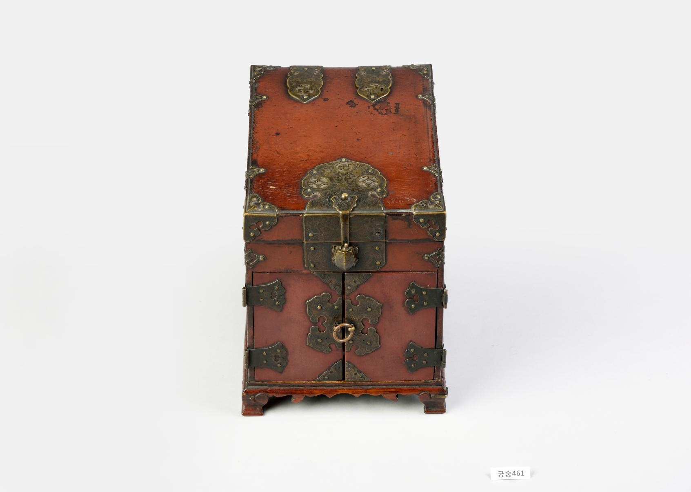

# 빗을 담는 상자의 문지기는 거북이었다

*붉은 빗접에 달린 작은 자물쇠*

Life · Housing

> 출처 대조와 공개 게시 승인을 마친 이야기입니다. 실제 게시 여부는 사이트 배포 상태를 따릅니다.

*주칠빗접 · 국립고궁박물관 소장·제공. 전체 사진을 자르지 않고 사용했습니다.*

[이미지 출처와 소장품 안내](https://www.gogung.go.kr/gogung/pgm/psgudMng/view.do?menuNo=800065&psgudSn=438986) · 공공누리 제1유형(출처표시)

작은 붉은 상자가 있다. 문짝과 금속 장식이 달려 있어서 가구를 줄여 놓은 것처럼 보인다. 가까이 살펴볼 때 재미있는 것은 가운데 붙은 자물쇠다. 모양이 거북이다.

국립고궁박물관의 주칠빗접이다. 빗접이라는 낯선 이름을 만났다면, 빗을 두는 작은 수납 가구를 떠올려 보자. 이 물건에서는 안을 정리하는 구조와 밖을 꾸미는 장식이 함께 눈에 들어온다.

## 안에도 자리가 나뉜다

박물관은 윗단을 젖혀 여는 부분과 안쪽의 서랍 두 개가 있는 구조라고 설명한다. 윗부분 안에는 칸막이도 있으며, 현재 그 일부는 없어져 있다. 작은 상자라고 안이 텅 비어 있는 것은 아니다.

오늘날 화장대 서랍에 정리함을 넣는 모습을 생각하면 이해하기 쉽다. 다만 각 칸에 정확히 무엇을 넣었는지는 이 설명만으로 알 수 없다. 물건마다 자리를 나누어 둔 구조에 먼저 주목하면 된다.

## 붉은 겉과 검은 속

겉면에는 붉은 칠을 했고 내부는 검은 칠로 마감했다. 서랍 역시 앞면은 붉고 나머지 면은 검다고 한다. 닫았을 때 보이는 부분과 열었을 때 드러나는 부분의 색이 다르다.

금속 장식에는 꽃무늬를 비롯한 여러 무늬가 있다. 호리병과 복숭아, 부채, 꽃과 새 장식도 설명에 등장한다. 작은 수납 가구에 꽤 많은 볼거리를 모아 둔 셈이지만, 처음부터 모두 찾으려 애쓸 필요는 없다.

## 가운데의 작은 동물

이 빗접에는 거북이 형태의 자물쇠가 붙어 있다고 박물관은 알려 준다. 서랍 속을 다 확인하지 않아도 이 작은 동물 하나 덕분에 상자의 인상이 달라진다.

거북이 장식의 뜻을 이 자료만으로 확정하거나 잠금장치의 성능을 짐작하지는 말자. 여기서 즐길 것은 수납 가구의 한가운데 동물의 모양을 놓았다는 선택이다. 붉은 상자를 다시 볼 때 문양이 많았다는 기억보다, 빗을 지키는 거북이 같았다는 인상이 먼저 떠오를지도 모른다.

## 이야기의 바탕이 된 자료

- [국립고궁박물관 — 주칠빗접](https://www.gogung.go.kr/gogung/pgm/psgudMng/view.do?menuNo=800065&psgudSn=438986) · 확인일 2026-10-28
  - 확인 내용: 윗닫이·서랍 두 개·내부 칸막이 일부 결실 / 외면과 서랍 전면 주칠·내부 흑칠 / 거북이 형태 자물쇠와 금속 문양

---

[같은 소주제의 이야기](README.md) · [전체 서가](../../README.md)
