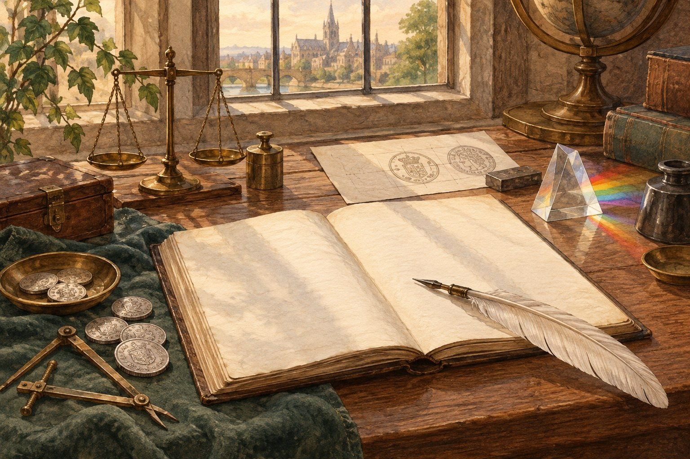

# 뉴턴의 또 다른 일터는 조폐국이었다

*동전의 무게를 살피던 과학자의 일상*

History · Europe

> 자료 대조를 마친 검토용 이야기입니다. 공개 게시 승인은 아직 받지 않았습니다.

*KnowledgeWalk 제작 · AI 설명용 삽화. 실제 인물·유물·제품·장소를 정확하게 재현한 자료가 아닙니다.*

뉴턴이라는 이름을 들으면 과학책의 초상화부터 떠올리기 쉽다. 그런데 그의 이력에는 조금 다른 장소도 나온다. 금속을 녹이고 동전을 만드는 왕립조폐국이다.

서류에 서명만 하러 가끔 들른 명예직이었을까. 영국 왕립조폐국의 설명을 읽으면 꽤 바쁜 직장이었음을 알 수 있다. 뉴턴은 1696년 그곳에서 일을 시작했고, 동전의 무게와 품질을 확인하는 문제에 깊이 관여했다.

실험실을 떠난 뒤에도 정확하게 재고 확인하는 일이 그를 기다렸던 셈이다.

## 오래된 은화를 다시 만드는 시기

뉴턴이 조폐국에 들어갔을 무렵에는 오래된 은화를 새로 만드는 큰 작업이 진행되고 있었다. 여러 지역에 보조 조폐 시설까지 마련할 만큼 규모가 컸다. 새로운 직장에 적응할 시간부터 넉넉하게 주어진 상황은 아니었다.

왕립조폐국은 이 작업이 약 3년 안에 마무리되었다고 설명한다. 뉴턴 혼자서 모든 일을 해냈다는 이야기는 아니다. 수많은 사람과 시설이 움직이는 조직 안에서 그도 일을 맡았다.

이후에는 동전을 위조하거나 훼손한 사람들을 조사하는 일에도 관여했다. 범죄자와 제보자를 직접 만나 조사한 기록도 소개된다. 우리가 익숙하게 떠올리는 과학자의 모습에 서류와 면담 일정이 더해진다.

그렇다고 거리에서 범인을 쫓는 장면까지 상상해 넣을 필요는 없다. 실제로 확인되는 업무만으로도 그의 조폐국 생활은 충분히 분주해 보인다.

## 동전 한 개에도 오차가 있다

조폐국에서 중요한 것은 동전에 예쁜 그림을 찍는 일만이 아니었다. 정해진 무게와 금속의 순도를 맞추고, 동전끼리의 차이를 줄이는 것도 필요했다.

왕립조폐국은 뉴턴의 기여 가운데 하나로 이런 정확성에 대한 관심을 든다. 손에 쥐는 작은 동전이라도, 여러 개가 서로 다르게 만들어지면 돈을 사용하는 사람들에게 문제가 될 수 있었다.

누군가에게는 서류 속 작은 수치였겠지만, 실제로는 재료와 제작 과정, 검사를 연결하는 문제였다. 책상 위에서 계산한 기준이 작업장의 금속으로 이어져야 했다.

그의 이름이 붙었다고 해서 조폐국의 모든 제도가 단번에 바뀐 것은 아니다. 공식 설명도 큰 조직 개혁과 그가 기울인 관리의 노력을 구분한다. 유명한 인물의 이력이라고 모든 일을 극적인 혁명으로 만들 필요는 없다.

## 초상화 바깥의 직장 생활

뉴턴은 1699년부터 조폐국의 다른 관리직을 맡았고, 1727년 세상을 떠날 때까지 그곳과 관계를 이어 갔다. 잠깐의 외도가 아니라 생애의 긴 부분이었다.

이 사실을 알고 나면 위인의 이력도 한 가지 직함으로만 읽히지는 않는다. 연구 결과를 남긴 사람에게도 조직 안에서 처리해야 할 일과 확인해야 할 문서가 있었다.

다음에 동전을 손에 쥔다고 뉴턴을 꼭 떠올릴 필요는 없다. 다만 과학책의 초상화 옆에 동전의 무게와 순도를 살피던 또 다른 직장인의 모습도 놓아 볼 수는 있겠다. 작은 돈 한 개를 정확하게 만드는 일도 그의 오랜 일상이었다.

## 이야기의 바탕이 된 자료

- [The Royal Mint — Sir Isaac Newton and The Royal Mint](https://www.royalmint.com/stories/commemorate/sir-isaac-newton-and-the-royal-mint/) · 확인일 2026-10-27
  - 확인 내용: 1696년 조폐국 근무 시작과 재주조 업무 / 위조범·제보자 직접 조사 / 무게·순도 정확성에 대한 관심 / 1699년 Master 취임과 1727년까지의 재직

---

[시범 이야기 목록으로](README.md)
