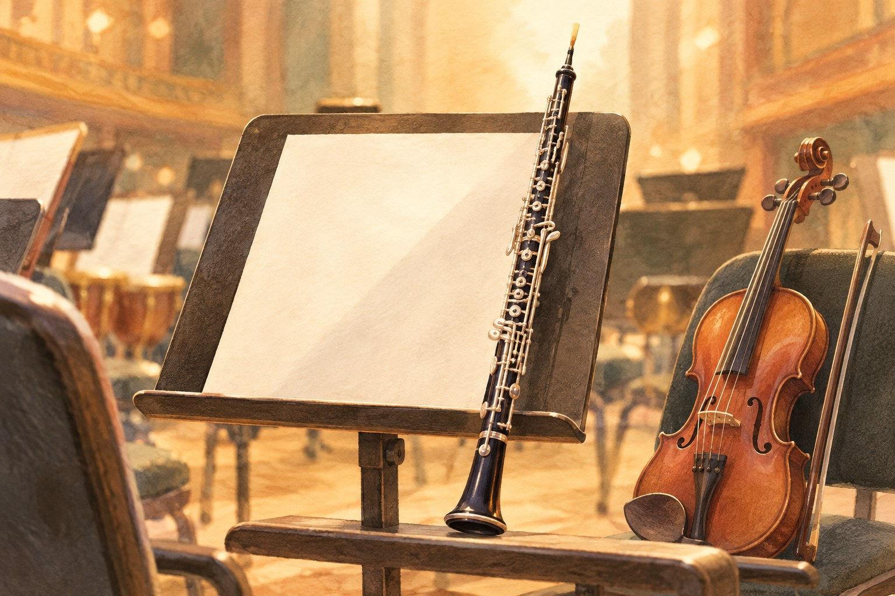

# 공연 시작 전, 오케스트라는 왜 한 음을 길게 낼까

*오보에의 짧은 신호와 음악회가 시작되는 순간*

Culture · Music

> 편집 검토용 이야기입니다. 게시 전 출처 확인이 남아 있습니다.

*AI 설명용 삽화 · 특정 유물·제품·장소의 실제 모습을 재현한 사진이 아닙니다.*

공연장에 조금 일찍 도착하면 무대에서 이미 음악 비슷한 것이 들린다. 바이올린은 짧은 구절을 켜고, 관악기는 제각각 소리를 낸다. 아직 같은 곡을 연주하는 것 같지는 않다.

잠시 뒤 길게 이어지는 한 음이 들린다. 다른 악기들이 그 소리를 듣고 조금씩 맞추기 시작한다. 음악회에 익숙하지 않다면 이것도 곡의 도입부인가 싶을 수 있다.

대개는 공연 전 조율이다. 그때 기준음을 내는 악기로 자주 등장하는 것이 오보에다.

## 작은 악기가 먼저 말을 건넨다

오보에는 검은 몸체에 은빛 장치가 붙은 목관악기다. 멀리서 보면 클라리넷과 헷갈릴 수 있지만, 연주자는 얇은 갈대 조각 두 장을 맞댄 리드를 입에 물고 소리를 낸다.

공연 전에는 흔히 ‘라’ 음을 길게 낸다. 연주자들은 그 음과 자기 악기의 음을 비교하면서 높이를 맞춘다. 오보에가 오케스트라의 모든 소리를 정하는 지휘자가 된다는 뜻은 아니다. 함께 출발할 기준을 들려주는 것이다.

왜 하필 오보에일까. 소리가 뚜렷하게 들리고 음을 이어 내기 좋다는 점, 오케스트라에서 오래 이어진 관행이 함께 관련된다. 다만 오보에는 절대로 음이 흔들리지 않는 악기라서 이 일을 맡는다고 설명하면 지나치다. 관악기 역시 온도와 연주 조건의 영향을 받는다.

기준음을 내는 연주자도 그날의 약속된 높이에 맞추어 준비한다. 아무렇게나 한 음을 불면 나머지 사람들이 무조건 따라가는 것은 아니다. 짧게 들리는 신호 뒤에도 준비가 있는 셈이다.

## 같은 라인데도 맞추어야 할까

악보에 같은 음이 적혀 있다고 해서 실제 높이가 저절로 일치하지는 않는다. 악기의 상태와 환경, 연주자의 조절에 따라 조금씩 차이가 생긴다. 혼자 연주할 때는 잘 모르던 차이도 여러 악기가 겹치면 귀에 들어온다.

현악기 연주자가 줄감개를 만지거나 관악기 연주자가 악기를 조절하는 모습은 그 차이를 줄이는 과정이다. 우리가 보기에는 공연을 기다리는 시간일 수 있지만, 무대 위에서는 함께 연주할 조건을 마지막으로 확인하는 시간이다.

오케스트라마다 채택하는 기준음의 높이가 조금 다를 수 있다. 그래서 어느 음반에서 들은 ‘라’와 오늘 공연장의 ‘라’가 완전히 같은 조건이라고 단정할 필요는 없다. 숫자를 외워야 음악을 즐길 수 있는 것은 아니니 이 정도만 알아두어도 충분하다.

그리고 이 순서에도 예외가 있다. 피아노처럼 공연 직전에 전체 음높이를 쉽게 바꾸기 어려운 악기가 함께하면, 그 악기에 맞추는 것이 중요해진다. 모든 공연이 늘 똑같은 방식으로 시작되는 것은 아니다.

## 소란이 준비로 들리는 순간

조율은 곡이 아니어서 멜로디를 따라 부를 수 없다. 여러 소리가 겹치는 몇 분이 누군가에게는 조금 어수선하게 들릴 수도 있다. 하지만 그 안에는 목적이 있다. 각자의 악기를 함께 연주할 상태로 모으는 일이다.

한 음을 들은 뒤 연주자들이 어떻게 반응하는지 살펴보자. 자기 소리를 길게 내보기도 하고, 옆 사람과 맞추기도 한다. 크고 작은 악기들이 서로의 소리를 듣는 모습이 음악회에 앞서 펼쳐진다.

관객이 해야 할 일은 특별하지 않다. 조율의 원리를 시험받는 것도 아니고, 틀린 음을 찾아낼 필요도 없다. 잠깐 귀를 기울이면 공연이 시작되기 전에도 볼거리가 있다는 정도면 된다.

다음 음악회에서는 첫 곡만 기다리지 말고 그 앞의 긴 ‘라’도 들어보자. 아직 이야기는 시작되지 않았지만, 등장인물들이 목소리를 맞추고 있다.

## 이야기의 바탕이 된 자료

- [Philharmonia — Oboe](https://philharmonia.co.uk/resources/instruments/oboe/) · 확인일 2026-10-27
  - 확인 내용: 오보에의 이중 리드와 목관악기 구조; 조율 기준 선택의 근거는 추가 확인 중
- [Philharmonia — Orchestral concerts: a 60-second beginner’s guide](https://philharmonia.co.uk/orchestral-concerts-a-60-second-beginners-guide/) · 확인일 2026-10-27
  - 확인 내용: 공연 전 악장이 조율을 지시한다는 절차

아직 대조하지 못한 내용이 남아 있습니다. 위 자료가 모든 문장의 확인 완료를 뜻하지는 않습니다.

---

[시범 이야기 목록으로](README.md)
