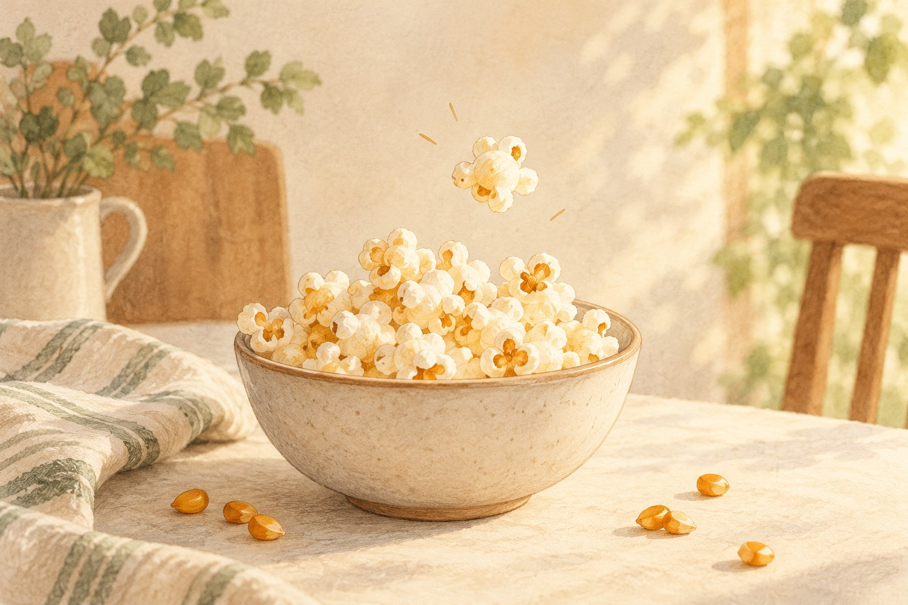

# 팝콘 한 알은 어떻게 저렇게 커질까

*알갱이 안에 남아 있던 수분이 하는 일*

Life · Food

> 편집 검토용 초안 · 출처 원문 대조 미완료 · 미게시

*AI 설명용 삽화 · 특정 유물·제품·장소의 실제 모습을 재현한 사진이 아닙니다.*

영화가 시작되기 전, 팝콘 통에는 벌써 손이 몇 번 오간다. 하얗고 가벼운 조각을 집다 보면 가끔 바닥에 남은 단단한 알갱이를 만나기도 한다.

둘은 같은 옥수수에서 출발했다. 그런데 하나는 부풀어 올랐고 다른 하나는 작은 돌처럼 남았다. 대체 알갱이 안에서 무슨 일이 벌어진 것일까.

팝콘을 만드는 데에는 단지 높은 온도만 필요한 것이 아니다. 눈에 잘 보이지 않지만 중요한 준비물이 있다. 알갱이 안의 수분이다.

## 작은 알갱이 안에 갇힌 것

팝콘용 옥수수 알갱이에는 전분과 수분이 들어 있고, 바깥을 단단한 껍질이 감싸고 있다. 열을 가하면 안의 물이 뜨거워지고 수증기가 생기면서 압력이 높아진다.

껍질은 그동안 속을 붙들어 두는 역할을 한다. 하지만 압력이 충분히 커지면 결국 터진다. 그 순간 안쪽의 뜨겁고 부드러워진 전분이 빠르게 부풀고, 식으면서 우리에게 익숙한 가벼운 모양이 된다.

하얀 부분은 옥수수 위에 따로 생겨난 장식이 아니다. 원래 알갱이 안에 있던 내용물이 크게 모습을 바꾼 것이다. 작은 봉투 속에 이렇게 많은 것이 들어 있었나 싶은 변신이다.

그래서 ‘물을 말끔히 없애면 더 잘 터지겠다’고 생각하면 반대가 된다. 속의 수분이 너무 적으면 팝콘이 제대로 부풀기 어렵다. 터뜨리려면 안에 갇혀 있을 것이 필요하다.

## 모든 옥수수가 영화관 간식이 되지는 않는다

옥수수라고 해서 아무 종류나 같은 팝콘이 되는 것은 아니다. 팝콘용 품종은 단단한 껍질과 내부의 성질이 이 변화에 맞는다. 우리가 쪄 먹는 옥수수를 그대로 말려 데운다고 영화관에서 보던 모양을 기대하기는 어렵다.

팝콘용 알갱이도 모두 성공하는 것은 아니다. 수분 상태나 껍질의 손상, 가열 조건이 영향을 준다. 그래서 바닥에 남은 알갱이를 보고 무조건 덜 익었다고 생각할 필요는 없다. 터지기 위한 조건을 갖추지 못했을 수도 있다.

기름 역시 팝콘의 흰 부분을 만드는 재료는 아니다. 기름은 조리 과정에서 열을 전달하고 맛을 더할 수 있지만, 뜨거운 공기를 이용해 만드는 팝콘도 있다. 변신의 주인공은 여전히 옥수수 알갱이 안에 있다.

물론 이 이야기는 터지지 않은 알갱이를 억지로 씹어 보라는 권유가 아니다. 팝콘 사이에서 단단한 것이 느껴지면 따로 골라내면 된다. 원리를 아는 것과 이가 해야 할 일을 늘리는 것은 다른 문제다.

## 모양이 제각각인 이유를 보는 재미

팝콘 한 통을 조금 천천히 보면 모두 같은 모양이 아니다. 날개처럼 여러 방향으로 벌어진 것도 있고, 비교적 둥글게 부푼 것도 있다. 품종과 가열 조건에 따라 모습이 달라질 수 있다.

그래서 팝콘은 간식이면서 작은 구경거리이기도 하다. 똑같은 금형으로 찍은 과자와 달리, 알갱이마다 터지고 굳은 흔적이 남는다. 같은 통 안에서도 유난히 큰 조각과 작은 조각이 섞여 있다.

영화를 볼 때 이 모든 과정을 떠올릴 필요는 없다. 이야기의 중요한 장면에 옥수수의 껍질을 연구하고 있을 이유도 없다. 다만 다음에 팝콘을 집었을 때, 그 가벼운 조각이 한때는 단단한 씨앗이었다는 사실을 잠깐 생각해 볼 수 있다.

요란한 소리와 함께 벌어지는 작은 변신. 팝콘은 영화가 시작되기도 전에 자기 몫의 짧은 장면을 끝낸 셈이다.

---

[시범 이야기 목록으로](README.md)
