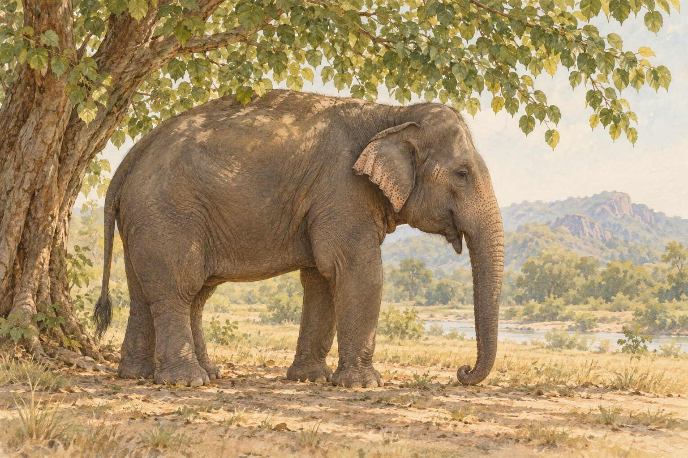

# 코끼리가 귀를 흔드는 데에는 이유가 있다

*커다란 귀가 몸의 열을 식히는 방법*

Science · Biology

> 출처 대조와 공개 게시 승인을 마친 이야기입니다. 실제 게시 여부는 사이트 배포 상태를 따릅니다.

*KnowledgeWalk 제작 · AI 설명용 삽화. 실제 유물·제품·연주 기구·동물의 생김새를 정확하게 재현한 자료나 실험 결과가 아닙니다.*

코끼리 영상을 보다 보면 귀가 자꾸 눈에 들어온다. 앞으로 한 번, 뒤로 한 번. 몸은 가만히 있는데 귀만 느긋하게 움직인다. 커다란 부채 두 개를 들고 있는 것 같다.

실제로 그 귀는 소리를 듣는 일 외에 몸을 식히는 데에도 쓰인다. 스미스소니언 국립동물원의 아시아코끼리 안내를 읽으면, 펄럭이는 귀 안쪽에 꽤 바쁜 길이 있다는 것을 알게 된다. 혈관이다.

## 1. 귀 안쪽을 지나는 따뜻한 피

아시아코끼리의 귀에는 많은 혈관이 있다. 더운 날 귀를 움직이면 그 안을 흐르는 피가 식고, 식은 피가 다시 몸을 돌면서 체온을 낮추는 데 도움을 준다고 동물원은 설명한다.

우리가 부채를 흔들 때는 손이 바쁘지만, 코끼리는 귀 자체를 움직인다. 따뜻한 피가 지나는 넓은 자리를 바람에 내어놓는 셈이다. 그래서 귀의 움직임을 보고 곧바로 기분이나 성격만 짐작할 일은 아니다.

귀는 겉으로 보이는 크기만큼이나 안쪽의 구조도 중요하다. 넓적한 모양과 혈관, 펄럭이는 동작이 함께 몸의 열을 다루는 데 쓰인다.

## 2. 두꺼운 피부에도 돌봄이 필요하다

코끼리의 피부는 어디나 똑같이 두껍지 않다. 동물원은 등처럼 두꺼운 곳이 있는 반면, 귀 안쪽처럼 아주 얇은 곳도 있다고 설명한다. 멀리서 본 커다란 몸에도 섬세한 부분이 섞여 있다.

피부는 신경이 풍부해 민감하다. 코끼리가 흙이나 모래, 진흙을 몸에 덮는 행동도 햇빛과 벌레로부터 피부를 보호하는 데 도움이 된다. 귀를 움직이고 몸에 흙을 묻히는 모습은, 더운 날의 생활을 다른 방식으로 보여준다.

동물원 안내에는 아시아코끼리가 하루 중 가장 더운 시간에 쉬거나 낮잠을 자는 경향도 나온다. 그늘에서 쉬는 몸, 움직이는 귀, 피부에 얹힌 흙이 한 장면 안에 놓인다.

## 3. 넓은 면과 그 안을 흐르는 피

귀가 몸의 열을 다루는 데 쓰인다는 설명에는 넓은 표면과 혈관이 함께 등장한다. 귀를 움직이는 행동만 따로 보는 것보다 그 안쪽의 흐름을 생각하면 구조가 더 구체적이다. 따뜻한 피가 지나가는 자리가 주변의 공기와 관계를 맺고, 그 피가 다시 몸을 도는 과정이 있다. 몸의 일부가 다른 곳의 상태와 연결되는 것이다.

부채라는 비유는 이 움직임을 이해하게 돕지만 사람의 손부채와 완전히 같은 장치는 아니다. 귀 자체에 혈관이 있고 피부와 몸의 구조가 함께 작용한다. 익숙한 도구와 닮았다는 입구에서 출발해 동물의 실제 몸을 따로 읽어야 한다. 재미있는 별명이 해부와 행동의 설명을 대신하지 않도록 하는 것이다.

## 4. 귀를 흔든다는 사실에서 감정까지 바로 가지 않기

큰 동물의 움직임을 보면 우리는 화가 났는지 즐거운지부터 짐작한다. 그러나 귀의 움직임에는 체온 조절과 관련된 기능도 있다. 하나의 행동에 한 가지 감정만 붙이면 실제 몸의 필요를 놓칠 수 있다. 동물원 안내는 그런 익숙한 해석 밖의 설명을 알려 준다.

그렇다고 모든 귀 움직임이 언제나 열을 식히는 목적 하나라고 정할 필요도 없다. 개별 장면을 이해하려면 상황과 다른 행동을 함께 살펴야 한다. 여기서는 안내가 설명한 아시아코끼리의 몸과 기능을 배운다. 멀리서 본 표정처럼 보이는 움직임을 몸의 구조와 연결해 보는 관점이다.

## 5. 흙이 묻었다고 관리하지 않는 것은 아니다

코끼리가 몸에 흙이나 진흙을 덮으면 인간의 깨끗함 기준으로는 지저분해 보일 수 있다. 하지만 자료는 햇빛과 벌레로부터 피부를 보호하는 역할을 설명한다. 보이는 상태와 실제 기능을 나누어 생각할 필요가 있다. 동물의 행동을 사람의 생활 습관으로만 평가하지 않을 이유다.

민감한 피부라는 설명도 큰 몸의 첫인상과 다르다. 두꺼운 곳이 있어도 전부 같은 두께가 아니고 감각을 가진 몸이다. 크고 튼튼해 보인다는 말이 불편과 자극을 느끼지 않는다는 뜻은 아니다. 귀의 얇은 부위와 피부를 덮는 행동을 함께 보면 코끼리의 하루가 조금 더 구체적으로 느껴진다.

## 6. 쉬는 시간도 환경과 연결된다

하루 중 더운 시간에 쉬는 경향은 귀와 피부의 구조 옆에 행동의 조절을 더한다. 동물은 몸의 한 부분만으로 환경을 견디는 것이 아니다. 움직임과 휴식, 그늘과 피부의 상태가 함께 관계를 맺는다. 다만 사진 한 장으로 실제 기온과 개체의 체온을 알아낼 수는 없다.

다음에 코끼리를 관찰할 기회가 있다면 귀만 확대하기보다 몸 전체와 주변도 살펴보자. 그늘에 있는지, 흙이 묻어 있는지, 가만히 쉬는지 같은 다른 정보가 들어온다. 모든 행동의 이유를 그 자리에서 확정할 필요 없이도 질문은 늘어난다. 큰 귀의 펄럭임이 단순한 몸짓에서 환경과 몸을 잇는 행동으로 보이기 시작한다.

## 7. 가만히 있는 줄 알았던 순간

동물은 빨리 달리거나 크게 울 때만 볼거리를 주는 것은 아니다. 조용히 서 있을 때도 몸의 작은 부분은 일을 하고 있다. 귀를 한번 움직이는 데에도 생활의 이유가 있다.

다음에 코끼리를 만나면 긴 코를 본 뒤 귀에도 잠깐 눈을 주어 보자. 이 이야기가 다룬 것은 아시아코끼리다. 귀의 모양과 크기를 다른 코끼리와 비교해 보는 것도 재미있겠지만, 우선은 한 번의 펄럭임을 천천히 보는 것으로 충분하다.

느긋한 오후처럼 보이던 장면 안에서, 커다란 몸은 자기 방식으로 더위를 견디고 있었던 것이다.

## 이야기의 바탕이 된 자료

- [Smithsonian National Zoo — Asian elephant](https://nationalzoo.si.edu/animals/asian-elephant) · 확인일 2026-10-27
  - 확인 내용: 귀의 혈관과 귀를 움직여 체온 조절을 돕는 과정 / 부위별 피부 두께와 민감한 피부 / 햇빛·벌레로부터 보호하는 흙·모래·진흙 / 더운 시간에 쉬거나 낮잠을 자는 경향

---

[같은 소주제의 이야기](README.md) · [전체 서가](../../README.md)
