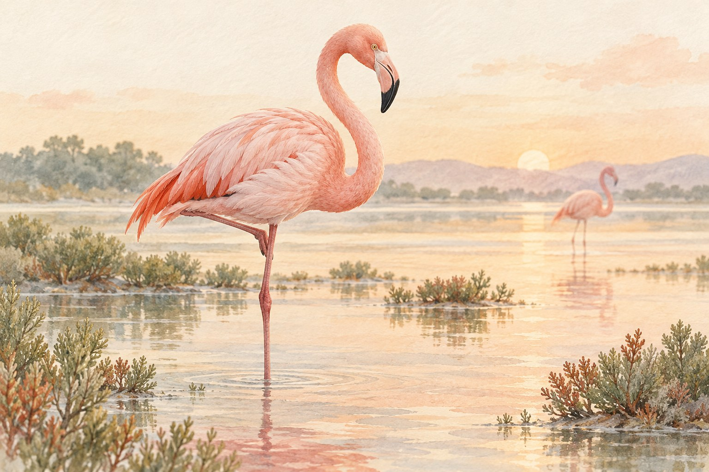

# 플라밍고는 태어날 때부터 분홍색일까

*우아한 깃털에 숨어 있는 식사의 흔적*

Science · Biology

> 자료 대조를 마친 검토용 이야기입니다. 공개 게시 승인은 아직 받지 않았습니다.

*AI 설명용 삽화 · 특정 유물·제품·장소의 실제 모습을 재현한 사진이 아닙니다.*

플라밍고를 그려 보라고 하면 분홍색부터 찾게 된다. 긴 다리와 굽은 목도 중요하지만, 색을 빼놓으면 어쩐지 다른 새처럼 느껴진다.

그런데 어린 플라밍고는 우리가 떠올리는 선명한 분홍색과 다르다. 회색빛이나 흰빛이 도는 솜털로 시작한다. 처음부터 어른 새와 똑같은 색의 작은 복사본이 태어나는 것은 아니다.

그렇다면 자라면서 분홍색은 어디에서 오는 것일까. 답을 찾으려면 깃털보다 먼저 먹이를 보아야 한다.

## 분홍색의 재료는 식사에 있다

플라밍고가 먹는 조류나 작은 갑각류 등에는 카로티노이드라는 색소가 들어 있다. 조금 낯선 이름이지만 자연에서 여러 노랑·주황·붉은빛과 관련되는 색소 무리다.

플라밍고는 먹이에서 얻은 이런 성분을 몸 안에서 처리하고, 그 결과가 깃털의 색에도 영향을 준다. 먹은 것을 단순히 깃털 바깥에 묻히는 방식은 아니다. 몸의 과정이 있어야 먹이와 새의 모습이 연결된다.

그래서 새우를 먹어서 분홍색이라는 설명은 기억하기 쉽지만 조금 짧다. 모든 플라밍고가 같은 먹이를 같은 비율로 먹는 것은 아니고, 색소의 경로도 한 가지 음식으로만 설명되지 않는다.

分홍색 깃털을 이해하려면 눈에 보이는 새만 볼 것이 아니라 그 새가 먹는 것도 살펴야 한다. 스미스소니언 국립동물원은 먹이의 색소를 몸 안에서 처리하는 과정이 깃털의 분홍빛으로 이어진다고 설명한다.

## 같은 분홍색도 자세히 보면 다르다

플라밍고 사진을 여러 장 놓고 보면 색이 모두 같지 않다. 연한 분홍빛을 띠는 새도 있고, 더 선명한 붉은빛에 가까운 새도 있다. 종과 나이, 먹이와 깃털의 상태 같은 여러 조건이 관련된다.

그러므로 색이 옅은 새 한 마리를 보고 바로 배가 고프다거나 건강에 문제가 있다고 판단할 수는 없다. 사진의 빛과 촬영 조건도 실제로 보이는 색에 영향을 준다. 색깔 하나로 새의 상태를 모두 읽을 수 있는 것은 아니다.

어린 새가 자라면서 어른의 색을 갖추는 데에도 시간이 필요하다. 먹이 한 끼를 먹고 바로 온몸이 물드는 만화 같은 변화는 아니다. 우리가 보는 깃털에는 그 새가 살아온 시간이 조금씩 반영되어 있다.

이렇게 생각하면 분홍색은 장식 이상의 것이 된다. 생김새를 알아보게 하는 특징이면서, 새가 사는 환경과 먹는 것을 떠올리게 하는 단서이기도 하다.

## 물속에서는 무엇을 하고 있을까

플라밍고가 물에 부리를 넣고 움직이는 모습을 볼 때가 있다. 긴 목과 독특한 부리는 얕은 물에서 먹이를 얻는 방식과 연결된다. 우아한 자세만 취하고 있는 것이 아니라 식사 중일 수 있다.

멀리서 바라보면 우리는 분홍빛 무리라는 큰 풍경을 본다. 조금 더 들여다보면 한 마리는 먹이를 찾고, 다른 한 마리는 깃털을 손질한다. 포스터에 그려진 상징과 달리 실제 새는 계속 생활하고 있다.

플라밍고를 좋아한다고 어려운 생물학 용어를 외울 필요는 없다. 다만 그 분홍색이 처음부터 완성된 물감처럼 주어진 것은 아니라는 사실만 알아도 충분히 재미있다.

다음에 분홍색 플라밍고를 만나면 깃털을 한 번, 물속의 부리를 한 번 보자. 눈에 보이는 색과 눈에 잘 띄지 않는 식사가 같은 이야기 안에 들어 있다. 아름다운 깃털에도 나름의 식단이 있었던 셈이다.

## 이야기의 바탕이 된 자료

- [Smithsonian’s National Zoo — American flamingo](https://nationalzoo.si.edu/animals/american-flamingo) · 확인일 2026-10-27
  - 확인 내용: 어린 새의 흰 솜털과 성장·털갈이에 따른 변화 / 얕은 물에서의 먹이 섭취와 부리의 여과 기능
- [Smithsonian’s National Zoo — Why Are Flamingos Pink? And Other Flamingo Facts](https://nationalzoo.si.edu/animals/news/why-are-flamingos-pink-and-other-flamingo-facts) · 확인일 2026-10-27
  - 확인 내용: 먹이의 카로티노이드와 분홍빛 깃털 / 새끼의 흰색·회색 솜털, 조류·갑각류 등의 먹이

---

[같은 소주제의 이야기](README.md) · [전체 서가](../../README.md)
