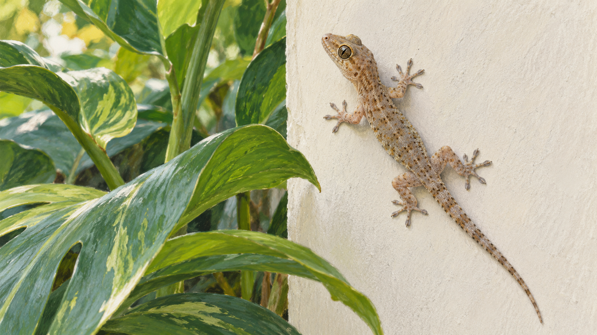

# 도마뱀붙이 — 접착제 없이 벽을 걷는 발

*작은 접촉이 아주 많이 모이면 생기는 힘*

Science · Biology

> 출처 대조와 공개 게시 승인을 마친 이야기입니다. 실제 게시 여부는 사이트 배포 상태를 따릅니다.

*AI 관련 삽화 · 벽에 붙은 도마뱀붙이의 분위기를 표현했습니다. 실제 개체 사진·미세 구조·부착력 측정 자료는 아닙니다.*

작은 도마뱀붙이가 매끈한 벽에 붙어 있다. 손톱이 걸릴 틈도 없어 보이는데 발을 옮기며 움직인다. 천장에서도 비슷한 능력을 보이는 종류가 있다. 발바닥에 접착제가 묻어 있거나 작은 빨판이 달려 있는 것일까.

교재에 소개된 연구는 다른 답을 보여 준다. 발의 아주 작은 구조가 표면과 많은 접촉을 만들고, 가까운 거리에서 작용하는 작은 힘들이 모인다. 벽을 걷는 능력은 거대한 힘 하나보다 눈에 잘 보이지 않는 접촉의 수와 방식에 관한 이야기다.

## 1. 가까이 보면 발의 표면이 다르다

OpenStax는 도마뱀붙이의 발가락에 많은 미세한 털이 있고, 그 털이 더 작은 납작한 끝으로 갈라진다고 설명한다. 우리가 멀리서 보는 발바닥은 매끈한 한 장의 판이 아니다. 매우 작은 크기에서 표면을 만나는 구조가 반복되어 있다.

이런 구조는 표면과 접촉할 수 있는 부분을 크게 늘린다. 발 전체가 벽에 한 번 닿는 것처럼 보여도 미세한 끝들은 많은 자리에서 작용할 수 있다. 몸의 크기만 보는 시선과 접촉의 작은 크기로 내려가는 시선이 서로 다른 정보를 주는 것이다.

## 2. 분자 사이에도 약한 끌림이 있다

교재는 분산력이라는 분자 사이의 인력을 설명한다. 전자의 분포가 순간적으로 달라지면서 이웃한 입자와의 끌림이 나타날 수 있다. 원자와 분자가 단단한 구슬처럼 서로 전혀 관계없이 놓여 있는 것은 아니다.

여기서 중요한 것은 한 쌍 사이의 힘이 작다는 점이다. 작은 힘이라는 이유로 언제나 무시해도 되는 것은 아니다. 아주 가까운 접촉이 충분히 많아지면 전체의 효과가 커질 수 있다. 도마뱀붙이의 발은 이 작은 크기와 많은 수의 만남을 생각하게 한다.

## 3. 작은 힘을 여러 곳에서 더하기

미세한 털 끝들이 벽과 가까이 접촉하면 많은 자리에서 분자 사이의 힘이 작용한다. 교재는 그 합이 몸을 지탱할 만큼 커질 수 있다고 설명한다. 접착제를 발라 굳히는 방식이나 공기를 빨아내는 빨판과는 다른 원리다.

그렇다고 발이 닿는 모든 곳에서 같은 힘을 낸다는 뜻은 아니다. 실제 접촉의 상태와 표면의 성질이 중요하다. 작용할 수 있는 구조가 있다는 사실과 그 구조가 충분히 접촉하고 있다는 사실은 다르다. 능력을 설명할 때도 조건을 함께 보아야 한다.

## 4. 무엇에 붙는지 비교한 실험

교재는 2000년 켈러 오텀 연구팀이 서로 다른 성질의 표면에서 부착을 비교한 연구를 소개한다. 극성이 있는 표면과 그렇지 않은 표면에서도 잘 붙는다는 관찰은 분산력의 중요성을 설명하는 근거가 되었다. 인상적인 동작을 보는 데서 멈추지 않고 가능한 원인을 구분하려 한 것이다.

이 대목에서 재미있는 것은 답의 이름보다 질문의 방식이다. 접착제인지, 다른 분자 간 상호작용인지 설명을 나누고, 서로 다른 예측이 나오는 조건에서 비교한다. 생물의 묘기를 과학의 문제로 바꾸는 일에는 이런 실험의 설계가 들어 있다.

## 5. 잘 붙는 발은 어떻게 다시 떨어질까

벽에 아주 잘 붙기만 한다면 다음 발을 옮기기 어려울 것이다. 실제 동물은 붙는 일과 떨어지는 일을 반복하며 걷는다. 교재는 발끝과 표면 사이의 각도, 발가락의 움직임이 접촉을 바꾸는 설명을 소개한다.

힘의 크기만 키우는 것과 필요할 때 작용을 바꾸는 것은 다른 과제다. 구조가 표면에 어떻게 놓이는지에 따라 전체의 부착 상태가 달라질 수 있다. 도마뱀붙이의 능력은 강하게 버티는 발뿐 아니라 움직임에 맞추어 접촉을 조절하는 발의 이야기이기도 하다.

## 6. 젖은 표면에서도 같은 결과일까

교재는 물에 잘 젖지 않는 표면에서 마른 조건과 젖은 조건의 부착을 비교한 후속 연구도 소개한다. 이는 모든 종류의 젖은 벽에서 항상 똑같이 붙는다는 뜻은 아니다. 물과 표면의 조합, 시험 조건을 구별해야 한다.

어떤 연구가 특정한 조건에서 좋은 결과를 보였다는 말과 자연의 모든 상황을 해결했다는 말은 다르다. 동물의 능력을 흥미롭게 소개할수록 그 범위를 지키는 일이 중요하다. 조건이 남아 있다는 사실은 발견을 약하게 하기보다 무엇을 더 알아볼지 알려 준다.

## 7. 생물의 발에서 재료의 아이디어로

연구자들은 이런 부착 구조를 이해해 새로운 접착 기술에 활용할 가능성을 살핀다. 끈적한 물질을 더 많이 쓰는 대신 표면의 미세한 모양과 접촉을 바꾸는 길을 생각할 수 있기 때문이다. 자연을 관찰하는 일이 재료의 설계와 이어지는 대목이다.

그러나 동물의 원리를 알았다고 같은 성능의 제품이 바로 완성되는 것은 아니다. 반복 사용과 먼지, 표면의 차이 같은 실제 조건이 남는다. 생물의 특징에서 아이디어를 얻는 일과 그 아이디어를 안정적인 물건으로 만드는 일 사이에도 별도의 연구와 시험이 필요하다.

## 8. 작은 발을 보는 두 가지 거리

함께 실은 AI 삽화는 벽에 붙은 도마뱀붙이를 표현한 관찰 분위기의 그림이다. 실제 개체의 사진이나 발가락 미세 구조를 촬영한 현미경 자료는 아니다. 이 그림만으로 털의 수와 접촉 면적을 확인할 수는 없다.

멀리서는 작은 동물이 벽을 걷고, 가까운 연구에서는 미세한 구조와 분자 사이의 힘이 만난다. 어느 한쪽만으로는 신기함과 원리를 함께 보기 어렵다. 도마뱀붙이의 발은 작은 작용도 많이 모이고 적절하게 조절되면 놀라운 능력이 될 수 있음을 보여 준다.

## 이야기의 바탕이 된 자료

- [OpenStax Chemistry — 분자 사이의 힘과 도마뱀붙이](https://raw.githubusercontent.com/openstax/osbooks-chemistry-bundle/main/modules/m68761/index.cnxml) · 확인일 2026-10-31
  - 확인 내용: 수소 결합·분자 간 인력 / 발의 미세 털과 분산력·서로 다른 표면을 비교한 연구 / 각도와 접촉 변화·젖은 소수성 표면의 후속 연구

---

[같은 소주제의 이야기](README.md) · [전체 서가](../../README.md)
