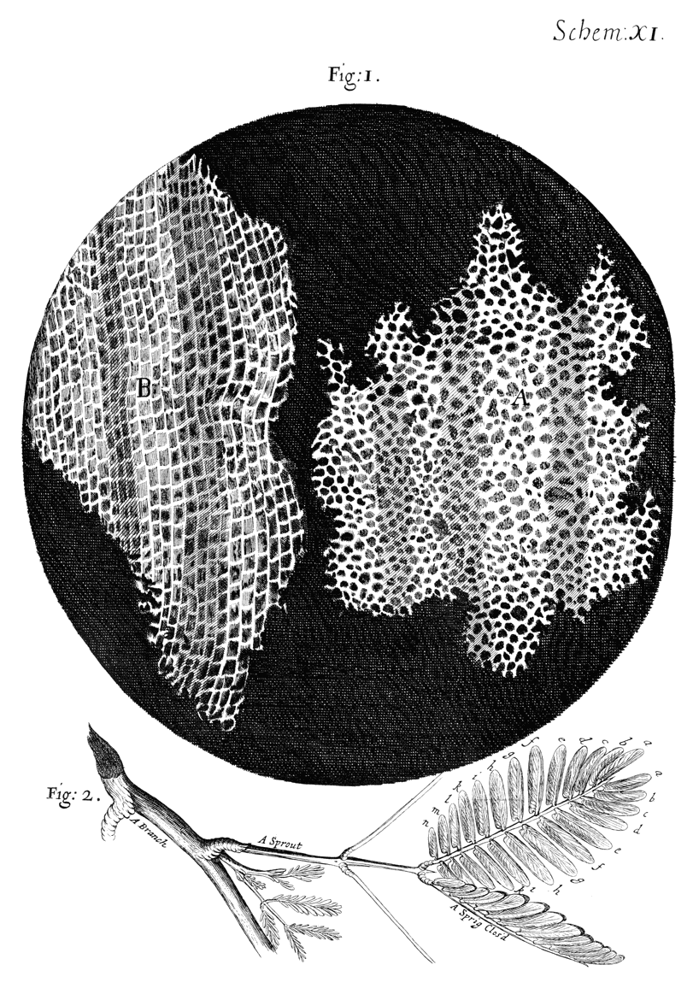

# 로버트 훅 — 코르크 속에서 작은 방을 보다

*1665년 『마이크로그라피아』와 눈에 보이는 세계의 확장*

Science · Biology

> 출처 대조와 공개 게시 승인을 마친 이야기입니다. 실제 게시 여부는 사이트 배포 상태를 따릅니다.

*Robert Hooke, Micrographia (1665), Scheme XI / Project Gutenberg · Public Domain. 위 그림 1은 코르크의 관찰, 아래 그림 2는 별도의 식물 관찰입니다. 현미경 사진이나 현대 세포 모식도가 아닙니다. 원본 도판 파일 그대로 사용했습니다.*

[이미지 출처·제작 근거](https://raw.githubusercontent.com/GITenberg/MicrographiaSome-Physiological-Descriptions-of-Minute-Bodies-Made-by-Magnifying-Glasses-with-__15491/master/15491-h/images/scheme-11.png) · Public Domain

코르크를 아주 얇게 잘라 들여다보니 작은 방들이 이어져 있었다. 병마개로 친숙한 재료가 전혀 다른 풍경을 보여 준 것이다. 로버트 훅은 이 칸들을 보고 방을 뜻하는 이름을 떠올렸다. 오늘의 세포라는 말은 그 관찰과 연결된다.

함께 실은 그림은 현대 교과서가 새로 상상한 그림이 아니다. 1665년 출간된 『마이크로그라피아』의 도판 11이다. 위쪽 원 안에는 코르크의 칸이, 아래에는 다른 관찰 대상인 식물의 가지와 잎이 담겨 있다. 작은 것을 크게 보게 된 시대는 눈으로 본 것을 다른 사람에게 보여 주는 방식도 바꾸었다.

## 1. 작은 것이 원래 단순한 것은 아니었다

맨눈으로 매끈해 보이는 표면도 확대하면 다른 구조를 드러낼 수 있다. 보이지 않는다고 그곳에 아무것도 없는 것은 아니다. 현미경은 먼 곳을 가까이 보던 망원경과는 다른 방향으로 사람의 시야를 넓혔다.

새로운 도구를 손에 넣었다고 모든 상이 곧바로 믿을 만해지는 것은 아니었다. 빛을 비추고 초점을 맞추며 얇은 시료를 준비해야 했다. 작은 세계에 접근하는 일에는 도구뿐 아니라 다루는 기술도 필요했다.

## 2. 훅이 사용한 복합현미경

훅은 여러 렌즈를 사용하는 복합현미경으로 관찰했다. 『마이크로그라피아』에는 관찰한 사물뿐 아니라 사용한 도구의 설명도 담겼다. 무엇을 보았는지와 함께 어떻게 볼 수 있었는지 전하려 했다.

렌즈가 여러 개라는 이유만으로 당시의 모든 단일 렌즈보다 더 선명했다고 말할 수는 없다. 유리의 품질과 가공, 빛의 조건이 중요했다. 기술의 역사를 부품 수가 많아지는 단순한 순서로만 보면 실제 성능의 차이를 놓친다.

## 3. 코르크를 얇게 자르는 이유

두꺼운 덩어리 그대로보다 얇은 부분을 살피면 내부의 칸 구조를 볼 수 있었다. 훅의 관찰에는 무엇을 볼지 고르는 일과 보이도록 준비하는 일이 함께 있었다. 도구를 눈에 댄 순간에만 발견이 일어나는 것은 아니다.

코르크의 칸들은 벌집과도 닮아 보였다. 익숙한 모양과 비교하는 말은 낯선 관찰을 독자에게 전하는 데 도움이 되었다. 작은 세계를 이해하려고 이미 아는 사물의 이름과 이미지를 빌려온 셈이다.

## 4. 세포는 처음에 빈 방처럼 보였다

훅이 본 코르크는 살아 움직이는 세포의 내부가 가득한 표본이 아니었다. 죽은 조직에 남은 세포벽의 구조를 살폈기 때문에 비어 있는 방처럼 보였다. 그가 붙인 이름은 관찰한 모습과 잘 맞았다.

하지만 오늘날 세포를 그 빈칸으로만 생각하면 곤란하다. 살아 있는 세포에는 여러 활동과 구조가 있다. 이름이 시작된 장면과 나중에 그 이름으로 이해하게 된 내용 사이에는 더 많은 연구가 들어 있다.

## 5. 한 번의 관찰이 세포학 전체는 아니었다

세포라는 말이 등장했다고 현대 생물학의 이론이 그때 완성된 것은 아니다. 훅이 본 코르크와 오늘날 설명하는 생명의 기본 단위 사이에는 새로운 표본, 도구와 연구자들의 작업이 이어졌다.

과거의 과학자에게 후대의 지식을 모두 미리 알았던 사람처럼 역할을 주면 실제의 발견이 흐려진다. 그가 확실히 본 것과 아직 몰랐던 것을 구별할 때 작은 관찰이 얼마나 큰 출발점이었는지도 더 잘 보인다.

## 6. 그림이 다른 사람의 눈이 되었다

현미경에 얼굴을 대지 않은 독자도 책의 도판으로 그 구조를 만날 수 있었다. 그림과 글은 한 사람의 관찰을 다른 사람과 나누는 방법이었다. 새로운 세계가 개인의 신기한 경험으로만 머물지 않게 했다.

물론 도판은 현미경 속 상을 그대로 찍은 사진은 아니다. 관찰한 것을 골라 선으로 표현한 그림이다. 그림을 보는 사람도 어디까지가 관찰과 표현인지 살펴야 한다. 정교한 출판은 검토와 새로운 질문을 이어 주는 다리였다.

## 7. 레이우엔훅의 작은 렌즈와 편지

같은 시대의 안토니 판 레이우엔훅은 단일 렌즈를 사용한 작은 현미경으로 미생물을 관찰했다. 관찰 결과는 런던 왕립학회에 보낸 편지로 전해졌다. 도구의 모양과 출판 방식은 달랐지만 기록과 공유가 중요했다.

이들을 현미경의 단 한 명의 발명자로 세우기는 어렵다. 렌즈를 만들고 도구를 발전시킨 사람들은 앞서도 있었다. 잘 남은 관찰과 확인의 기록 덕분에 어떤 발견이 널리 알려지는가도 과학사의 일부다.

## 8. 작은 칸에서 코르크의 성질로

훅은 칸을 보고 모양이 신기하다는 데서 멈추지 않았다. 왜 코르크가 가벼운지, 왜 물에 잘 뜨는지, 눌렸다가 다시 부풀려는 성질은 어떻게 설명할지 물었다. 원문에는 이런 익숙한 물성에 대한 생각이 이어진다.

그는 작은 방과 공기를 코르크의 가벼움과 탄성에 연결했다. 당시의 해석을 오늘의 재료 과학 전체와 같다고 볼 수는 없다. 하지만 확대해 본 내부 구조로 손에 잡히는 성질을 설명하려 했다는 점이 흥미롭다.

코르크가 병마개나 뜨개로 쓸모 있다는 사실은 관찰 전에도 알려져 있었다. 훅이 새롭게 물은 것은 그 쓸모가 어떤 구조와 관련되는가였다. 작은 칸의 그림은 이름 하나를 남기면서 일상 재료를 탐구할 길도 열었다.

## 9. 병마개가 달라 보이는 순간

코르크를 다시 손에 쥐면 매끈한 물건 안의 수많은 칸을 떠올릴 수 있다. 훅의 이야기는 특별한 재료만 관찰할 가치가 있다는 생각을 흔든다. 친숙한 사물도 보는 조건이 달라지면 새로운 질문을 낳는다.

『마이크로그라피아』가 넓힌 것은 단지 물체의 크기가 아니었다. 관찰을 글과 그림으로 남겨 다른 사람이 함께 살필 세계도 넓혔다. 작은 방이라는 이름은 그 오래된 관찰과 대화의 흔적이다.

## 이야기의 바탕이 된 자료

- [OpenStax Microbiology — Peering Into the Invisible World](https://raw.githubusercontent.com/openstax/osbooks-microbiology/main/modules/m58786/index.cnxml) · 확인일 2026-10-31
  - 확인 내용: 훅의 복합현미경과 코르크·1665년 출판·죽은 조직의 세포벽 / 레이우엔훅의 단일 렌즈와 관찰 편지 / 현미경 단독 발명자의 확정이 어려운 역사
- [Robert Hooke, Micrographia (1665) — 관찰 XVIII·도판 XI](https://raw.githubusercontent.com/GITenberg/MicrographiaSome-Physiological-Descriptions-of-Minute-Bodies-Made-by-Magnifying-Glasses-with-__15491/master/15491-h/15491-h.htm) · 확인일 2026-10-31
  - 확인 내용: 얇게 자른 코르크·검은 받침과 조명·벌집/작은 상자 비유 / 코르크의 가벼움·부력·탄성에 대한 훅의 역사적 해석 / 도판 XI 그림 1의 코르크와 그림 2의 별도 식물 그림을 구별

---

[같은 소주제의 이야기](README.md) · [전체 서가](../../README.md)
