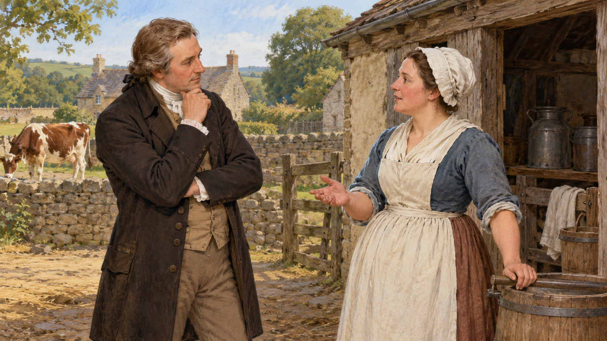

# 제너 — 우유 짜는 사람들의 경험이 백신으로 이어지기까지

*1796년의 시도와 그보다 오래된 예방의 역사*

Science · Biology

> 자료 대조를 마친 검토용 이야기입니다. 공개 게시 승인은 아직 받지 않았습니다.

*AI 관련 장면 삽화 · 일상의 관찰과 의학의 질문을 떠올리는 상상 속 장면입니다. 제너의 실제 초상·기록된 만남·어린이 대상 실험을 재현하지 않았습니다.*

병에 걸린 뒤 고치는 방법이 마땅치 않던 시대에는 미리 피할 수 있는 길이 큰 희망이었다. 천연두는 그런 절박함을 낳은 질병이었다. 그런데 소와 가까이 일하는 사람들이 겪는 다른 병의 경험이 예방의 새로운 방법과 연결되었다.

영국 의사 에드워드 제너는 우두를 앓은 사람들이 천연두에 잘 걸리지 않는다는 관찰에 주목했다. 여기서 출발한 1796년의 시도는 백신의 역사에서 중요한 장면이 되었다. 다만 한 천재가 아무 선행 지식 없이 예방을 발명한 이야기로 읽으면 그 앞뒤의 사람과 시간을 놓친다.

## 1. 제너 이전에도 예방을 시도한 사람들이 있었다

교재는 천연두를 막기 위한 인두법이 제너 이전부터 사용되었다고 설명한다. 중국을 비롯한 지역에서 이루어진 시도가 다른 지역으로 퍼졌다. 천연두를 앓은 사람의 물질을 이용해 예방을 기대한 방식이었다. 병을 겪은 뒤 다시 걸리지 않는 현상에 대한 경험이 배경에 있었다.

그러나 이 방법 자체가 감염과 유행을 일으킬 위험도 있었다. 예방의 필요가 컸다고 시도하는 모든 방법이 안전했던 것은 아니다. 제너의 이야기는 이미 있던 예방의 역사와 그 위험 속에서 더 나은 방법을 찾던 흐름에 놓여 있다.

## 2. 목장 주변의 경험을 질문으로 바꾸다

우두는 소와 사람 사이에서 관련되는 감염병으로 천연두와는 다르다. 교재는 제너가 우두를 겪은 우유 짜는 사람들의 경험에서 가설을 세웠다고 설명한다. 비교적 가벼운 다른 감염이 더 심각한 병에 대한 보호와 연결될 수 있는가라는 질문이었다.

이것은 당시 그가 바이러스의 유전자와 면역 세포를 모두 이해했다는 뜻은 아니다. 지금의 설명과 당시의 질문은 구별해야 한다. 주변에서 관찰한 경험을 새로운 예방 방법의 가능성으로 읽었다는 점이 중요하다. 일상의 지식이 의학의 질문과 만나는 자리였다.

## 3. 1796년, 한 아이에게 시행한 시도

제너는 1796년 우두의 물질을 어린아이에게 접종했다. 교재는 아이가 비교적 가벼운 증상을 보인 뒤, 이후 천연두 물질에 노출되었을 때 천연두를 앓지 않았다고 설명한다. 제너에게는 자신의 가설을 뒷받침하는 중요한 결과였다.

그러나 오늘의 독자는 이 장면을 용감한 성공담으로만 읽을 수 없다. 어린이를 연구에 참여시키고 위험에 노출한 행동에는 동의와 보호라는 중대한 윤리적 질문이 있다. 역사적 성과를 이해하는 일과 그 과정의 위험을 정당화하는 일은 다르다. 당시의 방법을 다시 따라 할 수 있는 절차로 읽어서는 안 된다.

## 4. 소라는 말이 이름에 남다

백신 접종을 뜻하는 vaccination이라는 말은 소를 뜻하는 라틴어 vacca와 연결된다. 우두를 이용한 이 역사가 이름 속에 남은 것이다. 오늘날 익숙한 의료 용어 뒤에 목장과 소, 사람의 감염 경험이 들어 있다는 점이 흥미롭다.

그렇다고 현재의 모든 백신이 소에서 얻은 같은 물질이라는 뜻은 아니다. 이후 여러 질병과 다양한 방식의 백신이 개발되었다. 이름의 기원은 출발점을 알려 주지만 지금 존재하는 모든 방법을 한꺼번에 설명해 주지는 않는다.

## 5. 오늘의 면역 지식으로 다시 읽으면

교재는 우두와 천연두를 일으키는 바이러스가 관련되어 있어 면역 반응이 보호로 이어질 수 있었다고 설명한다. 우리 몸이 한 번 만난 병원체의 특징을 기억하고 다음의 관련된 침입에 반응하는 능력이 중요하다. 제너의 관찰은 나중에 더 정교한 지식으로 해석될 수 있었다.

이 차이를 알면 옛 의사가 오늘의 설명을 모두 알고 행동한 것처럼 묘사하지 않게 된다. 결과가 먼저 관찰되고 그 결과를 이해하는 언어가 뒤에 발전할 수도 있다. 과학의 역사는 실천과 설명이 언제나 같은 날 완성되는 것은 아님을 보여 준다.

## 6. 한 번의 결과에서 넓은 예방으로

1796년의 시도가 의미 있었다고 그 한 번으로 모든 사람의 효과와 안전성이 확인된 것은 아니다. 더 많은 경험과 검토, 생산과 보급의 문제가 뒤에 남아 있었다. 개인의 관찰이 사회의 의료로 이어지려면 여러 단계가 필요하다.

교재는 제너 이후 파스퇴르를 비롯한 연구자들이 다른 질병의 예방으로 길을 넓혀 갔다고 설명한다. 백신의 역사는 한 물질의 성공을 그대로 복제하는 것이 아니라 질병과 방법에 맞추어 새로운 근거를 쌓아 간 과정이었다.

## 7. 발견의 이야기에서 빠지기 쉬운 사람들

유명한 이름은 제너지만 배경에는 우유를 짜던 사람들의 경험과 이전의 예방 관행, 시도에 참여한 아이가 있었다. 발견이 한 사람의 머리 안에서만 이루어진 것은 아니다. 어떤 경험을 누가 듣고 어떤 문제로 바꾸었는지 살펴보면 이야기가 넓어진다.

이런 시선은 공로를 없애려는 것이 아니다. 관찰한 사람과 실험한 사람, 위험을 감수한 사람의 자리가 같지 않았음을 함께 보려는 것이다. 과학의 성과를 소중히 여기는 일은 그 성과를 가능하게 한 관계와 책임을 살피는 일과 함께 갈 수 있다.

## 8. 목장과 실험, 제도 사이의 긴 길

함께 실은 AI 삽화는 18세기 말 농촌에서 의사와 우유 짜는 사람이 대화하는 상상 속 장면이다. 제너의 실제 초상이나 기록된 만남을 재현하지 않았다. 어린이에게 시행된 실험을 그린 자료도 아니다. 일상의 관찰과 질문의 관계를 표현했다.

제너의 이야기를 읽고 나면 백신은 완성된 원리를 외우는 단어보다 긴 시간을 가진 이름이 된다. 병을 막고 싶었던 사람들의 필요와 앞선 관행, 새로운 시험과 윤리의 질문이 함께 들어 있다. 그 과정을 읽는 것이 발견을 더 깊게 이해하는 과학사의 즐거움이다.

## 이야기의 바탕이 된 자료

- [OpenStax Microbiology — 예방 접종의 역사](https://raw.githubusercontent.com/openstax/osbooks-microbiology/main/modules/m58888/index.cnxml) · 확인일 2026-10-31
  - 확인 내용: 제너 이전 인두법의 전파와 위험 / 우두를 겪은 사람의 관찰·1796년 어린이 접종과 이후 노출 / vacca 어원·현대의 면역 기억 해석·후속 백신 개발. 당시 행동의 윤리 평가는 편집적 관점으로 구별

---

[같은 소주제의 이야기](README.md) · [전체 서가](../../README.md)
