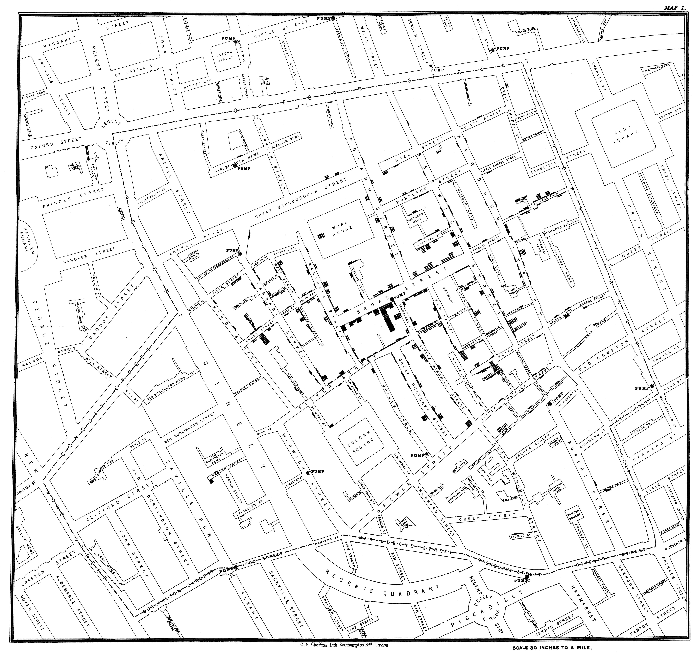

# 존 스노 — 펌프 손잡이보다 먼저 바꾼 질문

*1854년 런던에서 누가 어떤 물을 마셨는지 묻다*

Science · Biology

> 출처 대조와 공개 게시 승인을 마친 이야기입니다. 실제 게시 여부는 사이트 배포 상태를 따릅니다.

*John Snow, On the Mode of Communication of Cholera, 제2판(1855), Map 1 · Project Gutenberg · Public Domain. 사망 위치와 펌프를 표시한 당시 지도이며 모든 감염자의 위치를 뜻하지 않습니다.*

[이미지 출처·제작 근거](https://raw.githubusercontent.com/GITenberg/On-the-mode-of-communication-of-cholera_72894/master/72894-h/images/i_map1_large.jpg) · Public Domain

지도에 작은 표시들이 모여 있다. 장식이나 가게의 위치가 아니라 사람들이 죽은 집을 나타낸 흔적이다. 1854년 런던의 콜레라를 조사한 의사 존 스노는 누가 병에 걸렸는지만큼 그들이 어떤 물을 마셨는지 물었다.

유명한 결말은 브로드 스트리트 펌프의 손잡이를 떼어 냈다는 이야기다. 하지만 그 장면만 기억하면 그 앞의 질문과 뒤의 신중한 해석이 사라진다. 스노가 1855년에 낸 책을 읽으면 지도와 사람들의 대답이 어떻게 증거가 되었는지 더 자세히 보인다.

## 1. 같은 동네에서 왜 결과가 달랐을까

스노는 1848~1849년의 콜레라 경험을 바탕으로 물과 감염의 관계를 의심했다. 나쁜 공기만으로 병의 분포를 설명하기보다 사람들이 실제로 무엇을 마셨는지 살폈다. 익숙한 설명을 바꾸려면 다른 종류의 질문을 던져야 했다.

1854년 그는 브로드 스트리트 주변의 집과 사망자의 주소를 조사했다. 병이 생긴 위치를 지도로 옮기면 거리의 인상보다 구체적인 분포를 볼 수 있었다. 그러나 지도에 표시가 모였다는 사실만으로 원인이 자동으로 증명되는 것은 아니었다. 그다음에 사람들의 생활을 확인해야 했다.

## 2. 집과 펌프 사이의 관계

당시 주민들은 동네 펌프에서 물을 얻었다. 스노는 사망자의 집이 어느 펌프와 가까운지뿐 아니라 실제로 그 물을 이용했는지 확인했다. 가까운 곳에 산다는 사실과 그곳의 물을 마셨다는 사실은 다를 수 있기 때문이다.

함께 실은 실제 지도는 그의 1855년 책에 실린 첫 번째 지도다. 작은 표시들은 확인한 사망의 위치를 나타낸다. 오늘의 감염자 실시간 현황도나 모든 사람의 이동 기록은 아니다. 어떤 자료가 지도에 들어 있는지 알면 유명한 그림도 더 정확하게 읽을 수 있다.

## 3. 멀리 사는 사람의 물도 따라가다

스노의 책에는 펌프와 떨어져 사는 사람이 그 물의 맛을 좋아해 가져다 마셨다는 사례가 나온다. 가까이 살지 않아도 같은 물을 이용하면 조사에서 중요해질 수 있었다. 반대로 같은 지역에 있어도 다른 물을 이용한 곳은 비교의 대상이 되었다.

이런 사례는 지도에서 먼 점을 예외로 버리지 않고 왜 그런 일이 생겼는지 다시 묻는 태도를 보여 준다. 잘 들어맞는 집만 모으면 이야기는 깔끔해질 수 있다. 그러나 원인을 알아보려면 설명이 어려운 사례와 병에 걸리지 않은 사람들의 조건도 살펴야 한다.

## 4. 더 넓은 런던의 급수망을 비교하다

스노는 동네 펌프만 조사하지 않았다. 서로 다른 수도회사의 물을 받는 집들의 사망 양상도 비교했다. 한 회사는 강의 더 깨끗한 구간으로 급수원을 옮겼고 다른 회사의 물에는 하수의 영향이 더 남아 있었다. 물의 출처가 조사에서 중요한 구분이 되었다.

사람을 일부러 위험에 노출해 보지 않고 이미 다른 조건에 놓인 집들을 비교한 것이다. 물론 주소와 급수원, 사망 기록을 정확히 맞추는 어려움이 있었다. 스노의 작업은 지도 한 장의 번뜩임보다 여러 자료를 연결하는 수고에 가까웠다.

## 5. 9월 8일, 손잡이를 떼어 내다

스노의 조언에 따라 지역 관계자들은 브로드 스트리트 펌프의 손잡이를 제거했다. 위험한 물일 가능성이 있는 공급원을 더 이상 이용하지 못하게 하는 조치였다. 원인의 모든 세부가 완성되기 전에도 공중보건을 위한 판단이 필요했다.

그러나 손잡이를 뗀 순간부터 유행이 처음 줄었다고 단정하면 원문과 달라진다. 스노는 자신의 책에서 그전에 이미 발생이 감소했고 많은 주민이 떠났다는 점을 적었다. 조치와 결과를 함께 기록하면서도 단순한 인과로 과장하지 않은 것이다.

## 6. 스노가 남긴 불확실성

그는 물의 사용을 막기 전부터 유행이 줄었으므로 그때 우물 안의 위험이 계속 남아 있었는지 판단하기 어렵다고 썼다. 현장에서 얻은 증거가 어디까지 답할 수 있는지 스스로 선을 그었다. 유명한 성공담보다 이런 문장이 연구의 태도를 잘 보여 주기도 한다.

물과 콜레라의 관계를 지지하는 여러 증거가 있다고 해서 한 조치의 효과를 정확히 분리해 측정한 것은 아니었다. 이 두 문장은 함께 성립할 수 있다. 근거를 쌓는 일은 확신을 크게 말하는 일과 반드시 같은 것은 아니다.

## 7. 병원체의 완전한 설명보다 앞선 조사

스노가 오늘의 미생물학 지식을 모두 갖고 시작한 것은 아니다. 그는 감염 경로에 관한 가설을 세우고 관찰과 기록을 비교했다. 현미경으로 병원체를 완벽히 규명하는 일과 생활의 자료에서 위험한 경로를 찾아내는 일은 다른 방식의 연구였다.

교재는 이런 사례를 현대 역학의 발전과 연결한다. 다만 이것이 인류 최초의 모든 유행병 대응이었다고 확대할 필요는 없다. 앞선 사람들의 예방과 조사도 있었다. 스노의 공로는 구체적인 질문과 자료 연결의 방식 속에서 읽을 때 더 분명해진다.

## 8. 지도보다 오래 남는 질문

이 지도는 그 자체가 정답을 말하는 그림이 아니다. 누가 어디에 살았고 어떤 물을 마셨는지 물은 결과가 표시되어 있다. 우리가 기억하는 펌프 손잡이는 그 긴 조사 가운데 눈에 잘 보이는 한 장면이다.

다음에 질병 지도를 만나면 표시의 수만 보지 말고 무엇을 세었으며 어떤 비교가 가능한지 살펴보자. 스노의 기록은 예외와 한계까지 남길 때 연구가 더 설득력 있어질 수 있음을 보여 준다. 한 동네의 물을 따라간 질문은 사람들의 생활과 과학의 증거를 함께 바꾸었다.

## 이야기의 바탕이 된 자료

- [John Snow, On the Mode of Communication of Cholera, 1855년 제2판](https://raw.githubusercontent.com/GITenberg/On-the-mode-of-communication-of-cholera_72894/master/72894-0.txt) · 확인일 2026-10-31
  - 확인 내용: 브로드 스트리트 조사·실제 음수 경로·사망 지도·9월 8일 이전 환자 감소·수도회사 비교
- [OpenStax Microbiology — 감염병의 추적](https://raw.githubusercontent.com/openstax/osbooks-microbiology/main/modules/m58872/index.cnxml) · 확인일 2026-10-31
  - 확인 내용: 스노의 주소와 급수 조사·관찰과 비교의 의미

---

[같은 소주제의 이야기](README.md) · [전체 서가](../../README.md)
