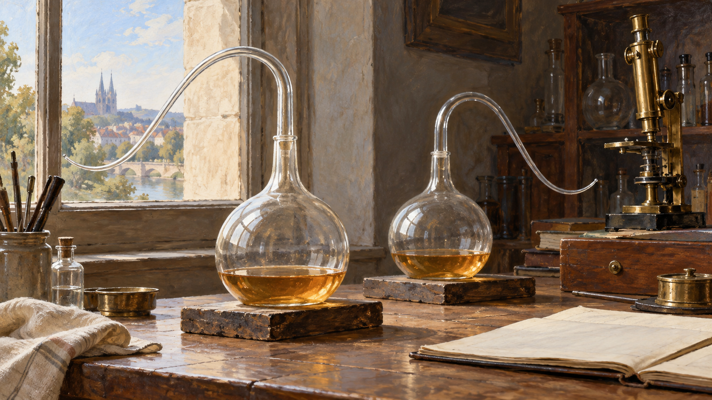

# 파스퇴르 — 공기는 들어오는데 왜 썩지 않았을까

*구부러진 플라스크가 오래된 생명 논쟁에 던진 질문*

Science · Biology

> 출처 대조와 공개 게시 승인을 마친 이야기입니다. 실제 게시 여부는 사이트 배포 상태를 따릅니다.

*AI 관련 장면 삽화 · 실제 소장 유물의 정밀 복원이나 실험 결과의 증거가 아닙니다. 병목의 작용은 본문의 설명과 근거자료를 함께 읽어 주세요.*

국물이 든 유리병에 공기는 드나드는데 국물은 쉽게 변하지 않는다. 뚜껑으로 꽉 막은 것도 아니다. 병의 목이 길게 구부러져 있을 뿐이다. 파스퇴르의 유명한 실험은 커다란 기계보다 이 낯선 유리병의 모양으로 기억된다.

왜 병목을 휘게 만들었을까. 이것을 알려면 먼저 옛 연구자들이 무엇을 다투고 있었는지 살펴야 한다. 논쟁의 중심에는 썩는 물질에서 작은 생명이 저절로 생겨나는가라는 질문이 있었다.

## 1. 갑자기 나타나는 생물의 수수께끼

고기를 두면 구더기가 보이고 국물을 오래 두면 작은 생물이 늘어난다. 그 시작을 직접 보지 못하는 사람에게는 물질 자체에서 생명이 생겨난 것처럼 보일 수 있었다. 이런 생각을 자연발생설이라고 부른다.

오늘의 답을 안다고 옛사람 모두를 관찰하지 않는 사람으로 생각해서는 안 된다. 그들 역시 눈앞에 무엇이 나타나는지 보았다. 문제는 보이지 않는 알이나 미생물이 들어온 가능성을 어떻게 구별할 것인가였다.

## 2. 고기와 파리 사이를 가로막다

1668년 프란체스코 레디는 고기를 담은 용기의 덮개를 달리했다. 파리가 고기에 닿을 수 있는지 비교한 것이다. 공기는 들어가되 파리는 막는 덮개를 두면 구더기의 발생을 다른 방식으로 해석할 수 있었다.

그러나 큰 파리와 구더기의 관계를 밝힌다고 작은 미생물의 문제까지 바로 끝나는 것은 아니었다. 보이는 생물보다 훨씬 작은 대상을 두고도 같은 설명이 가능한지, 연구는 다른 규모에서 이어져야 했다.

## 3. 끓인 국물이 다시 흐려졌다

18세기 존 니덤은 국물을 잠시 끓인 뒤에도 미생물이 나타나는 것을 보았다. 라차로 스팔란차니는 가열과 밀봉의 조건을 달리해 다른 결과를 얻었다. 미생물이 남거나 다시 들어오는 가능성이 논쟁에 들어왔다.

그러자 밀봉한 병에는 생명이 생기는 데 필요한 공기나 힘이 들어가지 못한다는 반론이 나왔다. 병을 닫고 열어 보는 것만으로는 서로 다른 설명을 떼어 놓기 어려웠다. 양쪽이 받아들일 수 있는 비교가 필요했다.

## 4. 파스퇴르가 바꾼 비교의 조건

발효와 부패를 연구하던 루이 파스퇴르는 공기와 함께 무엇이 들어오는지 주목했다. 공기 중의 먼지 등에 미생물이 있을 수 있다면 공기를 허용하면서 그런 물질의 유입은 막아 볼 수 있었다.

여기서 구부러진 병목이 중요한 역할을 했다. 바깥 공기는 안쪽과 통하지만 먼지를 실은 입자들이 국물까지 곧바로 닿기 어렵게 만든 것이다. 밀봉한 병과 열린 병을 비교하던 논쟁에 다른 선택지가 생겼다.

## 5. 목이 남은 병과 부러진 병

가열한 국물을 백조목 플라스크에 두면 목이 온전한 동안 오염되지 않은 상태를 유지할 수 있었다. 반대로 목을 부러뜨려 바깥의 미생물이 들어올 조건을 만들면 국물에서 미생물이 자랐다.

중요한 것은 유리병이 신비한 힘으로 생명을 막았다는 설명이 아니다. 공기가 있다는 조건은 유지하면서 미생물이 들어올 경로를 달리한 점이다. 서로 섞여 있던 조건을 분리하니 결과를 설명할 길도 좁혀졌다.

## 6. 작은 병이 큰 논쟁을 흔들다

이 실험들은 자연발생설을 반박하는 중요한 근거가 되었다. 파스퇴르는 1862년 관련 상을 받았고 이후의 강연에서도 자신의 실험을 설명했다. 작은 유리병은 한 번 보여 주고 끝나는 묘기가 아니라 논쟁 속의 증거였다.

앞선 연구자들의 실험과 반론이 없었다면 왜 공기를 통하게 해야 하는지도 덜 분명했을 것이다. 발견의 역사는 마지막 답을 말한 사람 한 명만으로 이루어지지 않는다. 틀린 해석과 까다로운 반박도 더 나은 실험의 조건을 만들었다.

## 7. 지구 최초의 생명까지 설명했을까

파스퇴르가 살핀 것은 그 실험 조건에서 국물에 나타나는 미생물의 기원이었다. 이것을 지구의 모든 시대와 모든 환경에서 생명이 어떻게 시작되었는지에 대한 완전한 답으로 확대하면 실험의 범위를 벗어난다.

또 이 이야기는 집에서 음식을 오래 두어도 된다는 보관 요령이 아니다. 실제 식품의 안전은 여러 조건에 달려 있다. 역사 속 실험을 읽는 목적은 따라 하는 절차보다 어떤 질문을 어떻게 검토했는지 이해하는 데 있다.

## 8. 투명한 국물이 말해 주는 범위

이 실험에서 국물이 흐려지는 모습은 미생물이 자랐는지 살피는 단서가 된다. 그러나 결과를 읽으려면 처음 상태와 가열, 오염될 경로 같은 조건을 함께 알아야 한다. 유리병이 맑아 보인다는 인상만 떼어 놓아서는 같은 결론을 낼 수 없다.

따라서 책 속 삽화는 실험의 결과를 대신 입증하는 자료가 아니다. 어떤 장치를 생각했는지 이해를 돕는 그림이다. 실제 논증은 조건을 통제한 관찰과 그 기록에 있다. 보기 좋은 장면과 근거의 역할을 구별해야 한다.

이 차이는 과학의 역사를 읽을 때도 유용하다. 유명한 사진이나 도구가 기억의 출발점은 될 수 있지만 왜 설득력이 있었는지는 그 주변의 질문과 비교를 읽어야 알 수 있다. 플라스크의 굴곡에는 그 비교의 생각이 들어 있다.

## 9. 답을 바꾼 것은 병의 모양이었다

공기를 넣을 것인가 막을 것인가라는 질문을 공기는 통하게 두고 무엇을 막을 것인가로 바꾸었다. 이 작은 전환 덕분에 이전의 반론을 더 직접적으로 살필 수 있었다. 실험 도구의 모양이 생각의 모양도 바꾼 셈이다.

백조목 플라스크를 볼 때 그저 과학자의 멋진 소품으로만 보지 않아도 좋다. 구부러진 유리에는 긴 논쟁이 담겨 있다. 좋은 답을 얻으려면 때로 더 복잡한 말보다 서로 다른 가능성을 가려 주는 간단한 장치가 필요하다.

## 이야기의 바탕이 된 자료

- [OpenStax Microbiology — Spontaneous Generation](https://raw.githubusercontent.com/openstax/osbooks-microbiology/main/modules/m58790/index.cnxml) · 확인일 2026-10-31
  - 확인 내용: 레디 1668년·니덤·스팔란차니 실험과 반론 / 파스퇴르의 공기와 미생물 유입 구분·백조목 플라스크·목을 부러뜨린 비교 / 1862년 수상·당시 실험의 범위와 생명 기원 일반론의 구별

---

[같은 소주제의 이야기](README.md) · [전체 서가](../../README.md)
