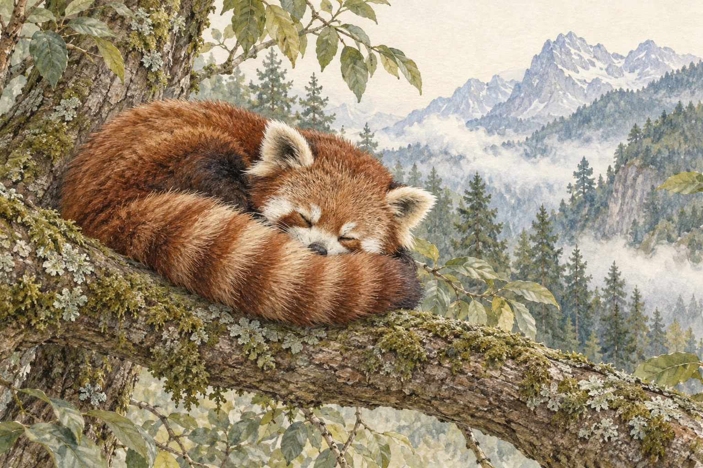

# 레서판다의 꼬리는 담요가 되기도 한다

*나뭇가지 위에서 발견하는 꼬리의 두 가지 쓰임*

Science · Biology

> 자료 대조를 마친 검토용 이야기입니다. 공개 게시 승인은 아직 받지 않았습니다.

*KnowledgeWalk 제작 · AI 설명용 삽화. 실제 유물·제품·연주 기구·동물의 생김새를 정확하게 재현한 자료나 실험 결과가 아닙니다.*

레서판다를 그려 보라고 하면 몸보다 꼬리를 먼저 떠올릴지도 모른다. 붉은 털 사이로 옅은 고리가 번갈아 이어지는, 길고 풍성한 꼬리다. 나뭇가지에 앉아 있으면 몸 뒤로 한참 늘어지기도 한다.

사진에서는 귀여운 무늬부터 보이지만, 그 꼬리에는 꽤 실용적인 쓰임도 있다. 스미스소니언 국립동물원은 레서판다의 꼬리가 균형을 잡고 추위와 바람을 견디는 데 도움을 준다고 소개한다.

## 가지 위에서는 균형을 잡는 일

레서판다는 나무를 잘 탄다. 나무는 몸을 숨기고, 포식자를 피하고, 겨울에 햇볕을 쬐는 장소이기도 하다. 땅 위에서만 사는 동물과는 다른 생활의 자리가 있다.

그 자리에서 길고 풍성한 꼬리는 균형을 유지하는 데 도움이 된다. 가지가 몸을 받쳐 준다고 해서 걷고 돌아서는 일이 저절로 쉬워지는 것은 아니다. 몸 뒤의 긴 부분도 나무 위 생활의 한몫을 맡는다.

나무를 내려오는 모습도 흥미롭다. 동물원은 유연한 발목 구조 덕분에 머리를 아래로 향한 채 나무줄기를 내려올 수 있다고 설명한다. 꼬리만 따로 떼어 보기보다 몸 전체의 움직임과 함께 보면 더 재미있다.

## 추운 날에는 몸 가까이에

레서판다가 사는 곳에는 히말라야를 비롯한 높은 산지의 숲이 포함된다. 그곳에서 풍성한 털은 보기 좋은 외투 이상의 의미를 갖는다.

몸에는 부드럽고 촘촘한 속털이 있고, 긴 꼬리는 심한 추위와 바람으로부터 몸을 보호하는 데 도움이 된다. 발바닥도 털로 덮여 있다. 화면에서는 작은 동물이지만, 추운 곳의 생활에 필요한 차림을 하고 있는 셈이다.

꼬리를 몸 가까이에 둔 모습을 보면 담요나 목도리가 떠오른다. 물론 사람이 짠 물건을 두른 것은 아니다. 따뜻한 물건에 빗대어 보면, 긴 털이 왜 생활에 쓸모가 있는지 조금 친숙하게 느껴진다.

## 무늬를 알아본 다음에 보이는 것

레서판다의 꼬리에는 붉은색과 옅은 색의 고리 무늬가 번갈아 나타난다. 그 무늬를 알아보는 즐거움과 꼬리의 쓰임을 아는 즐거움은 조금 다르다.

이름과 생김새를 맞힌 다음에도 구경은 계속된다. 가지 위에서 방향을 바꿀 때 꼬리가 어디에 있는지, 쉬는 동안에는 몸과 얼마나 가까운지 살펴볼 수 있다.

다음에 레서판다 사진을 본다면 얼굴만 확대하지 말고 꼬리까지 들어온 장면도 골라 보자. 작은 얼굴 뒤로 늘어진 긴 부분에, 나무를 타고 추위를 견디는 생활이 함께 달려 있다.

## 이야기의 바탕이 된 자료

- [Smithsonian National Zoo — Red panda](https://nationalzoo.si.edu/animals/red-panda) · 확인일 2026-10-27
  - 확인 내용: 긴 꼬리의 균형 유지와 추위·바람 보호 기능 / 고산 지역 숲의 서식 환경과 촘촘한 털 / 유연한 발목과 머리를 아래로 향한 나무 타기

---

[같은 소주제의 이야기](README.md) · [전체 서가](../../README.md)
