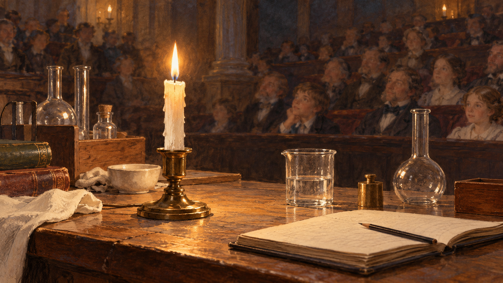

# 패러데이 — 촛불 하나로 어디까지 이야기할 수 있을까

*녹는 초와 올라가는 연료, 불꽃 뒤에 남는 물질을 따라*

Science · Chemistry

> 출처 대조와 공개 게시 승인을 마친 이야기입니다. 실제 게시 여부는 사이트 배포 상태를 따릅니다.

*AI 관련 장면 삽화 · 촛불 강연을 떠올리는 분위기이며 패러데이의 실제 얼굴·실험 장치·청중·특정 강연 현장을 복원하지 않았습니다.*

책상 위에 촛불 하나가 켜져 있다. 보기에는 단순하다. 심지 끝에서 불꽃이 흔들리고 초는 조금씩 짧아진다. 마이클 패러데이는 이 익숙한 물건을 가지고 여러 차례의 과학 강연을 이어 갔다.

『촛불의 화학적 역사』는 어린 청중을 위한 강연을 정리한 책이다. 시작은 작은 불꽃이지만 이야기는 공기와 물, 물질이 바뀌는 과정과 생명의 호흡까지 넓어진다. 특별한 물건보다 잘 고른 질문이 더 멀리 데려가는 사례다.

## 1. 왜 하필 촛불이었을까

강연에서 패러데이는 촛불에 자연의 법칙과 연결되는 많은 일이 담겨 있다고 말한다. 손에 잡히는 익숙한 물건이라 청중이 무엇을 보고 있는지 함께 알 수 있었다. 어려운 이름을 먼저 외우지 않아도 시작할 수 있었다.

물건이 단순하다는 것과 그 안의 과정이 단순하다는 것은 다르다. 촛불에는 고체와 액체, 기체의 변화가 있고 연료의 이동과 화학 반응이 있다. 하나를 이해하면 바로 옆에 다른 질문이 나타나도록 강연이 이어진다.

## 2. 불꽃 아래에는 작은 연못이 있다

불을 붙인 초의 심지 주변에는 녹은 연료가 모인다. 원래 단단했던 물질이 열을 받아 액체가 된 것이다. 바깥쪽의 초와 안쪽의 녹은 부분이 함께 있으니 연료가 잠시 머무를 자리가 생긴다.

초가 줄어드는 모습만 멀리서 보면 이런 중간 단계는 쉽게 지나친다. 패러데이의 시선은 끝의 불꽃에서 잠깐 아래로 내려온다. 연료가 어디에 있고 어떤 상태로 움직이는지부터 물어야 다음 과정을 설명할 수 있었다.

## 3. 심지는 연료가 올라가는 길이다

녹은 연료는 심지의 가느다란 틈을 따라 올라간다. 강연은 모세관 작용을 여러 친숙한 사례와 연결해 설명한다. 심지는 불꽃이 앉는 받침이면서 액체를 연소가 일어나는 쪽으로 보내는 길이기도 하다.

따라서 심지만 탄다고 생각하면 초의 연료가 어떻게 쓰이는지 놓친다. 그렇다고 심지가 전혀 타지 않는다는 뜻도 아니다. 보이는 물건 각각이 어떤 역할을 하는지 나누어 보아야 촛불의 지속적인 작동이 이해된다.

## 4. 고체인 초가 바로 타는 것은 아니다

불꽃 가까이 올라간 연료는 열을 받아 기체 상태가 되고 공기와 만나 반응한다. 눈에 보이는 고체에서 액체를 거쳐 기체로 이어지는 길이다. 손에 잡히는 초와 눈앞의 불꽃 사이에는 상태 변화가 들어 있다.

이 설명은 초가 신비하게 사라진다는 인상을 바꾼다. 연료가 자리와 상태를 바꾸며 반응하고 있었던 것이다. 덩어리가 줄어드는 현상과 반응한 물질의 행방을 함께 물을 수 있게 된다.

## 5. 불꽃의 노란빛에도 이유가 있다

패러데이는 불꽃을 하나의 균일한 덩어리처럼 보지 않았다. 부분마다 밝기와 상태가 다르다는 점에 주목했다. 촛불의 밝은 노란 영역에서는 뜨거워진 탄소 입자가 빛을 내는 과정이 중요하다.

이 설명을 모든 종류의 불꽃 색에 똑같이 적용할 수는 없다. 연료와 조건에 따라 빛이 생기는 방식과 색은 달라진다. 익숙한 촛불의 한 부분을 자세히 보는 일이 더 넓은 현상을 비교할 출발점이 되는 것이다.

## 6. 보이지 않는 공기도 참여한다

초에 연료가 있다고 혼자 계속 탈 수는 없다. 공기 중의 산소가 반응에 참여한다. 강연에서는 기체를 살피고 비교하는 과정을 통해 눈에 잡히지 않는 물질도 구별할 수 있음을 보여 준다.

공기는 빈 공간이라는 느낌이 들기 쉽다. 하지만 촛불을 이해하려면 그 안에 무엇이 있는지 물어야 한다. 손에 든 초만 보던 이야기가 방 안의 공기까지 넓어진다. 보이지 않는다는 이유로 과정에서 빠지는 것은 아니었다.

## 7. 불꽃 뒤에는 무엇이 남았을까

초가 타면 물과 이산화탄소 같은 생성물이 만들어진다. 패러데이는 강연에서 물의 존재와 당시 탄산 기체라고 부르던 이산화탄소의 성질을 살폈다. 불꽃은 빛과 열을 내면서 물질의 새로운 조합도 만든다.

연기가 별로 보이지 않는다고 아무것도 나오지 않는 것은 아니다. 불완전한 연소 등 조건에 따라 다른 물질도 생길 수 있다. 이 이야기는 촛불을 켠 공간의 공기가 언제나 안전하다는 보장이 아니라 연소의 물질적 행방을 이해하는 설명이다.

## 8. 촛불에서 호흡으로 이어진 강연

강연은 끝에 가서 공기와 탄소의 이동을 사람과 동물, 식물의 관계로 넓힌다. 촛불 하나를 관찰하다가 생활과 자연의 연결을 묻는 자리까지 간 것이다. 처음의 작은 물건이 긴 이야기의 중심을 계속 잡아 준다.

호흡과 촛불이 완전히 같은 반응 방식이라는 뜻은 아니다. 생명체의 과정에는 다른 조절과 단계가 있다. 다만 물질이 어디에서 와서 어디로 가는지라는 질문은 서로 다른 현상을 이어 생각하게 한다.

## 9. 쉬운 설명은 내용을 빼는 일일까

패러데이의 강연은 익숙한 대상을 고르고 한 가지 관찰에서 다음 질문을 꺼낸다. 어려운 단어를 모두 없애기보다 단어가 필요한 순간을 만들어 준다. 모세관이나 기체라는 말이 촛불을 이해하는 데 쓰이는 도구가 된다.

책을 읽으며 특별한 실험을 따라 할 필요는 없다. 불꽃 아래의 액체와 심지, 주변의 공기를 차례로 떠올려도 이야기의 연결이 보인다. 평범한 물건을 오래 바라보는 시간이 과학의 깊이로 이어질 수 있음을 보여 주는 강연이다.

## 이야기의 바탕이 된 자료

- [Michael Faraday, The Chemical History of a Candle — 촛불 강연 I~VI](https://raw.githubusercontent.com/GITenberg/The-Chemical-History-of-a-Candle_14474/master/14474-8.txt) · 확인일 2026-10-31
  - 확인 내용: 익숙한 촛불에서 시작한 청소년 강연·고체/액체/증기의 변화 / 심지와 모세관 작용·공기와 산소·밝은 탄소 입자 / 물과 당시 carbonic acid라고 부르던 이산화탄소·호흡과 자연의 연결. 현대 용어로 구별

---

[같은 소주제의 이야기](README.md) · [전체 서가](../../README.md)
