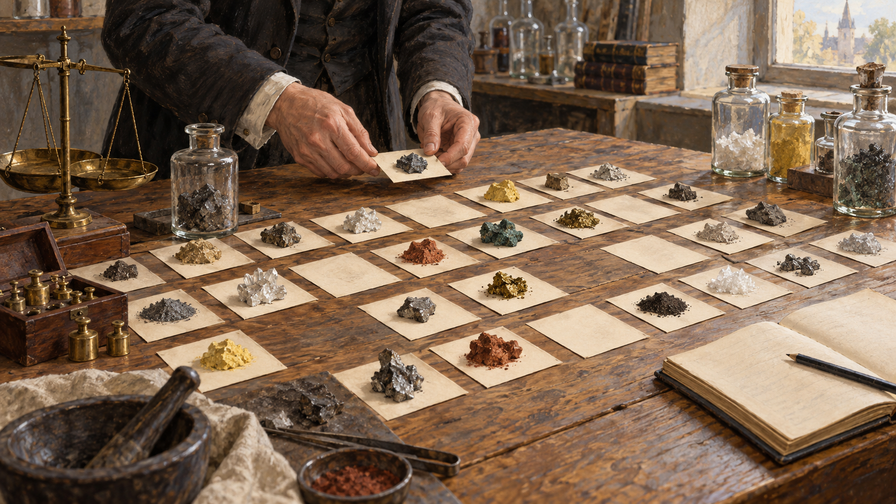

# 멘델레예프 — 표를 완성하려고 빈칸을 남기다

*1869년의 원소 배열과 아직 발견되지 않은 물질의 자리*

Science · Chemistry

> 출처 대조와 공개 게시 승인을 마친 이야기입니다. 실제 게시 여부는 사이트 배포 상태를 따릅니다.

*AI 관련 장면 삽화 · 멘델레예프의 실제 작업대·실험·원소표를 복원하지 않았습니다. 임의의 광물 같은 표본은 순수 원소의 실제 모습이나 모든 원소의 상태를 뜻하지 않습니다.*

표에 빈칸이 남으면 보통은 아직 정리를 끝내지 못했다고 생각한다. 그런데 빈칸이 오히려 새로운 물질의 존재를 예고한다면 어떨까. 멘델레예프의 원소 배열에서 흥미로운 부분은 채워진 자리만이 아니었다.

아직 아무도 분리해 확인하지 못한 원소가 어느 자리에 들어갈지, 그 물질은 어떤 성질을 보일지 예상하는 일. 익숙한 교실의 주기율표 뒤에는 눈앞의 자료를 정리하다가 보이지 않는 것을 묻게 된 이야기가 있다.

## 1. 원소가 늘자 닮은 점이 보였다

화학자들은 광석을 연구하고 물질을 분리하면서 여러 원소를 알아냈다. 원소의 이름을 하나씩 외우는 것과 원소 사이의 관계를 찾는 것은 다른 일이었다. 비슷한 성질이 반복해서 나타난다면 목록 이상의 질서가 있을 수 있었다.

리튬과 나트륨, 칼륨처럼 성질이 닮은 원소들이 있었다. 반면 다른 무리와는 반응하는 방식에서 차이가 났다. 모든 원소를 제각각의 물질로만 보기보다 비슷한 것끼리 비교하면 새로운 질문이 생긴다.

## 2. 무게의 순서와 성질의 순서

1869년 러시아의 드미트리 멘델레예프는 원소들을 배열한 표를 발표했다. 당시 원소를 비교하는 중요한 기준은 원자량이었다. 원자의 상대적인 무게를 따라 놓으면서 화학적 성질이 어떻게 반복되는지 살핀 것이다.

순서대로 적기만 하면 끝나는 작업은 아니었다. 어떤 원소를 같은 무리에 놓아야 자연스러운지 판단해야 했다. 숫자의 줄과 성질의 닮음이 서로 맞는지 묻는 일이었다. 표는 이미 아는 사실을 놓고 시험하는 도구였다.

## 3. 혼자만의 번뜩임은 아니었다

독일의 로타어 마이어도 원소의 성질과 배열 사이의 주기적인 관계를 독립적으로 연구해 표를 발표했다. 19세기 화학자들은 쌓여 가는 지식을 서로 다른 방식으로 정리하려 했다. 멘델레예프가 아무런 선행 작업 없이 질서를 발견한 것은 아니다.

그의 중요한 특징은 표의 자리를 아직 발견되지 않은 원소의 성질을 예상하는 데 사용했다는 점이다. 정리는 뒤돌아보는 일에 그치지 않았다. 지금의 질서가 맞는다면 앞으로 무엇을 발견해야 할지 물을 수 있었다.

## 4. 빈자리가 결함 대신 예측이 되다

성질이 반복되는 흐름을 따를 때 어떤 자리는 비어 있는 편이 더 잘 맞았다. 그 칸을 억지로 이미 아는 원소로 채우지 않는 선택이 필요했다. 아직 모르는 것이 존재할 수 있다는 판단이었다.

물론 빈칸을 남겼다는 사실만으로 새로운 원소가 생기지는 않는다. 어디에 무엇이 있을지 말하고 다른 연구자가 실제 물질을 찾아 확인해야 한다. 예측이 의미를 가지려면 틀렸는지도 확인할 수 있어야 했다.

## 5. 갈륨과 게르마늄이 들어왔다

1875년 갈륨, 1886년 게르마늄이 발견되었다. 이 원소들은 멘델레예프가 예상했던 자리와 성질을 검토할 중요한 근거가 되었다. 표의 질서는 이미 알려진 것을 보기 좋게 묶는 요령만은 아니라는 지지를 얻었다.

발견은 빈칸을 색칠하는 일처럼 간단하지 않았다. 새 물질의 성질을 측정하고 기존 예상과 비교하는 연구가 필요했다. 원소를 찾은 사람들의 실험과 정리한 사람의 예측이 만날 때 표의 힘도 더 분명해졌다.

## 6. 지금의 표는 그대로의 복제품이 아니다

현대의 주기율표는 원자량이 아니라 원자번호를 기준으로 배열한다. 원자번호는 원자핵 안의 양성자 수와 연결되는 값이다. 원자의 구조에 관한 지식이 발전하면서 배열을 설명하는 기준도 달라졌다.

따라서 오늘날 교실의 표를 1869년에 완성된 그림처럼 보면 안 된다. 기본적인 통찰이 중요했다고 해서 이후의 수정과 발견이 작아지는 것은 아니다. 오래 쓰이는 지식은 처음 모습 그대로 멈추어 있는 경우보다 다듬어지는 경우가 많다.

## 7. 외울 표에서 질문할 표로

주기율표를 암기할 때는 빈칸이 불편한 것처럼 느껴진다. 하지만 연구의 역사에서 빈자리는 질문을 만드는 장치였다. 여기에는 왜 없을까, 있다면 어떤 성질일까 하고 자료의 바깥을 바라보게 했다.

이것은 아무 근거 없이 상상으로 채우는 것과 다르다. 주변의 원소와 반복되는 관계가 예상의 범위를 제한했다. 좋은 표는 무엇이 알려져 있는지 보여 주면서 무엇을 아직 확인하지 못했는지도 드러낸다.

## 8. 닮은 성질을 찾는 일이 중요한 까닭

물건을 색깔이나 크기로 분류하는 방법은 많다. 원소에서도 단지 보이는 모습이 닮았다는 이유만으로 같은 자리를 줄 수는 없다. 다른 물질과 반응하는 방식과 만들어지는 화합물을 함께 비교할 필요가 있었다.

예를 들어 겉으로 반짝인다고 모든 금속이 같은 정도로 반응하는 것은 아니다. 반대로 서로 떨어져 발견된 물질도 비슷한 화학적 행동을 보일 수 있다. 정리의 기준을 잘 고르는 일이 자료의 양만큼 중요했던 셈이다.

그래서 원소표를 만든다는 것은 이름표를 정돈하는 작업을 넘어선다. 어떤 성질을 중요하게 볼지 정하고 그 기준이 다른 원소에도 통하는지 확인한다. 새로운 원소의 예측은 그런 비교가 바깥으로 뻗어 나간 결과였다.

## 9. 빈칸을 남겨 둘 용기

멘델레예프의 꿈에 완성된 표가 나타났다는 식의 일화보다 오래 남는 것은 비교와 예측의 방식이다. 자료가 모두 모일 때까지 기다리지 않으면서도 모르는 자리를 아는 것처럼 채우지 않았다.

표의 빈칸은 지식의 부족을 숨기는 장식이 아니었다. 나중의 발견이 들어와 맞는지 틀리는지 살필 자리였다. 빽빽하게 채운 페이지보다 조심스럽게 비워 둔 칸이 더 많은 것을 말해 줄 때가 있다는 사실이 이 이야기의 매력이다.

## 이야기의 바탕이 된 자료

- [OpenStax Chemistry — The Periodic Table](https://raw.githubusercontent.com/openstax/osbooks-chemistry-bundle/main/modules/m68695/index.cnxml) · 확인일 2026-10-31
  - 확인 내용: 원소의 성질과 원자량에 따른 배열·멘델레예프와 마이어의 독립 작업 / 미발견 원소 예측·갈륨 1875년과 게르마늄 1886년 / 현대의 원자번호 기준과 역사적 표의 차이

---

[같은 소주제의 이야기](README.md) · [전체 서가](../../README.md)
