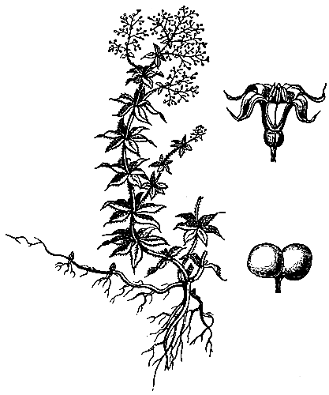

# 합성염료 — 석탄의 검은 부산물이 어떻게 산업의 색이 되었을까

*퍼킨의 모브에서 독일 화학 공업의 연구와 생산까지*

과학과 발견 · 물질과 에너지

> 출처 대조와 공개 게시 승인을 마친 이야기입니다. 실제 게시 여부는 사이트 배포 상태를 따릅니다.

*Raphael Meldola, Coal and What We Get from It, Fig. 11, The Madder Plant. 천연 염료의 재료이며 합성염료 견본이나 독일 공장 사진이 아닙니다.*

[이미지 출처·제작 근거](https://raw.githubusercontent.com/GITenberg/Coal-and-What-We-Get-from-It_33165/master/33165-h/images/fig11.png) · Public Domain

석탄을 가공하고 남은 검은 타르에서 선명한 옷감의 색을 얻는다는 생각은 쉽게 연결되지 않는다. 19세기의 합성염료 산업은 그 사이에 화학 지식과 실험, 분리와 정제의 기술을 놓았다. 영국의 발견에서 출발한 흐름은 독일의 연구와 산업에서도 크게 자랐다. 이 역사는 눈에 띄는 발명 한 번보다 발견을 반복해서 생산할 수 있는 환경의 중요성을 보여 준다.

## 01. 옷감의 색은 자연에서 얻는 재료에 기대었다

합성염료가 발달하기 전에도 사람들은 오래전부터 옷감을 물들였다. 식물과 동물에서 색을 얻고 그것을 섬유에 남게 하는 기술이 있었다. 꼭두서니의 붉은색처럼 염료 식물의 재배와 거래는 생활의 색을 공급하는 산업의 일부였다.

색을 얻는 재료에는 산지와 공급량, 가공 과정의 제약이 따랐다. 원하는 색을 일정한 품질로 얼마나 많이 만들 수 있는가는 장인의 감각만의 문제가 아니었다. 염료는 이미 농업과 무역, 제조를 연결하는 상품이었다.

## 02. 석탄 타르는 하나의 순수한 물질이 아니었다

석탄을 가공할 때 생기는 타르는 여러 성분이 섞인 물질이었다. 검은 액체를 그대로 천에 바르면 새로운 염료가 되는 것이 아니었다. 유용한 성분을 가려내고 그 성질을 알아야 다른 물질을 만드는 출발점으로 쓸 수 있었다.

분리와 정제는 그래서 부차적인 준비 작업이 아니었다. 실험 결과를 다시 얻으려면 무엇을 넣었는지가 일정해야 했다. 부산물을 화학 원료로 바꾸는 일에는 원료를 알아보는 지식과 다룰 수 있게 만드는 공정이 함께 필요했다.

타르의 여러 성분이 각기 다른 쓸모를 얻어 가는 과정은 폐기물과 자원이라는 구분도 고정되어 있지 않음을 보여 준다. 사용법을 모르는 혼합물과 성분을 분리해 다루는 원료는 같은 출발점에서 나온다. 가치가 생기려면 물질뿐 아니라 그것을 읽는 지식도 변해야 했다.

## 03. 1856년 퍼킨의 발견은 영국에서 나왔다

윌리엄 헨리 퍼킨은 1856년 보라색 합성염료 모브의 개발로 이어지는 발견을 했다. 그가 처음부터 완성된 색깔 산업의 설계도를 가지고 출발한 것은 아니었다. 기대와 다른 결과에서 쓸모를 알아보고 이를 제품으로 이어 가는 일이 중요했다.

이 사건을 독일에서 일어난 발명처럼 옮겨 적을 수는 없다. 다만 발견이 영국에서 나왔다는 사실만으로 이후 산업의 지리까지 설명되지는 않는다. 새로운 물질을 만드는 가능성이 열린 뒤에는 여러 연구자와 기업이 그 가능성을 넓혀 갔다.

퍼킨의 모브는 기존에 알려진 물질의 용도만 넓힌 사례와도 달랐다. 화학적 변환으로 새로운 염료를 얻는 일이 사업의 출발점이 되었다. 발견이 그 자체로 완제품은 아니었지만, 염료를 얻는 길이 더 넓어졌다는 점은 분명했다.

## 04. 독일에서는 연구와 생산이 서로를 밀었다

화학자 라파엘 멜돌라는 석탄 화학 산업의 전개를 설명하면서 독일에서 이론 연구와 제조가 긴밀히 연결된 점을 강조했다. 분자의 구조와 반응을 이해하려는 연구는 새로운 색을 찾는 데 도움이 되었다. 공장도 연구를 계속할 이유를 제공했다.

관계는 연구실에서 공장으로 향하는 한 방향만이 아니었다. 산업이 공급한 정제된 물질은 연구자가 비교 가능한 실험을 하는 데 쓰였다. 연구가 생산을 바꾸고 생산의 재료가 다시 연구의 범위를 넓히는 순환이 생겼다.

## 05. 같은 색을 되풀이하는 능력이 시장을 만들었다

작은 실험에서 색을 얻는 일과 많은 옷감에 일정한 색을 내는 일은 규모가 다르다. 반응이 가능하다는 지식에 원료 공급과 품질 관리가 더해져야 했다. 염료 제조는 이런 연결을 경제적 가치로 바꾸는 과정이었다.

성공한 한 병의 물질만 보면 공정의 반복을 떠받친 노동과 장비가 사라진다. 반대로 공장의 크기만 보면 새로운 물질을 찾는 지식이 보이지 않는다. 합성염료가 산업이 된 이유는 발견과 반복 생산이 서로 떨어져 있지 않았기 때문이다.

## 06. 꼭두서니의 색도 화학의 질문이 되었다

천연 염료는 합성염료가 등장했다고 곧바로 과학 밖의 옛 기술이 된 것이 아니었다. 어떤 성분이 색을 내는가를 분석하는 대상이 되었다. 꼭두서니의 색 성분인 알리자린을 화학적으로 이해하고 합성하는 발전은 자연 재료와 실험실 사이의 관계를 바꾸었다.

같은 색을 얻는 길이 재배에만 묶이지 않게 되면 원료의 생산자와 제조업자의 관계도 달라진다. 그렇다고 모든 천연 염료가 같은 시기에 사라졌다고 단정할 수는 없다. 새로운 생산 방식의 확산에는 색마다 다른 기술과 시장의 조건이 있었다.

멜돌라의 책은 이런 변화를 19세기 말 화학자의 시각으로 정리한 자료다. 산업의 진보를 높이 평가하는 당대 저자의 관점이 담겨 있다. 그 설명으로 연구와 생산의 연결을 살피되, 당시 공장 노동자의 모든 경험까지 대표한다고 읽을 수는 없다.

## 07. 산업의 색을 보면 지식의 기반이 보인다

검은 타르에서 선명한 염료가 나온다는 반전은 기억하기 쉽다. 그러나 그 반전을 오래 유지한 것은 신기한 우연만이 아니었다. 성분을 구분하는 지식, 실험을 이어 가는 인력, 결과를 제품으로 옮기는 조직이 함께 작동했다.

독일 화학 공업의 성장을 한 민족의 타고난 능력으로 설명할 이유는 없다. 어떤 지식을 지원하고 어디에서 연구와 제조가 만났는지를 살피는 편이 구체적이다. 옷감에 남은 색은 물질의 변화인 동시에 지식을 산업으로 연결한 방식의 흔적이었다.

## 이야기의 바탕이 된 자료

- [Raphael Meldola, Coal and What We Get from It (1891), coal-tar colours / anthracene and alizarin](https://raw.githubusercontent.com/GITenberg/Coal-and-What-We-Get-from-It_33165/master/33165-8.txt) · 확인일 2026-11-13
  - 확인 내용: 타르의 성분 분리·정제/1856퍼킨 모브/독일의 이론 연구와 제조의 상호관계/산업의 순수 재료가 연구를 지원/꼭두서니·알리자린. 저자의 퍼킨 특허 연도1858은 채택하지 않음. 영국 발명을 독일 발명으로 바꾸지 않음.

---

[같은 소주제의 이야기](README.md) · [전체 서가](../../README.md)
