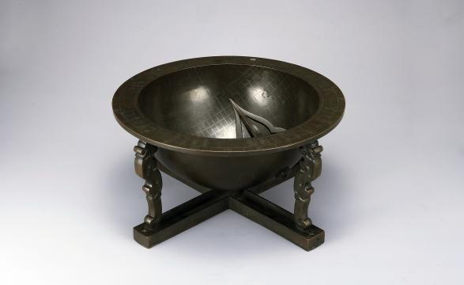

# 그릇처럼 생긴 해시계에는 두 종류의 선이 있다

*앙부일구 안에서 시간과 계절을 읽는 방법*

Science · Engineering

> 출처 대조와 공개 게시 승인을 마친 이야기입니다. 실제 게시 여부는 사이트 배포 상태를 따릅니다.

*앙부일구, 창덕12944 · 국립고궁박물관 소장·제공*

[이미지 출처·제작 근거](https://www.gogung.go.kr/gogung/pgm/psgudMng/view.do?menuNo=800065&psgudSn=360654) · 공공누리 제1유형(출처표시)

박물관에서 앙부일구를 보면 먼저 그릇 같다는 생각이 든다. 가운데에는 바늘처럼 생긴 물건이 비스듬히 서 있고, 안쪽에는 여러 줄이 새겨져 있다.

이름에도 그 모습이 들어 있다. 국립고궁박물관은 앙부일구를 솥 모양의 해시계라는 뜻으로 설명한다. 익숙한 디지털시계처럼 숫자가 차례로 바뀌지는 않는다. 대신 빛과 그림자가 표시를 움직인다.

그런데 안쪽의 선은 시간을 나누기 위한 것만은 아니다. 계절을 알려주는 선도 함께 있다.

## 바늘이 움직이는 대신 그림자가 움직인다

앙부일구는 해그림자를 받는 오목한 면과, 그림자를 만들어 내는 바늘로 이루어진다. 도구를 볼 때는 바늘만큼 그림자가 어디에 드리워지는지도 중요하다.

박물관 소장품 설명에서는 안쪽 면을 시반, 바늘을 영침이라고 부른다. 어려운 이름을 외우지 않아도 역할은 나누어 볼 수 있다. 하나는 그림자를 만들고, 다른 하나는 그 그림자를 읽는 자리다.

빛이 들어오는 조건에 따라 바늘의 그림자가 놓이는 위치가 달라진다. 안쪽에 새겨 둔 선들은 그 위치를 그냥 지나가는 모양이 아니라 정보로 읽을 수 있게 한다.

## 시간의 선, 계절의 선

소장품 설명에 따르면 시계 안에는 시각을 나누는 선과 절기를 나타내는 가로선이 있다. 같은 면 위에 두 종류의 기준을 겹쳐 둔 것이다.

계절에 따라 해그림자의 길이가 달라지므로, 동지와 하지의 그림자도 같은 자리에 놓이지 않는다. 박물관은 동지에는 가장 바깥쪽 계절선, 하지에는 가장 안쪽 계절선에 그림자가 위치한다고 설명한다.

그러니 바닥의 선을 모두 복잡한 장식으로 볼 필요는 없다. 어느 방향으로 시간을 읽고 어떤 선으로 계절을 살피는지 나누어 보면 조금 정리가 된다. 숫자와 곡선이 많은 이유가 있는 셈이다.

다만 사진 한 장만 보고 실제 시간을 정확하게 읽어 보려 할 필요는 없다. 놓인 방향과 빛의 조건이 맞아야 하는 도구다. 전시장에서 보는 모습과 실제로 시간을 재는 상황은 구분하는 편이 좋다.

## 사람들이 지나가는 곳의 시계

박물관은 앙부일구가 세종대에 처음 만들어져 서울의 혜정교와 종묘 남쪽 거리처럼 사람이 많이 다니는 곳에 설치되었다고 소개한다. 개인의 작은 물건이 아니라 길에서 시간을 만나는 방식도 있었던 것이다.

지금은 주머니의 화면만 열어도 시간을 확인할 수 있다. 그래서 하나의 시계를 여러 사람이 바라보는 풍경이 조금 낯설게 느껴질 수도 있다.

앙부일구를 다시 보면 그릇 같은 몸체 안에 그 풍경이 들어 있다. 해를 보고 바늘의 그림자를 찾고, 선을 따라 시간을 읽는 사람들이다.

다음에 이 해시계를 만나면 바늘과 곡선을 따로 한번 보아도 좋겠다. 복잡해 보이던 안쪽 면이, 시간과 계절을 함께 펼쳐 놓은 작은 지도처럼 보일 수 있다.

## 이야기의 바탕이 된 자료

- [국립고궁박물관 — 앙부일구(창덕12944)](https://www.gogung.go.kr/gogung/pgm/psgudMng/view.do?menuNo=800065&psgudSn=360654) · 확인일 2026-10-27
  - 확인 내용: 청동 반구형 시반과 북극을 향한 영침 / 시간선과 24절기를 나타내는 13개 계절선 / 동지선과 하지선의 위치 / 세종대 첫 제작과 혜정교·종묘 남쪽 거리 설치

---

[같은 소주제의 이야기](README.md) · [전체 서가](../../README.md)
