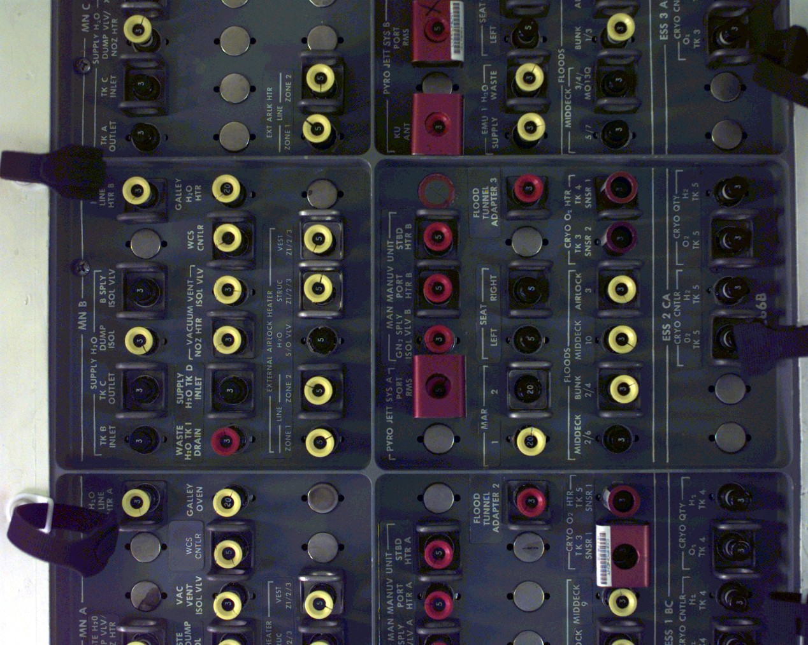

# 우주선 안에도 작은 이름표가 가득하다

*디스커버리호 패널을 가까이 보기*

Science · Engineering

> 출처 대조와 공개 게시 승인을 마친 이야기입니다. 실제 게시 여부는 사이트 배포 상태를 따릅니다.

*NASA / NASA 3D Resources · 실제 공개 사진. 사진 전체를 유지하고 웹 표시 크기로 줄였습니다.*

[이미지 출처·제작 근거](https://github.com/nasa/NASA-3D-Resources) · NASA 공식 저장소에서 free and without copyright로 안내한 공개 자료

우주선 내부를 상상하면 거대한 화면이나 멋진 조종석부터 떠오른다. 그런데 NASA가 공개한 디스커버리호 비행 갑판 패널 사진을 가까이 보면, 둥근 부분들이 줄지어 있고 그 곁에는 작은 글자와 표시가 붙어 있다.

전체 우주선을 보여 주는 풍경이 아니다. 좁은 한 부분을 모형 제작 등에 쓸 수 있도록 공개한 실제 패널 자료다. 넓은 우주보다 먼저 손이 닿을 만한 거리의 물건을 보게 된다.

## 1. 비슷한 모양은 구분이 필요하다

사진 속에는 서로 닮은 둥근 부분이 반복된다. 몇몇 부분에는 노란 테두리가 있고, 주변에는 어두운 색과 붉은색이 함께 쓰였다. 멀리서 보면 복잡한 무늬 같지만 가까이에서는 작은 차이들이 눈에 들어온다.

우리의 책상에서도 비슷한 일이 생긴다. 케이블이나 서랍, 열쇠가 여러 개면 이름표나 색깔로 구별한다. 우주선의 정확한 작업 절차를 모르더라도, 비슷한 것들을 헷갈리지 않게 표시하는 필요는 이해할 수 있다.

## 2. 모르는 기능을 상상으로 채우지 않기

이 사진에서 각각이 무슨 기능을 하는지까지 모두 읽어 내지는 않는다. 둥글다고 전부 같은 스위치라고 부르거나 색깔마다 특정 기능이 있다고 정하면 실제 자료를 넘어선 설명이 된다.

대신 같은 모양이 반복되는 방식과 그 옆의 표시를 차례로 살펴보자. 복잡한 기계의 표면을 그냥 복잡하다고만 느끼는 것과, 어떤 구분이 마련되어 있는지 보는 것은 조금 다른 경험이다.

## 3. 사람은 기계의 표면에서 필요한 것을 찾는다

복잡한 장비가 있어도 사용자가 필요한 부분을 구별하기 어려우면 작업은 더 까다로워질 수 있다. 패널의 표시를 보는 일은 그런 사람과 장치의 관계를 생각하게 한다. 모양이 반복되는 가운데 작은 이름과 색의 차이가 있다. 멀리서 하나의 복잡한 면처럼 보이는 것도 가까이에서는 나누어 읽을 자리가 생긴다.

이것은 사진 속 각 부품의 실제 사용 절차를 확인한 말은 아니다. 어느 것이 버튼이고 어느 것이 연결구인지, 특정한 색이 무슨 뜻인지는 별도 기술 자료가 필요한 문제다. 여기서는 직접 보이는 배열과 표기라는 사실에서 출발한다. 모르는 부분을 전부 하나의 스위치라고 부르지 않으면 관찰도 더 정확해진다.

## 4. 반복과 차이가 한 표면에 놓인다

같은 모양이 반복되면 규칙을 찾기 쉽지만 서로 헷갈릴 수도 있다. 그 옆에 글자와 색, 위치의 차이를 놓으면 어느 항목인지 더 세분해서 볼 수 있다. 실제로 이 패널이 어떤 설계 기준을 따르는지 단정하지 않더라도, 비슷한 부품을 구별하는 정보가 왜 필요할지는 이해할 수 있다.

우리 책상의 케이블이나 정리함을 비교한 것은 이 필요를 가까이 느끼게 하는 비유다. 우주선의 작업이 집의 정리와 같은 위험도나 절차를 가진다는 뜻은 아니다. 익숙한 예에서 구분의 필요를 떠올린 뒤 실제 사진의 범위로 돌아오는 것이 좋다. 비유가 기술의 정확한 내용을 대신하지 않도록 하는 것이다.

## 5. 사진의 이름도 기계의 표지와 다르다

NASA 자료명과 사진 번호는 이미지 자체를 찾게 해 주는 기록이다. 패널 위의 작은 글은 사진 안에 찍힌 물건의 표기다. 화면에는 함께 보이지만 서로 다른 대상을 식별한다. 자료의 이름을 읽는 일과 패널의 기능을 해석하는 일은 구분되어야 한다. 하나를 안다고 다른 하나의 답이 자동으로 나오는 것은 아니다.

Discovery Flight Deck Panels라는 이름은 어떤 맥락에서 사진을 만나야 하는지 알려 준다. 그러나 그 말만으로 개별 부품의 기능과 상태를 모두 알 수는 없다. 이 글에서는 실제 이미지에 나타난 원형 부분과 테두리, 표기를 관찰한다. 아는 것과 아직 기술 문서가 필요한 것을 나누어 두면 사진이 더 좋은 질문의 출발점이 된다.

## 6. 거대한 탐사도 작은 확인을 필요로 한다

우주선은 거대한 동체와 발사의 불꽃으로 기억되기 쉽다. 실내의 패널은 그 장비를 사람들이 어떻게 읽고 다루는지라는 다른 크기의 이야기를 보여 준다. 기계를 만드는 일에는 강한 추진력뿐 아니라 필요한 것을 구별하게 하는 표면도 포함된다. 장치의 능력과 사용자의 행동은 떨어져 있지 않다.

다음에 사진을 볼 때에는 전체의 복잡함을 한 번 보고 작은 표기를 하나 찾아보자. 무슨 기능인지 즉시 알아맞히기보다 어떤 구분이 눈에 보이는지 살피면 된다. 작동법을 배우지 않아도 설계가 사람에게 말을 건네는 자리를 볼 수 있다. 우주선 안의 작은 이름표들은 먼 탐사를 익숙한 읽기의 문제와 연결해 준다.

## 7. 거대한 기술과 손 가까운 정보

이 글에는 패널을 새로 상상한 삽화 대신 NASA가 제공한 실제 사진을 넣었다. 구체적인 사물이 중심일 때 원래 자료가 보여 주는 작은 차이들이 중요하기 때문이다.

탐사 이야기는 종종 큰 숫자와 먼 거리로 기억된다. 그러나 장치를 사용하는 사람에게는 가까이 놓인 표시 하나도 작업의 일부였을 것이다. 이 패널 사진은 거대한 우주선에도 작게 읽어야 할 정보가 있다는 사실을 조용히 보여 준다.

## 이야기의 바탕이 된 자료

- [NASA — Discovery Flight Deck Panels s103e0163](https://raw.githubusercontent.com/nasa/NASA-3D-Resources/master/Images%20and%20Textures/Discovery%20Flight%20Deck%20Panels/Discovery%20Flight%20Deck%20Panels%20s103e0163.jpg) · 확인일 2026-10-28
  - 확인 내용: NASA가 Discovery Flight Deck Panels s103e0163 이름으로 제공한 실제 사진 / 실제 이미지의 반복되는 원형 부분·색 테두리·작은 표기
- [NASA 3D Resources — 공개 자료 이용 안내](https://raw.githubusercontent.com/nasa/NASA-3D-Resources/master/README.md) · 확인일 2026-10-28
  - 확인 내용: NASA의 공개 이미지·텍스처 자료 제공과 이용 안내

---

[같은 소주제의 이야기](README.md) · [전체 서가](../../README.md)
