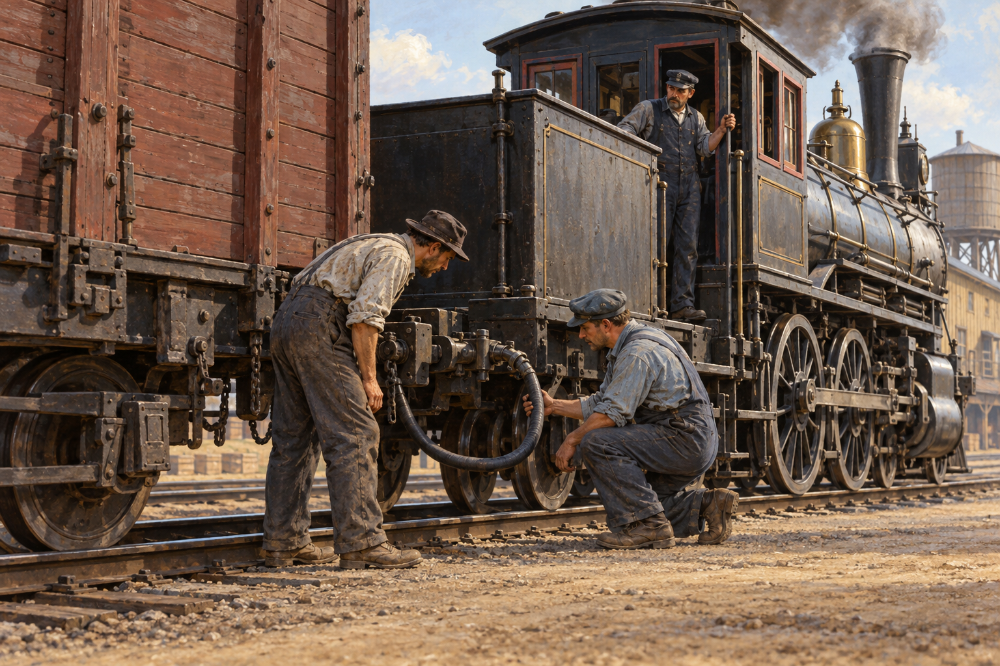

# 철도를 바꾼 것은 달리는 힘만이 아니었다

*차량 사이를 건너던 제동수에서 연결된 브레이크까지*

Science · Engineering

> 자료 대조를 마친 검토용 이야기입니다. 공개 게시 승인은 아직 받지 않았습니다.

*AI 이야기 장면 삽화 · 정차 중인 차량의 점검을 떠올린 그림입니다. 실제 제동 장치의 정확한 연결 방식이나 운전·정비 지침을 제공하는 도해가 아닙니다.*

기차의 발명이라고 하면 먼저 힘센 증기기관차를 떠올린다. 하지만 더 빨리 달릴 수 있다는 것은 더 잘 멈출 수 있어야 한다는 뜻이기도 하다. 무거운 객차와 화차가 길게 이어진 뒤에는 기관차 한 대의 능력만으로 풀기 어려운 문제가 생긴다.

초기의 철도에서는 제동수가 차량 사이를 이동하며 브레이크를 다루기도 했다. 발전의 역사를 기술자의 이름으로만 읽으면 그 위험한 일은 잘 보이지 않는다. 오픈스택스와 옛 기술 해설서 『어떻게 작동하는가』를 함께 읽으며 멈추는 기술의 변화를 살펴보자.

## 01. 기관차를 멈추면 뒤의 차도 멈출까

기차는 한 덩어리처럼 보이지만 여러 차량이 연결되어 있다. 기관차의 추진을 줄였다고 뒤에 이어진 모든 차의 움직임이 곧바로 사라지지는 않는다. 긴 열차 전체의 무게와 속도를 다루어야 한다. 앞에서 힘을 내는 문제와 각 차량에서 움직임을 줄이는 문제는 다르다.

브레이크는 바퀴의 움직임을 줄이는 힘을 만들어야 하고, 그 힘이 필요한 차량들에 맞추어 전달되어야 한다. 기관사에게 멈추라는 의사가 있어도 뒤에서 그 의사가 작동하지 않으면 부족하다. 열차가 길어질수록 제동은 장치 하나보다 신호와 힘을 함께 전달하는 체계의 문제가 된다.

## 02. 사람이 전달하던 멈춤

오픈스택스는 철도 노동자들이 달리는 차량 사이를 건너며 수동 제동을 해야 했던 위험을 설명한다. 겨울이나 비 오는 날을 특별히 상상하지 않더라도 움직이는 높은 곳에서 일한다는 사실 자체가 부담이다. 빠른 운송이 가능해진 만큼 누군가는 그 속도 가까이에서 위험을 감당했다.

모든 시대와 지역에서 정확히 같은 방식으로 일했다는 뜻은 아니다. 『어떻게 작동하는가』도 기관차와 차장 차량의 브레이크, 여러 시도의 차이를 설명한다. 중요한 것은 어느 한 나라의 장면을 전체 철도의 풍경으로 확대하기보다, 사람의 이동과 개별 조작에 크게 기대던 문제를 이해하는 것이다.

## 03. 쇠사슬로 한꺼번에 당기면 어떨까

옛 해설서에는 열차를 따라 긴 쇠사슬을 두고 각 차량의 장치와 연결하는 시도가 나온다. 한곳에서 당기면 여러 브레이크를 움직이게 하려는 생각이다. 하지만 연결의 길이와 힘이 균일하지 않으면 어느 부분만 먼저 작동할 수 있다. 주된 사슬이 끊어지는 경우도 문제였다.

이런 실패는 옛 기술자가 단순해서 생긴 웃을 일만은 아니다. 해결해야 할 조건을 하나씩 드러낸다. 모든 차에 힘을 보낼 것, 필요한 만큼 조절할 것, 연결에 문제가 생겼을 때도 안전을 생각할 것. 멈추는 기술은 이런 요구를 함께 만족시키는 방향으로 바뀌었다.

## 04. 증기도 생각처럼 움직이지 않았다

증기로 각 차량의 브레이크를 작동시키려는 시도도 있었다. 기관차에서 사용할 수 있는 힘을 뒤로 보내면 될 것 같지만, 긴 관을 지나는 동안 증기가 식어 물이 되는 일이 생긴다. 추운 환경과 열차 뒤쪽의 조건은 앞쪽과 다르다.

이것은 큰 기계를 작게 여러 번 붙이면 된다는 생각의 한계다. 힘이 출발한 장소에서 작동한 원리가 긴 거리의 끝에서도 똑같이 유지되는지 확인해야 한다. 열차의 길이는 단지 더 많은 승객을 싣는 규모가 아니라, 힘을 전달하는 환경을 바꾸는 조건이었다.

## 05. 공기를 이용해 차량들을 연결한다

이후 중요한 방향은 공기의 압력 차이를 이용하는 것이었다. 압축 공기를 쓰는 계통과 진공을 이용하는 계통은 구체적인 방식이 다르지만, 관으로 이어진 상태를 이용해 여러 차량의 제동을 다룬다는 생각을 공유한다. 보이지 않는 공기가 열차 전체를 연결하는 매개가 된다.

오픈스택스는 조지 웨스팅하우스의 공기 브레이크를 1869년의 변화로 소개한다. 다만 초기 장치와 뒤에 발전한 자동 제동을 한 번의 동일한 발명으로 섞지는 말아야 한다. 안정적인 체계는 개선을 거치며 만들어졌다. 지금의 모든 철도차량이 옛 책과 같은 장치로 움직인다는 뜻도 아니다.

## 06. 연결이 끊겼을 때를 생각하기

옛 해설서가 강조하는 자동 브레이크의 중요한 조건은 열차가 나뉘는 사고에서도 제동이 이루어지도록 하는 것이다. 연결이 정상일 때에만 힘이 전달된다면, 가장 필요한 순간에 체계가 사라질 수 있다. 평소의 성공보다 고장났을 때의 행동을 설계의 중심에 놓는다.

이 원리는 좋은 기술을 바라보는 눈을 넓혀 준다. 장치가 얼마나 강하게 작동하는지뿐 아니라, 정보와 에너지를 잃었을 때 어느 쪽 상태로 가는지도 중요하다. 여기서는 구체적인 조작이나 정비법을 설명하는 것이 아니라 기술자들이 풀어야 했던 질문의 방향을 읽는 것이다.

## 07. 안전해져서 더 빨라질 수 있었다

더 나은 제동은 사고의 위험을 줄이는 일인 동시에 철도의 운행 가능성을 넓히는 일이었다. 일정한 거리 안에서 속도를 관리할 수 있어야 시간표와 운송량도 계획할 수 있다. 빠른 기관차와 좋은 브레이크는 서로 반대편의 발명이 아니라 같은 교통 체계를 만드는 동료였다.

물론 장치가 생겼다고 점검과 숙련, 운행 규칙이 필요 없어지지는 않는다. 기술은 사람의 역할을 다른 자리로 옮기기도 한다. 차량 위를 위험하게 이동하던 일을 줄이는 대신, 연결과 압력, 장치의 상태를 살피는 일이 더 중요해진다. 자동이라는 말은 아무도 돌보지 않아도 된다는 뜻이 아니다.

## 08. 달리는 장면 뒤의 멈추는 사람들

철도 사진에서 연기와 바퀴는 쉽게 눈에 띈다. 관과 연결 장치, 제동을 위해 움직이던 노동자는 그보다 덜 보인다. 하지만 목적지에 도착한다는 일에는 안전하게 멈춘다는 마지막 동작이 포함된다. 교통의 역사는 출발의 감탄만으로 완성되지 않는다.

다음에 열차가 천천히 승강장으로 들어오는 모습을 보면 그 매끄러운 감속도 잠깐 바라보자. 그 평범해 보이는 순간에는 개별 차량과 긴 편성을 함께 다루려 했던 여러 실패가 들어 있다. 철도를 바꾼 것은 달리는 힘뿐 아니라 그 힘을 다루며 사람을 내려 줄 수 있게 한 기술이었다.

## 이야기의 바탕이 된 자료

- [OpenStax, World History Volume 2 — The Second Industrial Revolution](https://raw.githubusercontent.com/openstax/osbooks-world-history/main/modules/m00068/index.cnxml) · 확인일 2026-11-01
  - 확인 내용: 1869년 웨스팅하우스의 공기 브레이크·이전 차량 사이 이동/수동 제동 / 1870년대 스위프트의 사업과 관련된 냉장 화차 개선·산업과 운송 / 1867자치령/1871BC 합류와 약속/1885완공·유럽계와 중국계 노동·메티스/리엘의 권리 요구
- [Archibald Williams, How It Works — Chapter X: Railway Brakes](https://raw.githubusercontent.com/GITenberg/How-it-Works--13-Dealing-in-simple-language-with-steam-electricity-light-heat-sound-hydraulic__28553/master/28553-8.txt) · 확인일 2026-11-01
  - 확인 내용: 수동/쇠사슬/증기 제동의 한계·응결/긴 편성의 조건 / 진공 자동/Westinghouse 자동의 구별·열차 분리 때의 자동 적용·제동력 조절. 역사적 원리를 읽으며 조작/정비 지침으로 쓰지 않음

---

[같은 소주제의 이야기](README.md) · [전체 서가](../../README.md)
