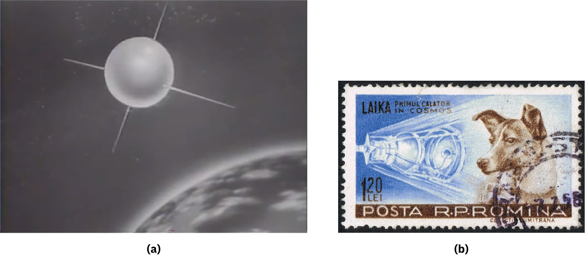

# 스푸트니크 — 작은 위성이 왜 거대한 충격이 되었을까

*1957년 소련의 인공위성과 과학 성과를 둘러싼 냉전의 경쟁*

과학과 발견 · 우주와 천문

> 출처 대조와 공개 게시 승인을 마친 이야기입니다. 실제 게시 여부는 사이트 배포 상태를 따릅니다.

*Universal Newsreel, First report of Sputnik 및 Romanian postage stamp, Wikimedia Commons · OpenStax 수록. 위성의 상상도와 기념 우표를 묶은 자료이며 우주 현장 촬영 사진이 아닙니다.*

[이미지 출처·제작 근거](https://raw.githubusercontent.com/openstax/osbooks-world-history/main/media/OSX_WorldHist_B14_01_Sputnik.jpg) · Public Domain

1957년 소련이 스푸트니크를 발사했을 때 충격은 지구 둘레를 도는 물체의 크기보다 컸다. 인류가 인공위성을 궤도에 올렸다는 과학적·기술적 사건이면서 냉전의 경쟁에서 누가 앞서 있는지를 보여 주는 상징이 되었기 때문이다. 위성 하나가 어떻게 국가의 자신감과 우주 개발의 제도를 움직였는지 살펴보면 기술 성과가 사회 안에서 해석되는 과정을 볼 수 있다.

## 01. 냉전의 경쟁은 군사 분야에만 있지 않았다

미국과 소련은 서로 다른 체제가 더 나은 삶과 미래를 만들 수 있다고 주장했다. 경제와 생활 기술의 성과도 그 주장을 보여 주는 재료가 되었다. 과학적 발전은 연구자만의 관심사로 남지 않았다.

1959년 모스크바 전시회에서 미국의 닉슨과 소련의 흐루쇼프가 주방 기술을 두고 논쟁한 일도 이런 분위기를 보여 준다. 가정의 편의 시설조차 체제의 능력을 말하는 증거로 제시되었다. 우주는 그보다 더 눈에 띄는 경쟁의 무대였다.

## 02. 1957년에는 처음이라는 사실이 중요했다

소련은 스푸트니크로 세계 최초의 인공위성을 우주에 올렸다. 사람이 만든 물체가 지구 둘레를 도는 성과는 새로운 가능성을 보여 주었다. 발사에 성공했다는 사실은 말이나 계획으로 대신할 수 없는 실증이었다.

그러나 이 사건을 사람이 달에 착륙한 것과 혼동해서는 안 된다. 위성 발사와 유인 우주비행, 다른 천체에 도착하는 임무는 각각 다른 과제다. 이후의 큰 성과를 알고 있더라도 당시 무엇이 새로 이루어졌는지를 구분해야 한다.

처음의 성과를 크게 기억할수록 참여한 여러 사람과 조직은 하나의 국가 이름 뒤로 숨기 쉽다. 발사는 한 명의 과학자가 순간적으로 이룬 발견과 다르다. 설계와 제작, 운용과 검증이 이어져야 가능한 공학적 결과였다.

## 03. 미국이 받은 충격에는 체제의 비교가 있었다

미국에서는 소련이 먼저 위성을 발사했다는 사실이 자존심에 타격이 되었다. 기술의 성능만이 아니라 세계가 어느 체제를 앞선 것으로 볼 것인가가 걸려 있었다. 성공의 상징적 가치가 실제 임무의 범위를 넘어 커졌다.

그렇다고 한 번의 발사로 과학의 모든 분야에서 한 국가가 다른 국가보다 우월해졌다고 말할 수는 없다. 특정 목표의 성공과 연구 역량 전체에 대한 평가는 다르다. 냉전의 경쟁은 그 차이를 종종 단순한 승패로 압축했다.

## 04. 대응은 연구를 맡을 조직의 변화로 이어졌다

1958년 아이젠하워 대통령은 우주를 탐사할 기구의 설립을 의회에 요구했고 그해 NASA가 만들어졌다. 스푸트니크의 성공에 대한 미국의 대응은 다음 발사 계획 하나를 세우는 데서 멈추지 않았다.

우주 개발을 지속하려면 자원과 인력, 여러 임무를 조정하는 조직이 필요했다. 기념할 만한 발사 순간 뒤에는 오랫동안 이어질 연구와 제도의 선택이 있었다. 국가 간 경쟁은 그런 선택을 빠르게 추진할 정치적 이유를 제공했다.

NASA의 설립을 모든 미국 우주 연구가 그때 처음 시작되었다는 뜻으로 읽을 수는 없다. 새 조직은 기존의 역량과 이후 임무를 이어 갈 제도적 틀이었다. 기관을 만든 연도와 그 아래에 축적된 연구의 시작은 구분해야 한다.

## 05. 다음의 성과는 또 다른 과제를 드러냈다

소련은 이어 스푸트니크 2호에 개 라이카를 태워 보냈다. 인공 물체의 비행과 생명체를 우주로 보내는 일은 다른 문제였다. 성공의 기록을 읽을 때 생명체를 대상으로 한 실험의 의미도 함께 생각할 필요가 있다.

1961년에는 소련이 최초의 우주비행사를 보냈고 1969년 미국은 최초로 사람을 달 표면에 착륙시켰다. 이 흐름을 처음부터 정해진 시간표처럼 볼 수는 없다. 각 성과는 앞선 경험과 새로운 과제 위에서 만들어졌다.

## 06. 위성의 그림도 목적을 구별해 보아야 한다

당시 보도와 기념 우표는 우주 개발의 성과를 널리 전달했다. 위성의 형태를 보여 주는 상상도와 개를 그린 우표는 실제 우주에서 촬영한 사진과 다르다. 이미지의 종류를 알아야 무엇을 보여 주는 자료인지 판단할 수 있다.

그런 표현은 기술의 대중적 인지도를 높였지만 위험과 노동, 실패의 과정을 모두 담지는 못했다. 매끈한 성공의 상징과 긴 개발 과정 사이에는 차이가 있었다. 우주 개발은 실험의 역사인 동시에 성과를 보여 주는 역사이기도 했다.

라이카를 기념한 우표가 소련 밖의 루마니아에서 만들어졌다는 점도 성과가 퍼진 범위를 보여 준다. 우주 경쟁의 이미지는 발사한 국가 안에서만 소비되지 않았다. 다른 국가도 그 성과를 자신이 표현하는 미래와 연결할 수 있었다.

## 07. 첫 위성의 의미는 작동의 성공보다 넓었다

스푸트니크는 소련의 성과였지만 오늘날의 러시아만이 당시 소련의 모든 역사를 대표하는 것은 아니다. 이 글의 국가 분류는 현재의 탐색을 위한 것이며 당시의 정치적 주체는 소련이었다. 국가 이름을 단순히 바꾸어 읽으면 참여한 공간과 사람의 범위가 좁아진다.

1957년의 위성은 새로운 기술이 국제정치의 언어가 되는 순간을 보여 준다. 무엇을 해냈는지와 그 성공을 사람들이 무엇의 증거로 읽었는지는 구분할 수 있다. 작은 위성이 남긴 큰 흔적은 그 두 층위가 만난 결과였다.

## 이야기의 바탕이 된 자료

- [OpenStax, World History Volume 2 — The Cold War Begins](https://raw.githubusercontent.com/openstax/osbooks-world-history/main/modules/m00034/index.cnxml) · 확인일 2026-11-13
  - 확인 내용: 냉전의 생활기술·1959주방논쟁/1957스푸트니크·미국충격/1958NASA/스푸트니크2라이카/1961첫우주비행사1969달착륙/보도상상도·우표. 과학 전체의 국가별 우열이나 군사적 자동인과를 주장하지 않음. 당시주체는 소련,현재탐색은러시아로 구별.

---

[같은 소주제의 이야기](README.md) · [전체 서가](../../README.md)
