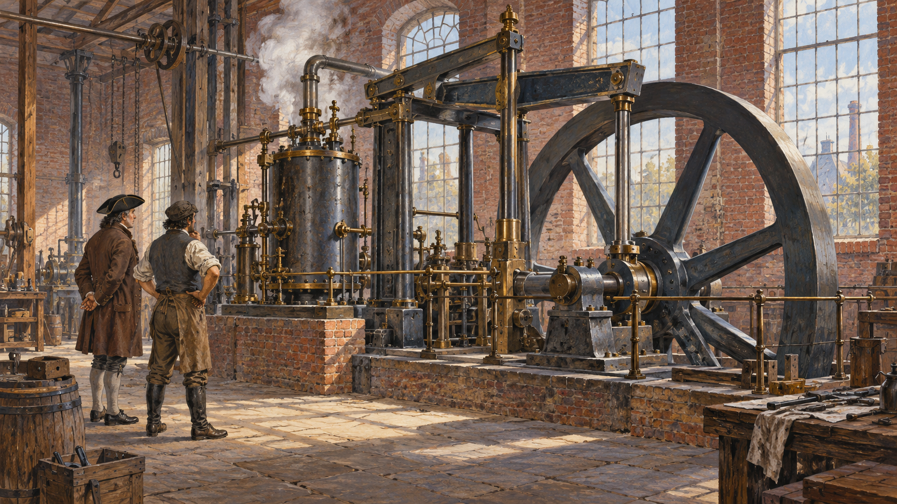

# 증기기관 — 광산의 물이 공장의 힘으로 이어지기까지

*기계의 개선과 일하는 장소가 바뀐 역사*

Science · Engineering

> 자료 대조를 마친 검토용 이야기입니다. 공개 게시 승인은 아직 받지 않았습니다.

*AI 관련 장면 삽화 · 초기 산업화 시대 증기기관 작업장을 떠올리는 상상 장면. 실제 인물의 초상·현장·문서·장치의 정확한 복원 자료가 아닙니다.*

광산의 물을 퍼내는 일과 공장에서 기계를 움직이는 일은 달라 보인다. 그러나 증기를 이용하는 장치의 역사는 이 두 장소를 이어 준다. 지하의 물을 다루던 필요가 더 넓은 산업의 힘으로 바뀌는 과정이 있었다.

제임스 와트의 이름은 유명하지만 그가 증기기관의 모든 것을 처음 만든 것은 아니었다. 앞선 장치와 현장의 문제, 기계를 만들고 사용할 사람이 있었다. 발명가 한 명의 영감보다 긴 길을 따라가면 증기기관이 왜 생활의 공간까지 바꾸었는지 보인다.

## 1. 먼저 풀어야 할 문제는 물이었다

교재는 17세기 말 토머스 세이버리의 장치가 광산의 물을 퍼내는 일과 산업용 물의 공급에 사용되었다고 설명한다. 광산을 더 깊이 이용하려면 그 안에 모이는 물은 실제 장애였다. 에너지의 역사는 이런 구체적인 현장의 필요에서 출발하기도 한다.

처음부터 모든 기계를 돌릴 수 있는 완성된 범용 장치가 준비되어 있었던 것은 아니다. 증기를 이용하는 여러 형태와 개선이 이어졌다. 무엇을 할 수 있었는지뿐 아니라 어떤 한계 때문에 다른 방법이 필요했는지를 함께 읽어야 기술의 변화가 보인다.

## 2. 열을 움직임으로 바꾸는 장치

물을 가열해 얻은 증기의 성질을 이용하면 기계적 운동을 만들 수 있다. 교재는 증기의 팽창과 피스톤의 운동을 현대의 기본 작동 설명으로 제시한다. 다만 역사 속 모든 증기 장치가 처음부터 똑같은 구조를 가졌던 것은 아니다.

여기서는 각 부품의 설계를 외우기보다 열에서 기계의 움직임을 얻는 길이 생겼다는 점에 주목하자. 어떤 연료를 마련하고 어디에 장치를 설치할지에 따라 사용할 수 있는 장소와 작업도 달라진다. 기계는 발명된 뒤에도 현장의 조건과 계속 관계를 맺었다.

## 3. 와트의 개선이 산업 현장으로 들어가다

18세기에는 증기기관을 더 유용하게 만들기 위한 개선이 이어졌다. 교재는 1776년 무렵 영국 공장들이 와트가 개선한 기관으로 일부 작업을 움직이고 있었다고 설명한다. 새 장치의 가치는 이름만이 아니라 실제 작업에서 어떤 도움을 주는지와 연결되었다.

개선한다는 것은 앞선 사람의 일을 지우는 것과 다르다. 이미 존재하던 기술의 문제를 다시 살피고 다른 구조와 제작 방식으로 풀어 가는 일이었다. 와트의 공로를 이해하는 데도 처음이라는 단어 하나보다 어떤 변화가 쓰임을 넓혔는지라는 질문이 더 도움이 된다.

## 4. 집에서 하던 일이 공장으로 모이다

교재는 산업화 이전과 그 과정에서 농촌 가정이 원료를 받아 실과 천 같은 물건을 만들던 가내 노동을 설명한다. 시간이 흐르며 사업가들은 노동자를 한곳에 모으고 기계와 관리자를 함께 두는 공장 방식을 확대했다.

공장에 사람이 모이는 변화와 증기기관의 보급은 서로 연결되지만 같은 사건은 아니다. 감독과 생산 조직, 자금과 시장도 중요했다. 기계 하나가 모든 공장을 자동으로 만든 것처럼 설명하기보다, 다른 변화들이 만나 새로운 작업장을 만들었다고 보는 편이 정확하다.

## 5. 물건을 만드는 힘이 옮기는 힘이 되다

증기의 활용은 공장에만 머물지 않았다. 배와 기관차에도 쓰이면서 원료와 완성품을 이동시키는 방식에 영향을 주었다. 교재는 19세기 초 증기선과 철도 운송이 발전한 과정을 함께 소개한다. 생산과 운송이 서로의 조건을 바꾸는 흐름이었다.

더 많은 물건을 만들 수 있어도 필요한 곳에 보낼 길이 없으면 시장은 제한된다. 반대로 운송이 달라지면 새로운 생산과 소비의 연결이 가능해진다. 증기의 역사는 움직이는 기계의 역사이면서 공장과 항구, 도시 사이의 관계가 바뀌는 역사이기도 했다.

## 6. 생산량 밖에서 달라진 하루

공장의 성장은 노동자의 하루도 바꾸었다. 교재는 기계화 속에서 싼 상품이 늘어나는 한편 장시간 노동과 위험한 조건, 작업에 대한 통제의 상실도 있었다고 설명한다. 물건을 더 많이 만드는 능력과 일하는 사람의 생활은 같은 방식으로 좋아지지만은 않았다.

스스로 작업 시간과 방식을 정하던 사람에게 공장의 규칙은 새로운 조건이었다. 기술의 이익과 부담이 누구에게 돌아가는지 물어야 하는 이유다. 증기기관의 성능을 칭찬하는 일과 그 힘으로 움직인 작업장의 관계를 살피는 일은 함께 할 수 있다.

## 7. 기계에 대한 반발은 무엇을 향했을까

교재는 산업화로 숙련과 지위를 위협받았다고 느낀 노동자들의 저항도 다룬다. 기계를 부수는 행동을 단순히 새것을 싫어하는 감정으로만 볼 수는 없다. 어떤 기술을 누가 소유하고 어떤 조건으로 일하게 했는지가 함께 문제였다.

모든 노동자와 모든 산업의 반응이 같았다는 뜻은 아니다. 다만 기계가 더 잘 작동한다는 이유만으로 사회적 합의가 저절로 만들어지지는 않는다. 기술이 실제 생활에 들어갈 때는 그것을 둘러싼 권한과 몫의 문제가 남는다.

## 8. 발명품에서 사회의 풍경으로

함께 실은 AI 삽화는 18세기 말 작업장을 떠올리는 상상 속 장면이다. 와트의 특정 기관이나 실제 공장 구조를 정확하게 재현한 설계 자료는 아니다. 기계를 만들고 살피는 사람의 작업을 떠올리는 이미지다.

증기기관을 기억할 때는 돌아가는 바퀴 옆에 광산과 연료, 공장과 노동자, 물건이 이동하는 길도 놓아 보자. 큰 기술의 변화는 작은 문제를 풀려는 시도에서 시작해 여러 현장의 삶과 만난다. 그 길을 따라갈 때 증기는 교과서의 발명품 이름을 넘어 한 시대를 움직인 힘으로 보인다.

## 이야기의 바탕이 된 자료

- [OpenStax World History — 자본주의와 제1차 산업혁명](https://raw.githubusercontent.com/openstax/osbooks-world-history/main/modules/m00078/index.cnxml) · 확인일 2026-10-31
  - 확인 내용: 광산 배수·세이버리·와트와 증기 동력·공장 노동과 변화

---

[같은 소주제의 이야기](README.md) · [전체 서가](../../README.md)
