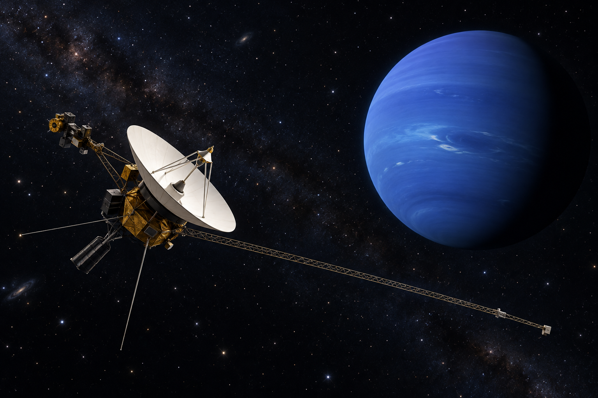

# 보이저 — 오래된 탐사선에 새 동작을 가르치다

*네 거대 행성을 잇는 길과 해왕성 사진 뒤의 사람들*

Science · Engineering

> 자료 대조를 마친 검토용 이야기입니다. 공개 게시 승인은 아직 받지 않았습니다.

*AI 이야기 장면 삽화 · 탐사선 밖에서 바라본 가상 시점의 그림입니다. 보이저가 실제 촬영한 사진이나 실제 비행 위치·장비의 정밀 도해가 아닙니다.*

## 소제목 바로가기

- [01. 행성 네 곳을 잇는 여행](#user-content-part-1)
- [02. 지나가면서 다음 길을 얻는다](#user-content-part-2)
- [03. 같은 탐사선이 다른 세상을 본다](#user-content-part-3)
- [04. 멀어질수록 사진은 더 어려워진다](#user-content-part-4)
- [05. 움직이는 동안 카메라도 맞추어 움직인다](#user-content-part-5)
- [06. 지구와 탐사선 사이의 아주 작은 목소리](#user-content-part-6)
- [07. 스쳐 지나가기와 오래 머물기는 다르다](#user-content-part-7)
- [08. 사진 바깥에 있는 탐사의 역사](#user-content-part-8)

해왕성까지 간 탐사선의 카메라가 예전처럼 쉽게 움직이지 않는다. 통신 장치와 컴퓨터에도 문제가 생겼다. 그렇다고 수리공을 보낼 수는 없다. 지구에 있는 사람들은 이미 그곳으로 날아간 기계가 무엇을 할 수 있는지 다시 생각해야 했다.

보이저 2호가 1989년 해왕성을 지나며 보내온 사진에는 행성의 모습뿐 아니라 이런 문제를 푼 사람들의 일이 숨어 있다. 오픈스택스 천문학 교재의 탐사 설명을 바탕으로, 오래된 탐사선으로 새로운 관측을 해낸 과정을 따라가 본다.

## 01. 행성 네 곳을 잇는 여행

보이저 1호와 2호는 이름이 비슷하지만 똑같은 길을 가지 않았다. 1호는 목성을 지나 토성으로 향했고, 2호는 목성·토성·천왕성·해왕성을 차례로 만나는 길을 갔다. 2호가 네 거대 행성을 지나는 여정은 그랜드 투어라는 이름으로 기억된다.

이 길은 지구에서 행성 네 곳을 향해 차례로 엔진을 세게 켜기만 해서 만든 것이 아니다. 행성들이 자리한 조건과 그 옆을 지나며 얻는 중력의 도움을 이용했다. 어느 때 출발하느냐가 어디까지 갈 수 있느냐와 연결된다. 우주선의 성능과 태양계의 시간표를 함께 맞춘 여행이다.

## 02. 지나가면서 다음 길을 얻는다

행성 가까이를 지나는 탐사선은 그 중력 때문에 진행 방향과 속도가 바뀔 수 있다. 움직이는 행성과의 만남을 이용해 다음 행성으로 향하는 길을 조정하는 것을 중력 도움이라고 부른다. 행성에서 연료를 받아 채우는 것과는 다르다. 만나는 위치와 방향을 잘 설계해야 한다.

우주를 텅 빈 공간의 직선 도로처럼 생각하면 이런 여정이 잘 보이지 않는다. 큰 천체가 있는 곳은 장애물이면서 경로를 바꾸는 기회이기도 하다. 당장의 목적지에 도착하는 일과 그다음 길을 만드는 일이 하나의 만남 안에서 이루어진다. 관측과 항법이 따로 떨어져 있지 않다.

## 03. 같은 탐사선이 다른 세상을 본다

보이저 2호는 1979년 목성, 1981년 토성, 1986년 천왕성을 거쳐 1989년 해왕성에 이른다. 지구에서 몇 년의 시간은 탐사선에도 몇 년의 사용 기간이다. 새로운 목적지가 생길수록 기계가 계속 새것인 상태로 도착하는 것은 아니다.

교재는 해왕성에 이르렀을 때의 상태를 사람의 노화에 빗대어 설명한다. 장비를 움직이는 기능이 제한되고 통신과 기억 장치에도 문제가 있었다. 이 표현을 실제 생명처럼 받아들일 필요는 없지만, 고장을 한 번도 겪지 않은 완벽한 기계의 여행이었다는 오해는 줄여 준다.

## 04. 멀어질수록 사진은 더 어려워진다

해왕성에서는 햇빛이 지구에서보다 훨씬 약하다. 같은 대상을 충분히 밝게 찍으려면 카메라가 빛을 더 오래 모아야 한다. 하지만 탐사선은 행성 곁을 빠르게 지나간다. 긴 노출은 빛을 얻는 데 좋지만, 그대로 두면 움직임 때문에 화면이 번질 수 있다.

문제가 하나라면 그 조건만 바꾸면 될 것 같다. 그러나 밝게 찍기와 선명하게 찍기가 서로 다른 요구를 한다. 이미 기능이 줄어든 기계로 둘 다 만족시킬 방법이 필요했다. 과학 사진 한 장의 품질은 좋은 렌즈 하나만으로 정해지지 않는다. 빛과 시간과 움직임을 함께 다루어야 한다.

## 05. 움직이는 동안 카메라도 맞추어 움직인다

해결의 핵심은 탐사선이 앞으로 가는 움직임을 보완하도록 카메라의 시선을 조정하는 것이었다. 지상에서는 관측 장면마다 필요한 복잡한 동작을 미리 계산하고 명령으로 준비했다. 장면이 지나간 뒤 다시 그 자리로 돌아와 찍을 수 있는 것도 아니었다.

이 부분에서 새 동작을 가르쳤다는 표현은 탐사선이 사람처럼 뜻을 이해했다는 뜻이 아니다. 남아 있는 기능을 이용해 이전과 다른 절차를 수행하게 했다는 말이다. 우주선이 가진 물리적 한계를 알고 명령의 순서와 움직임을 다시 설계하는 일이었다. 공학의 창의성이 드러나는 자리다.

## 06. 지구와 탐사선 사이의 아주 작은 목소리

사진을 찍어도 보내지 못하면 지구의 연구 자료가 되지 못한다. 해왕성 부근과 지구 사이의 거리는 수십억 킬로미터 규모다. 탐사선이 보내는 전파는 그 길을 건너오면서 아주 약해진다. 수신기와 안테나, 신호를 해석하는 작업이 모두 중요해진다.

지구에서 바로 옆의 로봇을 조종하듯 매 순간 지시할 수도 없다. 전파가 이동하는 시간과 통신 기회가 있으므로 미리 짠 절차가 필요하다. 멀리 보낸 탐사선의 능력에는 그 안의 컴퓨터뿐 아니라 지구에서 준비한 계획도 들어 있다. 두 장소의 작업이 긴 지연을 사이에 두고 이어진다.

## 07. 스쳐 지나가기와 오래 머물기는 다르다

보이저의 행성 관측은 곁을 지나며 살피는 근접 통과였다. 한 행성 둘레에 들어가 오랫동안 머무는 궤도 탐사와는 다르다. 지나가기 때문에 여러 곳을 향할 수 있지만, 특정 장면을 볼 시간과 각도에는 한계가 있다. 임무의 장점과 제약은 같은 선택에서 나온다.

뒤의 갈릴레오와 카시니 같은 임무는 다른 방식으로 거대 행성을 오래 살폈다. 이 탐사선들을 모두 보이저라고 부르거나 서로의 사진을 구별 없이 섞으면 탐사의 역사가 흐려진다. 어떤 기계가 어떤 위치에서 무엇을 보았는지 밝히는 일은 출처를 확인하는 기본이기도 하다.

## 08. 사진 바깥에 있는 탐사의 역사

이 글의 그림은 보이저형 탐사선과 해왕성을 떠올린 AI 삽화다. 우주선 밖에 카메라가 따라가 실제로 찍은 사진은 아니다. 실제 과학 사진과 설명용 상상 장면을 구분해야, 우리가 무엇을 직접 관측한 자료로 보고 있는지 혼동하지 않는다.

보이저의 이야기는 먼 곳에 도착했다는 거리 기록만으로 충분하지 않다. 다친 장비를 어떤 절차로 움직이고, 약한 신호에서 어떻게 자료를 얻었는지도 탐사의 일부다. 해왕성의 푸른 모습을 다시 떠올릴 때 그 사진 뒤에서 오래된 기계의 가능성을 끝까지 찾아낸 사람들의 일도 함께 기억해 보면 좋겠다.

## 이야기의 바탕이 된 자료

- [OpenStax, Astronomy 2e — Exploring the Outer Planets](https://raw.githubusercontent.com/openstax/osbooks-astronomy/main/modules/m59853/index.cnxml) · 확인일 2026-11-01
  - 확인 내용: 보이저 1/2의 경로 차이·2호의 목성1979/토성1981/천왕성1986/해왕성1989·중력 도움 / 노후화된 가동/통신/메모리·해왕성의 약한 빛/긴 노출과 움직임 보완 명령·약한 전파 수신 / 근접 통과와 궤도 탐사 구별. Cassini가 2012 목성을 촬영했다는 모듈의 잘못된 도판 연대는 사용하지 않음

---

[같은 소주제의 이야기](README.md) · [전체 서가](../../README.md)
