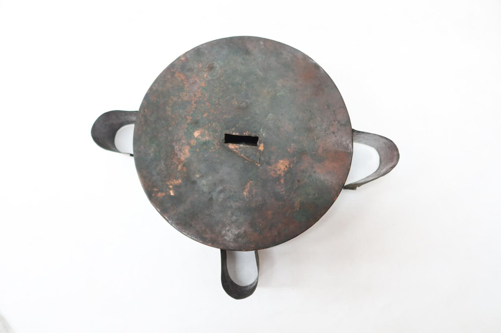

# 이 거북이는 물이 차면 떠올랐다

*자격루에서 시간을 전하던 둥근 부품*

Science · Engineering

> 출처 대조와 공개 게시 승인을 마친 이야기입니다. 실제 게시 여부는 사이트 배포 상태를 따릅니다.

*자격루 부표 · 국립고궁박물관 소장·제공. 전체 사진을 자르지 않고 사용했습니다.*

[이미지 출처·제작 근거](https://www.gogung.go.kr/gogung/pgm/psgudMng/view.do?menuNo=800065&psgudSn=436599) · 공공누리 제1유형(출처표시)

둥근 몸체에 날개 같은 부분이 네 개 달렸다. 거북이처럼 보이기도 하고 뚜껑처럼 보이기도 한다. 국립고궁박물관은 이것을 자격루의 부표라고 소개한다. 시계 전체가 아니라 그 안에서 움직이던 부품이다.

거북이를 닮았다고 부구라는 이름으로도 불렀다고 한다. 친근한 별명을 알고 나면 둥근 몸체와 옆으로 뻗은 부분을 다시 보게 된다. 이 물건에서는 물 위에서 움직이는 일이 이야기의 중심이다.

## 둥근 몸체 가운데의 자리

박물관 설명에 따르면 부표는 얇은 구리판을 붙여 만들었다. 원형 몸체의 사방에는 날개가 하나씩 달리고, 한쪽 면의 가운데에는 길쭉한 연결구가 있다. 여기에 잣대를 꽂았다.

시계를 떠올리면 바늘부터 찾게 되지만 이 부품에서는 잣대가 등장한다. 가운데의 작은 자리가 다른 물건과 이어지는 지점이라는 것을 알고 보면, 평범한 구멍 같은 부분에도 눈길이 간다.

## 물이 차오르면 함께 올라간다

부표는 물을 받는 통인 수수호 안에 들어가도록 만들었다. 박물관은 그 크기를 수수호의 속둘레에 맞추었다고 설명한다. 그릇과 부표가 아무렇게나 만나는 구조가 아니었던 것이다.

수수호에 물이 차면 부표가 떠오르고 잣대도 함께 올라간다. 오늘 이 글에서 알아둘 움직임은 이것이면 충분하다. 물이 높아지는 변화가 다른 부품의 위치 변화로 이어진다. 복잡한 자동 장치의 설명도 이렇게 작은 움직임 하나에서 시작할 수 있다.

## 전체를 몰라도 보이는 것

이 부표만으로 자격루 전체의 작동을 모두 설명할 수는 없다. 종이 울리는 과정이나 시간을 알리는 장치에는 다른 부품도 필요하다. 다만 사진 속 둥근 물건이 혼자 떠 있는 장식품이 아니라는 사실은 분명해진다.

가운데의 연결구, 옆으로 나온 네 날개, 통에 들어갈 크기. 그런 특징을 차례로 보면 부품이 왜 그 모양인지 궁금해진다. 시간을 재는 물건 안에도 물 위로 천천히 떠오르는 거북이 같은 부품이 있었다.

## 이야기의 바탕이 된 자료

- [국립고궁박물관 — 자격루 부표](https://www.gogung.go.kr/gogung/pgm/psgudMng/view.do?menuNo=800065&psgudSn=436599) · 확인일 2026-10-28
  - 확인 내용: 자격루 부표의 부구·부자 명칭 / 얇은 구리판 몸체·네 날개·잣대 연결구 / 수수호 크기에 맞춘 제작과 물이 차면 잣대와 함께 뜨는 작동

---

[같은 소주제의 이야기](README.md) · [전체 서가](../../README.md)
