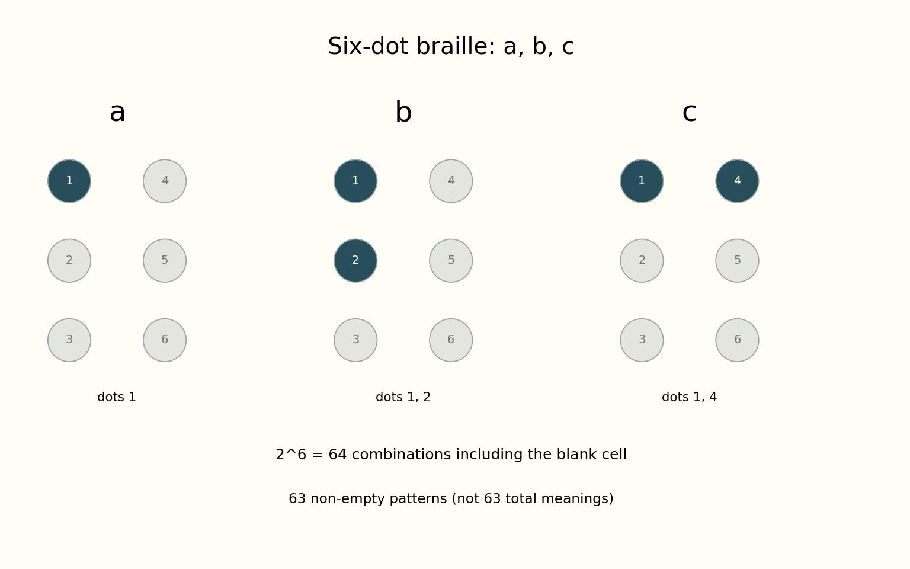

# 여섯 개의 점으로 얼마나 많은 모양을 만들까

*점자 한 칸에서 시작하는 조합 이야기*

Science · Mathematics

> 자료 대조를 마친 검토용 이야기입니다. 공개 게시 승인은 아직 받지 않았습니다.

*KnowledgeWalk 제작 설명도 · 원자료의 수치와 배치를 바탕으로 재구성. 역사적 원본이나 촬영 사진이 아닙니다.*

[이미지 출처·제작 근거](https://raw.githubusercontent.com/liblouis/liblouis/master/tables/latinLetterDef6Dots.uti) · KnowledgeWalk 직접 제작 설명도 · 원자료의 사실·수치에 근거

점 여섯 개가 세로로 세 개씩, 두 줄로 나란히 놓여 있다. 어떤 점은 올라오고 어떤 자리는 비어 있다. 한 칸 안에서 이 차이를 조합하면 서로 다른 모양을 만들 수 있다. 6점 점자를 생각하는 작은 출발점이다.

그저 점이 몇 개 있는지만 세면 놓치는 부분이 있다. 점이 하나라도 어느 자리에 있는지에 따라 모양이 달라진다. 개수와 위치는 같은 정보가 아닌 것이다.

## 켜짐과 꺼짐을 여섯 번

각 자리에는 올라온 점이 있거나 없다. 두 가지 선택이다. 그런 자리가 여섯 개면 가능한 조합은 2를 여섯 번 곱한 64가지다. 아무 점도 없는 경우를 빼면 점이 하나 이상 있는 형태는 63가지가 된다.

이것은 점자 전체의 뜻이 63개뿐이라는 말이 아니다. 한 칸의 모양을 세어 본 계산이다. 여러 칸을 이어 읽고 문맥과 규칙을 적용하는 일은 그다음에 있다.

## 같은 두 점도 자리가 다르면

점자 변환 프로젝트 Liblouis의 라틴 문자 정의를 보면 소문자 a는 1번 점, b는 1번과 2번 점으로 나타난다. c는 1번과 4번 점이다. b와 c는 점 두 개라는 점에서는 같지만 배치가 다르다.

함께 실은 설명도는 이 세 가지를 나란히 보여 준다. 글자 이름과 점 번호를 붙여 위치의 차이를 확인하도록 만들었다. 실제 읽기에 필요한 모든 점자 규칙을 대신하는 표는 아니다.

## 점 몇 개라는 말 너머

여기서는 6점 체계의 일부 예를 보고 있다. 모든 언어와 모든 점자 방식이 한 칸을 똑같이 해석한다고 생각해서는 안 된다. 작은 예를 전체 규칙으로 넓히지 않는 것이 중요하다.

그래도 여섯 자리를 다시 보면 처음과는 조금 다르게 느껴질 수 있다. 단순히 점을 더하거나 빼는 일이 아니라, 정해진 위치를 조합해 읽을 수 있는 차이를 만드는 일이다. 작은 칸 안에도 꽤 넓은 가능성이 들어 있다.

## 이야기의 바탕이 된 자료

- [Liblouis — 라틴 문자 6점 점자 정의](https://raw.githubusercontent.com/liblouis/liblouis/master/tables/latinLetterDef6Dots.uti) · 확인일 2026-10-28
  - 확인 내용: 라틴 문자용 6점 정의와 a=1, b=12, c=14 / 64·63은 여섯 자리의 두 상태에서 직접 계산한 값
- [Liblouis — 점자 변환 공식 문서](https://raw.githubusercontent.com/liblouis/liblouis/master/doc/liblouis.texi) · 확인일 2026-10-28
  - 확인 내용: 6점 체계와 점 패턴·언어별 변환 규칙을 사용하는 공식 문서

---

[같은 소주제의 이야기](README.md) · [전체 서가](../../README.md)
