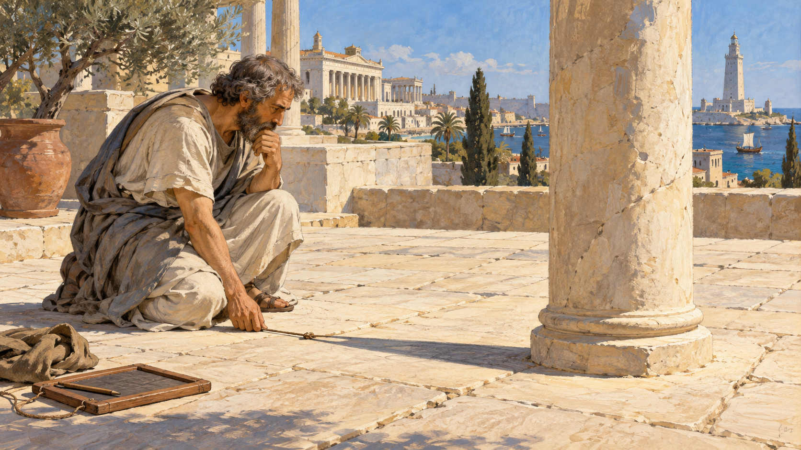

# 그림자로 지구를 잰 사람 — 에라토스테네스의 계산

*두 도시의 한낮에서 거대한 원의 길이를 생각하다*

Science · Mathematics

> 출처 대조와 공개 게시 승인을 마친 이야기입니다. 실제 게시 여부는 사이트 배포 상태를 따릅니다.

*AI 이야기 장면 삽화 · 측정 원리를 떠올리기 위한 장면이며 실제 인물의 초상·측정 당일의 고증이나 정확한 각도/길이를 제공하는 실험 도해가 아닙니다.*

## 소제목 바로가기

- [01. 이미 둥근 지구를 생각하던 사람들](#user-content-part-1)
- [02. 우물 속에 들어온 햇빛](#user-content-part-2)
- [03. 멀리 있는 태양이 만드는 조건](#user-content-part-3)
- [04. 한 바퀴의 쉰 부분 가운데 하나](#user-content-part-4)
- [05. 5천을 50배 하면](#user-content-part-5)
- [06. 정답이 현대 수치와 똑같았을까](#user-content-part-6)
- [07. 작은 관찰이 큰 질문이 될 때](#user-content-part-7)
- [08. 줄자보다 먼저 필요한 것](#user-content-part-8)

지구의 크기를 재려면 지구를 한 바퀴 걸어야 할까. 에라토스테네스가 떠올린 방법은 달랐다. 지구 전체 대신 두 도시의 한낮을 비교했다. 한쪽에는 그림자가 거의 없고 다른 쪽에는 그림자가 생긴다면, 그 차이가 거대한 공의 크기를 알려 줄 수 있다는 생각이었다.

오픈스택스의 천문학 교재가 설명하는 이 일화는 오래된 과학 이야기 가운데서도 이해하기 좋은 편이다. 필요한 계산은 짧다. 하지만 계산에 들어가기 전에 무엇을 비교해야 하는지 알아차리는 과정은 결코 작지 않다.

## 01. 이미 둥근 지구를 생각하던 사람들

에라토스테네스는 기원전 3세기 알렉산드리아에서 활동한 학자다. 그를 처음으로 지구가 둥글다고 알아낸 사람이라고 소개하면 이야기가 잘못 시작된다. 그리스의 학자들은 이미 구형 지구를 논의하고 있었다. 그가 도전한 것은 모양의 발견이 아니라 크기의 추정이었다.

어떤 대상이 둥글다는 것과 그 둘레가 얼마라는 것은 다른 질문이다. 공을 눈앞에 들고 있으면 줄자를 두르면 되지만, 지구 위에 서 있는 사람은 지구 전체를 손에 쥘 수 없다. 에라토스테네스는 접근할 수 있는 작은 장면에서 접근하기 어려운 전체를 계산하려 했다.

## 02. 우물 속에 들어온 햇빛

그는 시에네, 오늘의 아스완 부근에서 여름의 특정한 한낮에 햇빛이 깊은 우물 바닥까지 닿는다는 소식을 접했다고 전해진다. 해가 거의 머리 위에 있으면 수직으로 선 물체 옆에 그림자가 거의 생기지 않는다. 우물은 땅속에 숨은 공간이면서 태양의 방향을 알려 주는 단서가 된다.

같은 때 알렉산드리아에서는 수직으로 세운 물체에 그림자가 생긴다. 두 도시 모두 같은 태양 아래 있는데 결과는 다르다. 이 차이를 대수롭지 않게 지나치지 않는 순간 계산의 길이 열린다. 다만 오늘의 교과서 설명을 당시의 모든 작업 과정을 빠짐없이 적은 현장 일지로 생각할 필요는 없다.

## 03. 멀리 있는 태양이 만드는 조건

핵심에는 태양이 매우 멀리 있어 두 도시에 들어오는 햇빛을 거의 평행하다고 볼 수 있다는 생각이 있다. 빛이 나란히 들어오는데 각 도시의 수직 방향이 다르다면, 그 차이를 만드는 것은 땅의 굽음이다. 둥근 공 위의 두 점에서는 위쪽을 가리키는 방향도 조금씩 달라진다.

공 표면에 작은 막대 두 개를 세운 모습을 상상하면 도움이 된다. 막대는 각각 그 자리에서 똑바로 섰지만 서로 완전히 나란하지는 않다. 알렉산드리아의 그림자는 그곳의 수직과 햇빛 사이의 기울기를 보여 준다. 작게 보이는 그 각도에 두 도시 사이의 지구가 들어 있다.

## 04. 한 바퀴의 쉰 부분 가운데 하나

알렉산드리아에서 얻은 각도는 대략 한 바퀴의 50분의 1로 설명된다. 완전한 원을 360도로 놓으면 약 7.2도에 해당한다. 중요한 것은 소수점 한 자리 자체보다 전체 원과 두 도시 사이의 관계다. 두 도시 사이의 길이가 전체 둘레의 50분의 1이라고 볼 수 있게 된다.

이제 두 도시 사이의 거리만 알면 된다. 거리를 50배 하면 지구를 한 바퀴 도는 길이가 나온다. 큰 문제를 작은 비율 문제로 바꾸는 순간이다. 그림자 하나에 지구가 직접 찍힌 것은 아니지만, 기하학이 그 그림자에서 전체로 가는 다리를 놓는다.

## 05. 5천을 50배 하면

전해지는 설명에서 두 도시의 거리는 5천 스타디온으로 잡는다. 여기에 50을 곱하면 25만 스타디온이다. 계산만 보면 복잡한 기계가 필요하지 않다. 놀라운 점은 곱셈의 어려움이 아니라, 그 곱셈을 해도 된다는 관계를 세웠다는 데 있다.

물론 실제 지형은 교실의 깔끔한 도형과 다르다. 두 도시의 위치 관계, 태양의 방향, 거리의 측정값에는 근사와 오차가 들어간다. 단순한 설명은 원리를 드러내기 위해 조건을 정리한 것이다. 옛 과학자의 업적을 인정하는 일과 모든 조건이 완벽했다고 믿는 일은 함께 갈 필요가 없다.

## 06. 정답이 현대 수치와 똑같았을까

여기서 자주 등장하는 이야기가 아주 작은 오차로 지구를 정확히 재었다는 찬사다. 하지만 스타디온이 어느 길이 단위를 뜻했는지 확정하기 어렵다는 문제가 있다. 교재는 단위의 해석에 따라 현대 값과 비교한 오차가 상당히 달라진다고 설명한다.

숫자 하나를 오늘의 킬로미터로 바꾸는 데에도 역사적 판단이 필요한 것이다. 후대의 독자가 마음에 드는 환산값만 골라 놀라운 정확성을 강조하면 고대 계산의 실제 한계가 사라진다. 정확한 결과였다는 확신보다, 불확실한 자료로도 규모를 추정할 수 있었다는 점이 더 단단한 감탄의 근거다.

## 07. 작은 관찰이 큰 질문이 될 때

이 이야기의 주인공은 유명한 학자 한 사람만이 아니다. 한 장소의 우물에 관한 소식, 다른 장소의 그림자, 두 도시 사이 거리라는 서로 다른 정보가 만난다. 자료가 각각 따로 놓여 있었다면 지구의 둘레는 나오지 않았을 것이다. 연결 방식이 새로운 지식을 만든다.

에라토스테네스의 방법은 지금도 지구를 실제로 재고 싶게 만드는 매력이 있다. 다만 재현 실험에서는 장소와 시간, 수직 방향과 거리의 조건을 다시 살펴야 한다. 오늘 한낮에 생긴 아무 그림자나 50배 한다고 같은 답이 나오지는 않는다. 과학의 재미는 숫자를 외우는 데보다 무엇을 맞추어 비교할지 이해하는 데 있다.

## 08. 줄자보다 먼저 필요한 것

그는 지구를 작은 공처럼 손에 넣지 못했다. 대신 이미 알고 있던 둥근 모양을 이용해 손이 닿지 않는 길이를 계산했다. 관찰의 범위보다 질문의 범위를 크게 만드는 일, 그리고 그 간격을 비율로 메우는 일이 이 오래된 계산의 중심이다.

다음에 짧아진 한낮의 그림자를 보게 되면 단순히 해가 높다고만 생각하지 않아도 좋겠다. 다른 도시에서는 지금 어떤 그림자가 생길까. 거기까지 얼마나 멀까. 지구의 크기를 향한 출발점은 거창한 기계가 아니라 이렇게 서로 다른 장소를 한 질문 속에 놓는 데 있었기 때문이다.

## 이야기의 바탕이 된 자료

- [OpenStax, Astronomy — Ancient Astronomy: Eratosthenes and the size of Earth](https://raw.githubusercontent.com/openstax/osbooks-astronomy/main/modules/m59763/index.cnxml) · 확인일 2026-11-01
  - 확인 내용: 구형 지구를 이미 전제·시에네의 한낮과 알렉산드리아 그림자·태양광 평행 근사 / 원의 약 1/50·거리 5000 stadia × 50 = 250000 stadia·stadion 환산에 따른 오차의 불확실성

---

[같은 소주제의 이야기](README.md) · [전체 서가](../../README.md)
