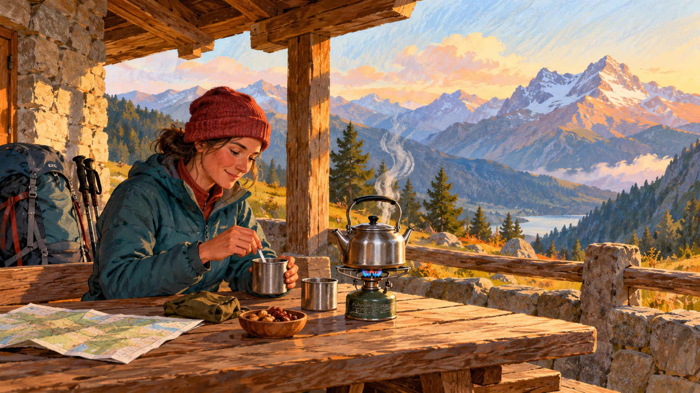

# 끓는 물 — 산에서는 왜 100도보다 먼저 끓을까

*불의 세기와 물의 끓는점을 나누어 생각하기*

Science · Physics

> 자료 대조를 마친 검토용 이야기입니다. 공개 게시 승인은 아직 받지 않았습니다.

*AI 관련 삽화 · 산에서 음료를 준비하는 분위기 그림입니다. 실제 고도의 끓는점 측정이나 조리 기구의 성능 자료는 아닙니다.*

높은 산에서 물을 끓인다. 주전자에서는 김이 오르고 물도 끓는데 음식이 익는 느낌은 평소와 다를 수 있다. 더 높은 곳에서 더 빨리 끓는다면 물이 더 뜨거워진 것일까. 끓는다는 말과 뜨겁다는 말을 같은 뜻으로 쓰면 이 질문이 헷갈린다.

우리가 외운 물의 끓는점 100도에는 조건이 붙어 있다. 주변의 압력이다. 주방과 산장에서 달라지는 것은 불꽃만이 아니다. 눈에 보이지 않는 공기의 압력이 물이 액체에서 기체로 바뀌는 조건에 함께 들어 있다.

## 1. 100도라는 숫자 옆에 붙는 조건

OpenStax는 순수한 물의 끓는점이 표준적인 대기압 1기압에서 섭씨 100도라고 설명한다. 압력이 바뀌면 끓는점도 달라진다. 따라서 물이라는 이름만으로 어느 환경에서나 똑같은 온도에 끓는다고 할 수는 없다.

실제 물에는 다른 물질이 녹아 있을 수도 있다. 이번에는 그 영향을 잠시 빼고 압력의 역할에 집중하자. 과학의 숫자에 조건을 붙이는 일은 답을 복잡하게 만들려는 것이 아니다. 어떤 환경에서 맞는 말인지 알려 주어 같은 현상을 다른 장소에서도 이해하게 하는 방법이다.

## 2. 증발은 끓기 전에도 일어난다

젖은 수건은 100도가 되지 않아도 마른다. 액체의 일부가 기체로 옮겨 가는 증발이 끓을 때만 일어나는 것은 아니기 때문이다. 교재는 액체와 기체 사이에서 분자들이 오가며 기체가 나타내는 증기압을 설명한다.

온도가 높아지면 물이 나타내는 증기압도 커진다. 끓는점은 이 증기압이 주변에서 누르는 압력과 같아지는 조건으로 이해할 수 있다. 용어가 낯설다면 물이 기체로 존재하려는 조건과 주변이 누르는 조건을 비교한다고 생각해도 좋다. 단순히 물속에서 무언가 보인다는 말과는 다른 기준이다.

## 3. 높은 곳에서는 바깥의 압력이 낮다

높은 산에서는 일반적으로 대기압이 낮다. 그래서 물의 증기압이 주변 압력에 도달하는 데 필요한 온도도 낮아진다. 물이 더 강한 불을 받아 특별한 성질로 변해서가 아니라 바깥 조건이 달라진 결과다.

같은 이유로 산에서 끓는 물이 평지의 끓는 물보다 반드시 더 뜨거운 것은 아니다. 오히려 낮은 온도에서 끓을 수 있다. 교재도 고도가 높은 곳의 낮은 압력과 끓는점 사례를 제시한다. 다만 모든 산장의 정확한 온도를 이 원리 하나로 지정할 수는 없다. 실제 압력은 장소와 날씨 등에 따라 달라진다.

## 4. 끓으면 음식이 익는 속도도 같을까

음식을 익히는 데는 온도와 시간이 영향을 준다. 낮은 온도에서 끓는 물은 기포가 활발하다고 평지와 같은 온도가 된 것은 아니다. 따라서 끓는 모습을 보고 조리 조건이 같다고 판단하면 예상과 다른 결과를 만날 수 있다.

이번 설명은 특정 음식의 조리 시간을 제시하는 안내가 아니다. 끓는다는 상태와 그때의 온도가 다른 정보라는 점을 이해하는 이야기다. 눈에 보이는 현상이 같아도 수치의 조건은 다를 수 있다. 주전자 하나가 온도계와 기압의 관계를 생각하게 한다.

## 5. 불을 더 세게 하면 어떻게 될까

압력과 물의 성분이 일정하고 액체가 계속 끓는 조건에서는 넣어 준 열의 상당 부분이 물을 기체로 바꾸는 데 쓰인다. 온도만 계속 올리는 데 사용되는 것이 아니다. 상태 변화에도 에너지가 필요하다는 점이 중요하다.

교재는 물질의 온도를 바꾸는 일과 상태를 바꾸는 데 필요한 열을 나누어 설명한다. 따라서 불을 세게 했다는 사실만으로 끓는 물의 온도가 같은 만큼 높아진다고 말할 수는 없다. 열이 어디로 전달되고 어떤 변화에 쓰이는지 함께 보아야 한다.

## 6. 압력을 높이는 조리 기구의 원리

압력솥은 압력이 높은 조건에서 물의 끓는점이 올라갈 수 있다는 원리를 이용한다. 물을 액체 상태로 유지하면서 더 높은 온도의 조리 환경을 만들 수 있는 것이다. 산에서 낮은 압력이 끓는점을 낮추는 현상과 같은 관계를 반대쪽에서 활용한다.

여기서 뚜껑만 덮으면 어떤 냄비나 같은 효과를 낸다고 생각하면 안 된다. 압력을 다루는 전용 기구는 그에 맞게 설계되고 사용되어야 한다. 이번 글은 장치를 개조하는 방법보다 압력이라는 조건이 끓는점에 영향을 준다는 원리를 설명한다.

## 7. 보이는 김보다 먼저 생각할 것

산장 주전자를 보면 열기와 따뜻한 음료부터 느껴진다. 그 장면에서 무엇이 측정되었는지 물으면 다른 이야기가 시작된다. 끓고 있다는 관찰과 주변 압력, 실제 물의 온도는 서로 연결되지만 각각 확인해야 할 정보다.

함께 실은 AI 삽화는 산에서 따뜻한 음료를 준비하는 상상 속 장면이다. 특정 고도의 끓는점 실험이나 조리 기구의 실제 성능을 보여 주는 사진은 아니다. 그림에는 분위기를, 원문 자료에는 원리의 근거를 맡겨 읽으면 된다.

## 8. 외운 숫자를 이해하는 숫자로 바꾸기

물은 100도에서 끓는다는 문장에 표준 대기압이라는 조건을 붙이면 산장의 경험이 더 이상 예외적인 수수께끼가 아니다. 같은 원리가 다른 압력에서 다른 온도로 나타난 것이다. 배운 규칙을 버리는 대신 규칙이 뜻하는 범위를 더 정확히 알게 된다.

다음에 물이 끓는 모습을 만나면 불꽃의 크기만 보지 말고 물이 놓인 환경도 떠올려 보자. 열을 더 주는 일과 끓는점을 바꾸는 일은 다르다. 익숙한 주전자는 온도와 압력, 상태 변화가 일상에서 어떻게 함께 작동하는지 보여 주는 작은 실험실이다.

## 이야기의 바탕이 된 자료

- [OpenStax Chemistry — 상태 변화와 끓는점](https://raw.githubusercontent.com/openstax/osbooks-chemistry-bundle/main/modules/m68768/index.cnxml) · 확인일 2026-10-31
  - 확인 내용: 증발과 응축·증기압·주변 압력과 끓는점 / 높은 고도에서의 낮은 압력·증발에 필요한 에너지
- [OpenStax University Physics — 상태 변화와 압력](https://raw.githubusercontent.com/openstax/osbooks-university-physics-bundle/main/modules/m58388/index.cnxml) · 확인일 2026-10-31
  - 확인 내용: 표준 대기압의 100도·압력과 끓는점 / 온도 변화와 상태 변화의 열·압력솥의 원리

---

[같은 소주제의 이야기](README.md) · [전체 서가](../../README.md)
