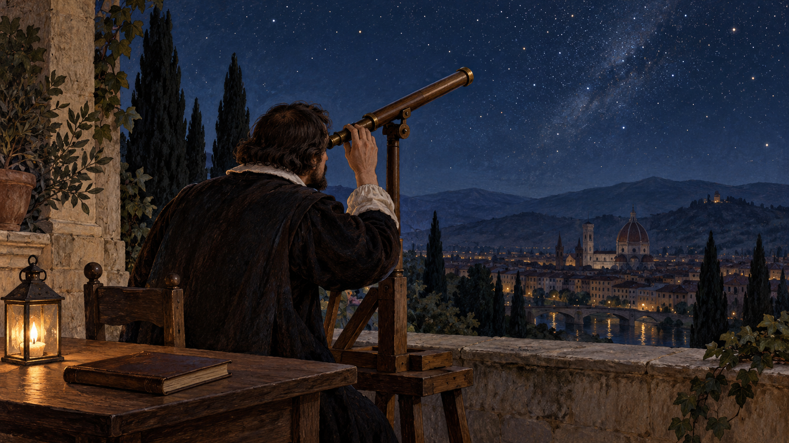

# 갈릴레오 — 망원경을 밤하늘로 돌리던 때

*먼 배를 보던 도구가 하늘의 질서를 묻기까지*

Science · Physics

> 출처 대조와 공개 게시 승인을 마친 이야기입니다. 실제 게시 여부는 사이트 배포 상태를 따릅니다.

*AI 관련 장면 삽화 · 17세기 초 천문 관측의 분위기입니다. 갈릴레오의 실제 초상·특정 망원경·관측 당시 하늘의 별 배치를 복원한 자료는 아닙니다.*

멀리 있는 배를 가까이 보는 도구가 생겼다. 항구에서 선박을 먼저 알아보고 싶어 하는 사람에게는 유용한 발명품이었다. 그런데 그 도구를 밤하늘로 돌리면 무엇이 보일까. 17세기 초 갈릴레오는 이 질문으로 사람들이 알고 있다고 믿던 하늘을 다시 살폈다.

그가 망원경 자체를 처음 발명한 것은 아니었다. 중요한 것은 이미 알려진 도구를 개선하고, 그것을 통해 보이는 현상이 믿을 만한지 확인하며, 기존의 설명과 비교한 과정이었다. 발견은 렌즈를 눈에 댄 한순간보다 길었다.

## 1. 네덜란드에서 들려온 도구의 소식

교재는 1608년 네덜란드에서 알려진 망원 도구와 한스 리퍼세이를 소개한다. 갈릴레오는 그 소식을 듣고 자신의 도구를 만들었다. 처음부터 오늘날의 천문대 같은 장비가 있었던 것은 아니다. 렌즈와 관을 조합하는 작업에서 출발했다.

멀리 있는 것을 크게 보이게 한다는 구상은 단순해 보이지만 실제로 선명한 상을 얻는 것은 다른 문제다. 갈릴레오는 배율과 광학 성능을 높이고 안정적으로 지지하는 장치도 마련했다. 관측의 역사는 눈의 역사이면서 도구를 만드는 손의 역사이기도 했다.

## 2. 1609년 베네치아에서 보여 준 것

1609년 8월 25일 갈릴레오는 베네치아의 관리들에게 망원경을 시연했다. 교재는 당시 배율이 아홉 배였다고 설명한다. 멀리 있는 대상을 일찍 확인하는 능력은 군사와 해상 활동에서 관심을 끌 만했다. 별보다 지상의 활용이 먼저 사람들의 눈앞에 놓였다.

그 뒤 밤하늘의 관측에 맞추어 도구의 성능이 더 개선되었다. 같은 물건도 어떤 질문에 사용하는지에 따라 역할이 달라진다. 먼 배를 보는 유용함에서 하늘의 기존 설명을 시험하는 도구로 넘어갈 수 있었던 것이다.

## 3. 렌즈가 보여 주는 것을 믿어도 될까

당시 사람들은 렌즈와 거울이 상을 바꾸거나 뒤집을 수 있다는 사실을 알고 있었다. 망원경에서 새로운 것이 보인다고 그것이 곧 실제 하늘의 모습이라고 인정되는 것은 아니었다. 도구가 만든 효과인지 대상의 성질인지 구별해야 했다.

교재는 갈릴레오가 가까이서 확인할 수 있는 대상을 반복해서 비교하며 도구를 신뢰할 근거를 마련했다고 설명한다. 과학의 역사에서 중요한 대목이다. 놀라운 장면을 보았다는 주장뿐 아니라 그것을 왜 믿을 수 있는지도 보여 줄 필요가 있었다.

## 4. 매끈하지 않았던 달

망원경으로 본 달에는 산과 골짜기, 여러 울퉁불퉁한 흔적이 나타났다. 지상의 불완전한 세계와 다른 완벽한 하늘이라는 생각에는 불편한 관찰이었다. 멀리 있는 천체도 땅처럼 복잡한 표면을 가진다면 둘 사이의 경계를 다시 물을 수 있었다.

갈릴레오가 어두운 부분을 물일 수 있다고 생각한 것은 오늘의 지식과 다르다. 관찰이 새로웠다고 모든 해석이 완성된 것은 아니었다. 중요한 것은 도구를 통해 얻은 세부가 오래된 설명과 비교되기 시작했다는 점이다. 잘 본 것과 정확하게 뜻을 붙인 것은 다른 단계였다.

## 5. 목성 주위에서 움직이는 작은 빛들

갈릴레오는 목성 주변을 도는 네 위성을 확인했다. 이 발견은 모든 천체가 지구만을 중심으로 움직여야 한다는 생각에 문제를 제기했다. 움직이는 행성도 자기 주위를 도는 천체를 가질 수 있었다. 지구가 움직이면 달이 따라오지 못할 것이라는 반론도 다시 생각하게 했다.

다만 이 관찰 하나로 태양계의 모든 모형이 동시에 판정된 것은 아니다. 목성 위성은 무엇이 지구 주위를 도는지에 관한 중요한 증거였지만, 다른 관측과 이론의 비교가 계속 필요했다. 발견의 의미를 크게 보면서도 그것이 답한 질문의 범위를 나누어 읽을 수 있다.

## 6. 금성의 모습이 달라지다

금성은 달처럼 여러 모습으로 보였다. 교재는 갈릴레오가 관측한 금성의 위상 변화가 기존 프톨레마이오스 체계와 맞지 않았다고 설명한다. 무엇이 어느 중심을 돌 때 어떤 모습이 보여야 하는지를 비교하는 관측이었다.

이 결과는 코페르니쿠스의 구상을 지지하는 데 중요했다. 그렇다고 하룻밤에 지동설의 모든 쟁점이 끝났다고 말할 수는 없다. 관측의 종류와 각 모형이 설명하는 범위가 서로 달랐다. 과학의 변화는 새로운 그림 하나가 옛 그림을 즉시 지우는 것보다 더 긴 논쟁과 확인의 과정이었다.

## 7. 보이는 것과 말할 수 있는 것 사이

갈릴레오의 주장은 교회 권위와 충돌했다. 1616년에는 코페르니쿠스의 주장을 옹호하지 못하게 하는 결정이 나왔고, 갈릴레오는 이후 종교재판과 가택연금도 겪었다. 관측 결과를 해석하는 일은 당시의 정치와 종교적 권위에서 떨어져 있지 않았다.

이 역사를 종교인 전체와 과학자 전체의 단순한 두 편 싸움으로 줄일 필요는 없다. 갈릴레오 자신도 신앙을 가진 사람이었다. 무엇을 근거로 자연을 설명하고 누가 그 설명을 공적으로 인정하는지라는 구체적인 긴장이 있었다.

## 8. 하늘을 바꾼 것은 질문하는 방식이었다

함께 실은 AI 삽화는 17세기 초 관측자를 떠올리는 상상 속 장면이다. 갈릴레오의 실제 초상이나 특정 망원경, 관측한 별의 위치를 재현한 자료는 아니다. 도구를 하늘로 돌린 행위의 분위기를 표현했다.

갈릴레오가 바꾼 것은 하늘 자체가 아니라 하늘을 알아보는 방법이었다. 렌즈를 만들고 신뢰를 확인하며 보이는 것과 설명을 비교했다. 밤하늘의 작은 빛들을 다시 읽은 이 과정은 과학사가 정답의 연표뿐 아니라 질문과 검증의 역사이기도 함을 보여 준다.

## 이야기의 바탕이 된 자료

- [OpenStax Astronomy — 근대 천문학과 갈릴레오](https://raw.githubusercontent.com/openstax/osbooks-astronomy/main/modules/m59765/index.cnxml) · 확인일 2026-10-31
  - 확인 내용: 네덜란드 망원 도구·1609년 8월 25일 베네치아 시연·성능 개선 / 도구의 상을 확인한 반복 관찰·달 표면·목성의 네 위성·금성 위상 / 1616년 금지 결정·교회 권위와의 갈등·가택연금

---

[같은 소주제의 이야기](README.md) · [전체 서가](../../README.md)
