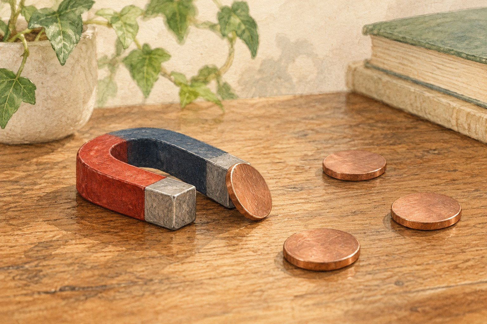

# 닮은 동전인데 왜 하나만 자석에 붙을까

*구리빛 표면 아래에 숨어 있는 다른 재료*

Science · Physics

> 출처 대조와 공개 게시 승인을 마친 이야기입니다. 실제 게시 여부는 사이트 배포 상태를 따릅니다.

*KnowledgeWalk 제작 · AI 설명용 삽화. 실제 유물·제품·연주 기구·동물의 생김새를 정확하게 재현한 자료나 실험 결과가 아닙니다.*

서랍에서 동전을 꺼내다가 자석에 하나가 붙었다고 생각해 보자. 옆에 있던 다른 동전은 그대로다. 둘 다 구리빛인데 반응은 다르다.

영국의 1페니와 2펜스 동전에는 실제로 이런 차이가 있다. 왕립조폐국의 안내에 따르면, 겉으로 비슷해 보여도 만들어진 시기에 따라 안쪽 재료가 다르기 때문이다.

## 1. 겉의 색과 속의 재료

예전의 영국 1페니와 2펜스 동전은 구리와 아연, 주석을 섞은 청동으로 만들었다. 왕립조폐국은 1992년 9월부터 구리를 입힌 강철로 재료를 바꾸었다고 설명한다.

표면은 계속 구리빛을 띠지만 속에는 강철이 들어간다. 이 강철 때문에 구리 도금 강철 동전은 자석에 끌리고, 이전 청동 동전은 그렇지 않다. 눈에 보이는 색만으로는 차이를 놓치기 쉽다.

새 재료가 들어갔다고 동전이 갑자기 전혀 다른 물건처럼 보이는 것은 아니다. 왕립조폐국의 해설은 두 종류의 색과 무게, 지름, 디자인이 같았다고 소개한다. 익숙한 모습을 이어 가면서 내부의 구성이 바뀐 것이다.

## 2. 자석은 색깔을 보고 고르지 않는다

여기서 재미있는 점은 자석이 우리가 보는 구리빛에 반응하는 것이 아니라는 데 있다. 겉으로 비슷한 물건도 무엇으로 만들었는지에 따라 결과가 달라진다.

같은 색의 그릇이 모두 같은 재료는 아니듯, 동전의 표면색도 재료 전체를 알려주는 이름표는 아니다. 얇게 입힌 금속과 그 안쪽의 금속이 서로 다른 역할을 맡을 수 있다.

이 이야기는 영국의 해당 동전을 다룬다. 나라와 액면이 달라지면 재료도 달라지므로, 모든 동전이 같은 방식으로 반응한다고 넓혀 생각할 필요는 없다.

## 3. 겉을 입힌 금속과 안쪽의 금속

구리 도금이라는 설명은 표면과 내부를 나누어 보게 한다. 눈에 보이는 색이 물건 전체를 이루는 재료와 같지 않을 수 있다. 겉에는 익숙한 구리빛을 두고 안에는 강철을 사용하면 외형을 알아보는 경험과 자석에 반응하는 성질이 달라질 수 있다. 재료를 읽는 데 시각만이 유일한 도구는 아니다.

그렇다고 강철이 들어 있으면 어떤 조건에서도 같은 정도로 붙는다고 판단할 필요는 없다. 이 글은 조폐국이 설명한 두 재료의 차이를 소개한다. 실제 동전의 정확한 구성을 식별하려면 해당 액면과 시기의 자료도 함께 확인해야 한다. 반응 하나로 나라와 연도, 통용 여부까지 모두 판정할 수는 없다.

## 4. 익숙한 모습을 유지한다는 선택

새 재료를 썼어도 색과 지름, 무게와 디자인을 같게 유지했다는 설명은 변화가 항상 겉으로 드러나는 것은 아님을 보여 준다. 사람들이 알아보는 표면을 유지하면서 만드는 조건을 바꾸는 선택이다. 다만 이 유사함을 근거로 두 물건이 물리적으로 모든 점에서 동일하다고 말할 수는 없다.

동전은 반복해서 손에 쥐는 물건이라 큰 모양이 계속 이어지는 일이 중요하게 느껴진다. 그 뒤의 금속 구성은 평소에 덜 의식할 수 있다. 자석을 함께 놓았을 때 비로소 다른 성질이 드러나는 것이다. 익숙한 물건을 재료의 질문으로 다시 읽으면 겉모습에서 지나쳤던 변화가 보인다.

## 5. 연도는 단서지만 전체 규칙은 확인해야 한다

1992년 9월이라는 시점은 조폐국이 설명하는 재료 전환의 기준이다. 하지만 개별 동전을 어떤 재료로 만들었는지 자세히 확인하려면 해당 자료를 더 살펴야 한다. 액면과 종류가 달라져도 같은 시점의 규칙을 무조건 적용하는 방식은 피하는 편이 정확하다. 이 이야기는 모든 동전을 가르는 세계 공통표가 아니다.

따라서 자석에 붙지 않는다고 그 동전을 곧 가짜라고 부를 수는 없다. 정식 동전도 재료가 다를 수 있다는 것이 바로 이 사례의 출발점이다. 물건의 진위와 자성이라는 한 가지 성질은 다른 질문이다. 관찰 결과에서 너무 먼 결론으로 나아가지 않으면 간단한 비교도 더 재미있는 탐구가 된다.

## 6. 작은 비교가 재료의 역사를 보여 준다

동전 두 개를 나란히 생각해 보면 숫자와 그림은 닮았는데 안쪽의 재료는 달라질 수 있다. 그 차이가 자석과의 관계에서 드러난다. 일상에서 재료의 성질은 눈에 보이는 이름보다 행동으로 확인되기도 한다. 다만 실제 물건을 훼손하거나 잘라 보아야 한다는 뜻은 아니다. 공식 자료와 비파괴적인 관찰로도 이해할 수 있는 부분이 있다.

금속이라는 한 범주 안에도 서로 다른 성질이 있다는 점을 기억해 보자. 작은 동전은 화폐이면서 재료를 선택해 만든 제품이다. 가격과 액면으로만 보던 물건을 표면과 내부로 나누어 보는 순간, 조폐의 역사가 손끝의 과학과 만난다. 닮았다는 첫인상은 질문의 끝이 아니라 시작이 될 수 있다.

## 7. 평범한 물건을 다시 보는 작은 방법

동전에는 초상과 숫자만 있는 것 같지만, 재료의 역사도 들어 있다. 손에 쥔 돈이 언제 어떤 금속으로 만들어졌는지 살피면 표면의 그림과는 다른 이야기를 만나게 된다.

자석에 붙은 동전과 붙지 않은 동전을 나란히 떠올리면, 보이는 모습과 실제 구성이 다를 수 있다는 말이 꽤 구체적으로 느껴진다. 어려운 공식보다 손바닥에 올라오는 물건이 먼저 이해를 돕는다.

다음에 구리빛 동전을 보게 된다면 겉의 색만으로 속까지 다 안다고 생각하지 않아도 좋겠다. 익숙한 표면 아래에서 재료는 이미 다른 시대로 넘어갔을지도 모른다.

## 이야기의 바탕이 된 자료

- [The Royal Mint — What are bronze coins made from? Why are some magnetic and some not?](https://www.royalmint.com/faqs/collectors/what-are-bronze-coins-made-from-why-are-some-magnetic-and-some-not/) · 확인일 2026-10-27
  - 확인 내용: 영국 1p·2p의 청동 구성 / 1992년 9월 이후 구리 도금 강철로 바꾼 사실 / 강철이 들어간 새 동전의 자석 반응
- [The Royal Mint — Why are some UK coins magnetic?](https://www.royalmint.com/stories/collect/why-are-some-uk-coins-magnetic/) · 확인일 2026-10-27
  - 확인 내용: 청동 동전과 구리 도금 강철 동전의 색·무게·지름·디자인 및 내부 강철의 차이

---

[같은 소주제의 이야기](README.md) · [전체 서가](../../README.md)
