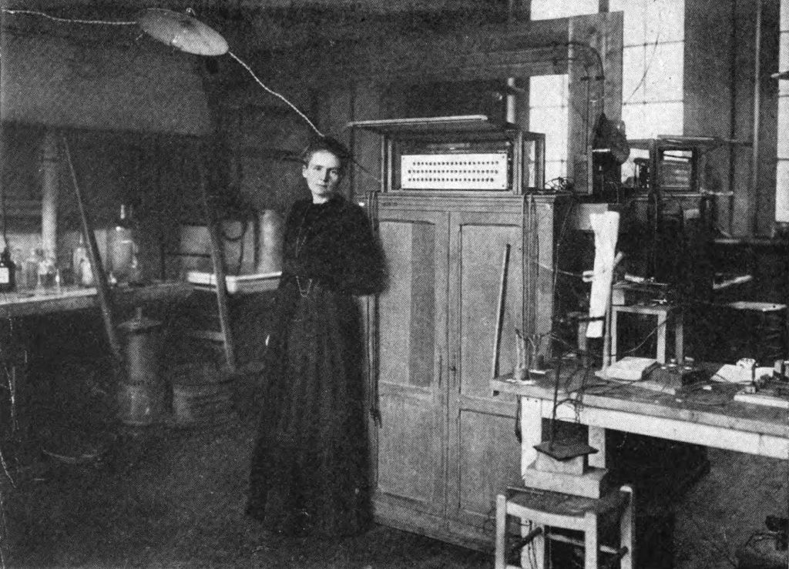

# 마리 퀴리의 생애 — 반짝이는 발견 뒤의 오래된 실험실

*바르샤바의 배움에서 파리의 연구와 전장의 X선 차량까지*

Science · Physics

> 자료 대조를 마친 검토용 이야기입니다. 공개 게시 승인은 아직 받지 않았습니다.

*마리 퀴리 저서 Pierre Curie(1923) 수록 실험실 사진 · Project Gutenberg·HathiTrust 원본 인쇄 자료*

[이미지 출처·제작 근거](https://raw.githubusercontent.com/GITenberg/Pierre-Curie_69617/master/69617-h/images/figure06.jpg) · 퍼블릭 도메인 원작·역사적 재현 자료 · Project Gutenberg 수록본

실험실의 사진 속 마리 퀴리는 장비에 둘러싸여 있다. 우리에게 익숙한 것은 노벨상을 두 번 받은 과학자의 이름이지만, 사진은 상보다 일을 먼저 떠올리게 한다. 측정하고 정리하고 다시 확인하는 시간이 발견의 한가운데 있었기 때문이다.

그는 1867년에 태어나 1934년에 세상을 떠났다. 바르샤바에서 공부하던 청년이 파리의 연구자가 되고 전쟁 중에는 X선 장비를 실은 차량을 움직이는 일에도 나선다. 한 번의 천재적인 순간보다 그 여러 전환을 따라가 보면 삶의 폭이 보인다.

## 1. 바르샤바에서 배움을 이어 갈 길을 찾다

마리의 원래 이름은 마리아 스크워도프스카다. 폴란드의 교사 집안에서 자랐고 배움에 대한 관심도 컸다. 그러나 원하는 공부를 바로 시작할 수 있는 조건이 늘 갖추어져 있지는 않았다. 일하고 돈을 마련하며 앞으로의 학업을 준비하는 시간이 필요했다.

자전적 기록에는 가정교사로 지내면서도 공부를 이어 가던 생활이 나온다. 뒤의 명성을 알고 읽으면 잠시 거쳐 간 준비 기간처럼 보이지만, 당시에는 언제 기회가 열릴지 확실하지 않은 삶이었다. 학문적 열정과 생활비의 문제는 서로 다른 세계에 놓여 있지 않았다.

## 2. 1891년 파리, 공부가 생활의 중심이 되다

1891년 그는 파리에 가서 공부를 시작한다. 새로운 언어와 도시, 빠듯한 생활을 감당하며 물리학과 수학을 배웠다. 낯선 곳에 도착했다는 장면으로 끝내기보다, 수업을 따라가고 생활을 꾸리는 하루가 계속되었다고 생각하면 유학의 무게가 더 구체적이다.

이 시기의 마리를 이미 위대한 발견을 앞둔 영웅으로만 볼 필요는 없다. 무엇을 연구할지 찾고 필요한 도구와 기초를 배우는 학생이었다. 이후의 공동 연구도 그런 배움과 만남 속에서 가능해졌다.

## 3. 피에르를 만나 함께 연구한다는 것

피에르 퀴리와의 관계에는 결혼과 가족뿐 아니라 실험과 논의가 들어 있다. 피에르는 이미 연구 경험을 가진 물리학자였고, 마리는 자기 연구 문제를 세워 나갔다. 두 사람은 각자의 능력과 작업을 공동의 탐구에 연결했다.

마리는 남편의 이름을 알리는 이야기 속 조수만도 아니고, 다른 사람의 도움 없이 모든 것을 이루어 낸 고립된 천재만도 아니다. 연구 주제의 선택과 측정, 협력의 방식이 어떻게 이어졌는지를 보면 사람이 함께 일하며 발견을 키우는 과정이 드러난다.

## 4. 이상한 측정값을 그냥 넘기지 않다

베크렐이 연구한 우라늄의 방출 현상을 계기로 마리는 관련 물질을 살폈다. 어떤 광석의 효과가 우라늄만으로 설명하기에 지나치게 강하다는 점이 새로운 질문이 된다. 이미 알려진 성분으로 충분하지 않다면 그 안에 다른 물질이 있는 것은 아닐까.

1898년에는 폴로늄과 라듐의 존재를 알리는 연구가 이어졌다. 폴로늄이라는 이름에는 고향 폴란드가 담겨 있다. 이름 붙이기는 낭만적인 장식만은 아니다. 어떤 발견을 무엇으로 식별할지 정하면서 한 연구자의 개인적·역사적 배경도 함께 남는 일이다.

## 5. 새 원소를 알리는 일과 손에 얻는 일 사이

존재를 추정하고 발표하는 것과 충분히 분리하여 성질을 확인하는 것은 같은 단계가 아니다. 많은 재료를 처리하고 반복해서 분리와 측정을 해야 했다. 자전적 기록은 이런 작업에 들어간 물리적인 수고와 열악한 실험 조건을 자세히 전한다.

발견이라는 말을 듣고 유리병 하나에서 갑자기 빛이 터지는 장면만 상상하면 이 긴 과정이 사라진다. 어떤 수치가 왜 다른지 확인하고 다른 가능성을 좁혀 가는 일이 중요했다. 직감과 끈기는 실험을 대신하는 것이 아니라 실제 확인의 과정 안에서 힘을 얻는다.

## 6. 두 번의 노벨상 사이에 있었던 상실

1903년 마리와 피에르, 베크렐은 함께 노벨상을 받는다. 연구가 널리 알려지고 지원도 늘지만 방문과 요구가 많아져 일상의 평온은 줄어들었다고 기록한다. 명예가 생겼다고 실험과 생활의 모든 어려움이 끝나는 것은 아니었다.

1906년 피에르가 사고로 세상을 떠난 뒤 마리는 큰 상실 속에서도 연구와 강의를 이어 갔다. 1911년에는 두 번째 노벨상을 받는다. 두 번의 수상 사이를 숫자로만 연결하면 개인의 슬픔과 일을 지속하기 위한 선택이 보이지 않는다. 상은 이 삶의 중요한 표지지만 삶 전체를 대신하지는 않는다.

## 7. 전쟁에서는 연구실 밖의 일을 선택했다

제1차 세계대전 중에는 부상자를 살피는 데 필요한 X선 장비와 인력을 마련하는 활동에 나선다. 이동 차량에 장비와 발전기를 싣고 병원의 촬영을 돕는 방식이었다. 연구한 지식을 어디에서 어떤 필요에 연결할지 판단하는 또 다른 종류의 일이었다.

라듐 같은 방사성 원소의 연구와 X선 촬영 장비의 운영은 구분해야 한다. 전장의 차량은 X선 장비를 사용했다. 마리는 장비만 전달하는 데서 그치지 않고 이를 다룰 사람을 교육하는 일도 중요하게 여겼다. 딸 이렌도 전시 활동에 참여했다.

## 8. 연구를 나눈다는 선택과 남은 사진

마리의 기록에는 라듐과 관련한 연구에서 특허로 독점적인 이익을 남기지 않았다는 설명도 있다. 연구 결과와 제조 방법이 어떤 방식으로 다른 사람에게 전해져야 하는지에 관한 선택이다. 이를 모든 시대와 모든 연구에 똑같이 적용할 정답으로 만들기보다 그가 실제로 취한 태도로 읽으면 좋다.

함께 실은 것은 1923년 저서에 수록된 파리 퀴리 연구소 실험실의 실제 사진이다. 발견의 순간을 재현한 연출 그림이 아니다. 장비 곁의 한 사람을 바라보며, 이름 뒤에 있던 공부와 측정, 협력과 돌봄의 시간을 떠올려 보자. 과학의 깊이는 어려운 공식만이 아니라 그런 일을 끝까지 확인해 가는 생활에서도 만날 수 있다.

## 이야기의 바탕이 된 자료

- [마리 퀴리 — Pierre Curie(1923), 자전적 기록 포함](https://raw.githubusercontent.com/GITenberg/Pierre-Curie_69617/master/69617-0.txt) · 확인일 2026-10-29
  - 확인 내용: 1867년 바르샤바 출생·가정교사와 공부·1891년 파리 유학 / 베크렐의 연구·방사능 측정·폴로늄과 라듐 발견·광석 처리 / 1903년 공동 노벨상·1906년 피에르 사망과 강의·1911년 두 번째 노벨상 / 방사선 차량·X선 장비·교육과 전시 활동·특허를 내지 않은 연구 공유
- [Pierre Curie — 사진 도판과 본문 HTML](https://raw.githubusercontent.com/GITenberg/Pierre-Curie_69617/master/69617-h/69617-h.htm) · 확인일 2026-10-29
  - 확인 내용: Figure 6을 파리 퀴리 연구소 실험실의 마리 퀴리로 식별
- [마리 퀴리 저서의 서지·판본 정보](https://raw.githubusercontent.com/GITenberg/Pierre-Curie_69617/master/metadata.yaml) · 확인일 2026-10-29
  - 확인 내용: 마리 퀴리 1867~1934·1923년 출간·역사적 사진이 수록된 판본

---

[같은 소주제의 이야기](README.md) · [전체 서가](../../README.md)
